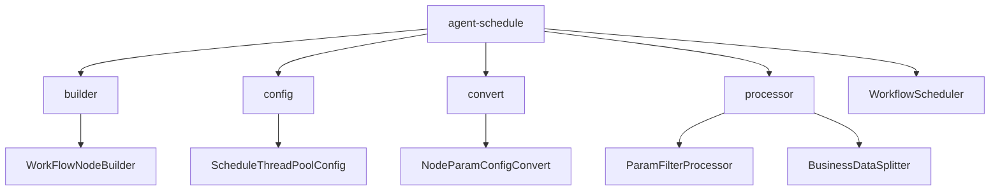
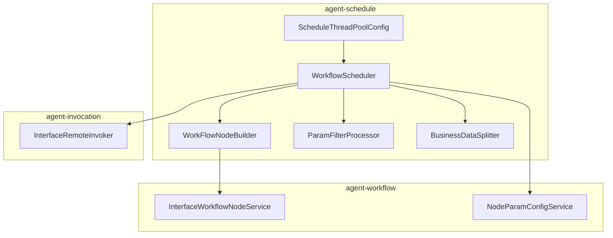
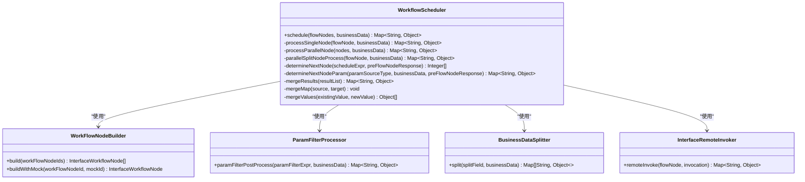
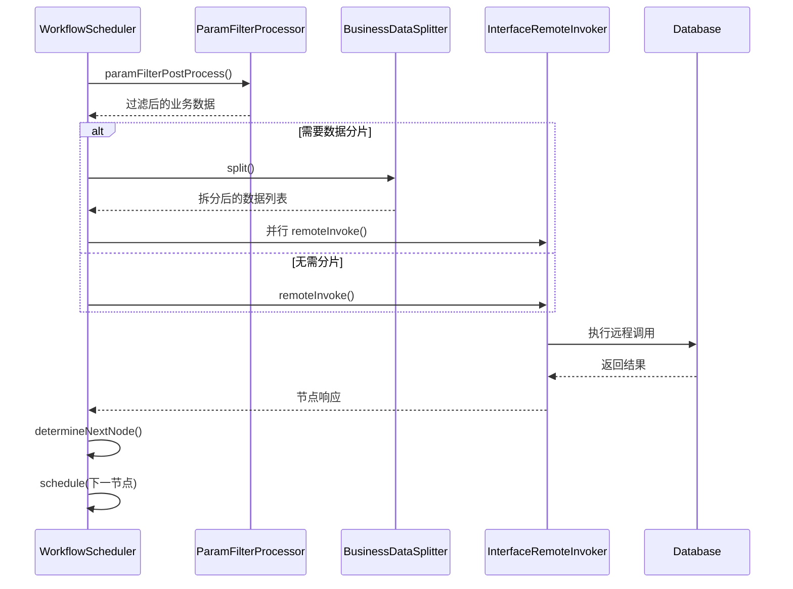
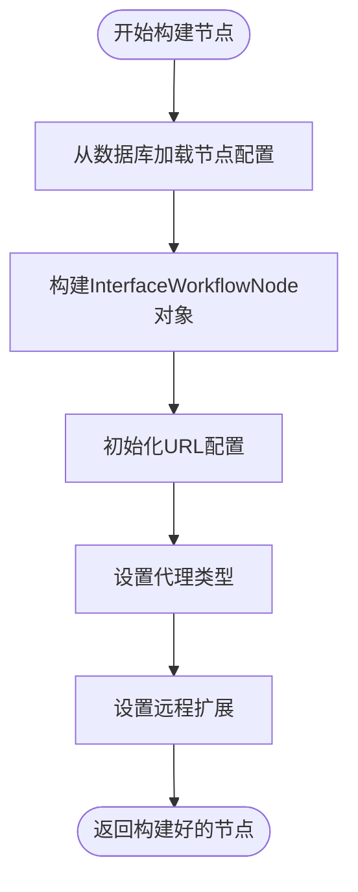
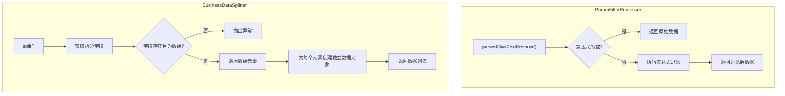
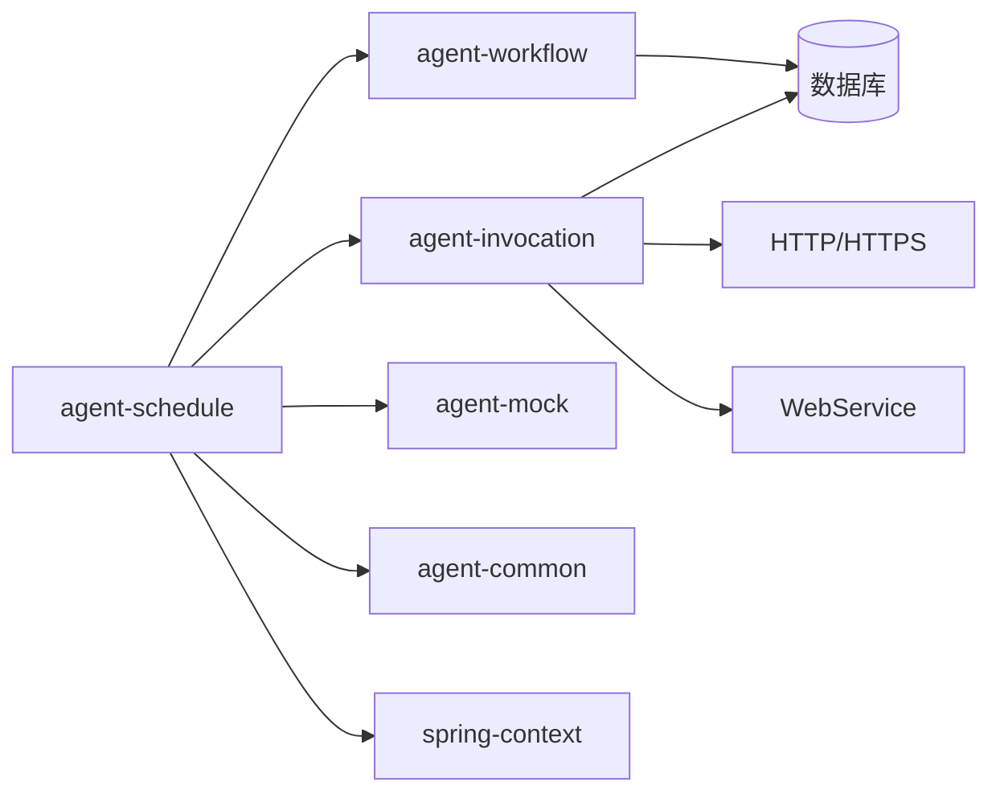

# agent-schedule 模块

<cite>
**本文档引用文件**  
- [WorkflowScheduler.java](file://agent-schedule/src/main/java/com/helianhealth/agent/schedule/WorkflowScheduler.java)
- [WorkFlowNodeBuilder.java](file://agent-schedule/src/main/java/com/helianhealth/agent/schedule/builder/WorkFlowNodeBuilder.java)
- [ParamFilterProcessor.java](file://agent-schedule/src/main/java/com/helianhealth/agent/schedule/processor/ParamFilterProcessor.java)
- [BusinessDataSplitter.java](file://agent-schedule/src/main/java/com/helianhealth/agent/schedule/processor/BusinessDataSplitter.java)
- [ScheduleThreadPoolConfig.java](file://agent-schedule/src/main/java/com/helianhealth/agent/schedule/config/ScheduleThreadPoolConfig.java)
- [NodeParamConfigConvert.java](file://agent-schedule/src/main/java/com/helianhealth/agent/schedule/convert/NodeParamConfigConvert.java)
- [InterfaceRemoteInvoker.java](file://agent-invocation/src/main/java/com/helianhealth/agent/invocation/remote/InterfaceRemoteInvoker.java)
- [InterfaceWorkflowNode.java](file://agent-invocation/src/main/java/com/helianhealth/agent/invocation/remote/model/InterfaceWorkflowNode.java)
- [DefaultInterfaceRemoteInvoker.java](file://agent-invocation/src/main/java/com/helianhealth/agent/invocation/remote/DefaultInterfaceRemoteInvoker.java)
- [NodeParamConfigService.java](file://agent-workflow/src/main/java/com/helianhealth/agent/workflow/service/NodeParamConfigService.java)
- [InterfaceWorkflowNodeService.java](file://agent-workflow/src/main/java/com/helianhealth/agent/workflow/service/InterfaceWorkflowNodeService.java)
- [ScheduleParamSourceType.java](file://agent-common/src/main/java/com/helianhealth/agent/common/enums/ScheduleParamSourceType.java)
- [WorkflowBusinessException.java](file://agent-common/src/main/java/com/helianhealth/agent/common/exception/WorkflowBusinessException.java)
</cite>

## 目录
1. [引言](#引言)
2. [项目结构](#项目结构)
3. [核心组件](#核心组件)
4. [架构概述](#架构概述)
5. [详细组件分析](#详细组件分析)
6. [依赖分析](#依赖分析)
7. [性能考量](#性能考量)
8. [故障排查指南](#故障排查指南)
9. [结论](#结论)

## 引言
agent-schedule 模块是接口代理系统中的核心调度引擎，负责工作流的编排与执行。该模块基于 Quartz 框架实现定时调度，通过 WorkflowScheduler 组件协调整个工作流的执行流程。它支持串行、并行和条件分支等多种复杂工作流模式，并提供了参数预处理、数据分片、并发控制和错误重试等关键功能。本文档将深入解析其运行机制，阐述各核心组件的协作方式，并提供性能监控与调优建议。

## 项目结构
agent-schedule 模块采用典型的分层架构，主要包含构建器、处理器、配置和调度器等核心包。其结构清晰，职责分明，便于维护和扩展。

**图示来源**
- [WorkFlowNodeBuilder.java](file://agent-schedule/src/main/java/com/helianhealth/agent/schedule/builder/WorkFlowNodeBuilder.java)
- [ScheduleThreadPoolConfig.java](file://agent-schedule/src/main/java/com/helianhealth/agent/schedule/config/ScheduleThreadPoolConfig.java)
- [NodeParamConfigConvert.java](file://agent-schedule/src/main/java/com/helianhealth/agent/schedule/convert/NodeParamConfigConvert.java)
- [ParamFilterProcessor.java](file://agent-schedule/src/main/java/com/helianhealth/agent/schedule/processor/ParamFilterProcessor.java)
- [BusinessDataSplitter.java](file://agent-schedule/src/main/java/com/helianhealth/agent/schedule/processor/BusinessDataSplitter.java)
- [WorkflowScheduler.java](file://agent-schedule/src/main/java/com/helianhealth/agent/schedule/WorkflowScheduler.java)

**本节来源**
- [WorkflowScheduler.java](file://agent-schedule/src/main/java/com/helianhealth/agent/schedule/WorkflowScheduler.java)
- [pom.xml](file://agent-schedule/pom.xml)

## 核心组件
agent-schedule 模块的核心组件包括 WorkflowScheduler、WorkFlowNodeBuilder、ParamFilterProcessor 和 BusinessDataSplitter。WorkflowScheduler 是调度引擎的入口，负责协调整个工作流的执行。WorkFlowNodeBuilder 负责从数据库加载并构建工作流节点对象。ParamFilterProcessor 在执行前对业务数据进行过滤和预处理。BusinessDataSplitter 则负责将数组类型的业务数据拆分为多个独立的处理单元，以实现并行处理。

**本节来源**
- [WorkflowScheduler.java](file://agent-schedule/src/main/java/com/helianhealth/agent/schedule/WorkflowScheduler.java)
- [WorkFlowNodeBuilder.java](file://agent-schedule/src/main/java/com/helianhealth/agent/schedule/builder/WorkFlowNodeBuilder.java)
- [ParamFilterProcessor.java](file://agent-schedule/src/main/java/com/helianhealth/agent/schedule/processor/ParamFilterProcessor.java)
- [BusinessDataSplitter.java](file://agent-schedule/src/main/java/com/helianhealth/agent/schedule/processor/BusinessDataSplitter.java)

## 架构概述
agent-schedule 模块的架构围绕 WorkflowScheduler 展开，它依赖于多个服务和处理器来完成工作流的调度任务。其核心架构体现了控制反转和依赖注入的设计思想。

**图示来源**
- [WorkflowScheduler.java](file://agent-schedule/src/main/java/com/helianhealth/agent/schedule/WorkflowScheduler.java)
- [WorkFlowNodeBuilder.java](file://agent-schedule/src/main/java/com/helianhealth/agent/schedule/builder/WorkFlowNodeBuilder.java)
- [InterfaceWorkflowNodeService.java](file://agent-workflow/src/main/java/com/helianhealth/agent/workflow/service/InterfaceWorkflowNodeService.java)
- [NodeParamConfigService.java](file://agent-workflow/src/main/java/com/helianhealth/agent/workflow/service/NodeParamConfigService.java)
- [InterfaceRemoteInvoker.java](file://agent-invocation/src/main/java/com/helianhealth/agent/invocation/remote/InterfaceRemoteInvoker.java)

## 详细组件分析

### WorkflowScheduler 分析
WorkflowScheduler 是整个调度系统的核心，它负责解析工作流定义、执行节点调度、处理并行任务和管理流程跳转。

#### 调度流程类图

**图示来源**
- [WorkflowScheduler.java](file://agent-schedule/src/main/java/com/helianhealth/agent/schedule/WorkflowScheduler.java)
- [WorkFlowNodeBuilder.java](file://agent-schedule/src/main/java/com/helianhealth/agent/schedule/builder/WorkFlowNodeBuilder.java)
- [ParamFilterProcessor.java](file://agent-schedule/src/main/java/com/helianhealth/agent/schedule/processor/ParamFilterProcessor.java)
- [BusinessDataSplitter.java](file://agent-schedule/src/main/java/com/helianhealth/agent/schedule/processor/BusinessDataSplitter.java)
- [InterfaceRemoteInvoker.java](file://agent-invocation/src/main/java/com/helianhealth/agent/invocation/remote/InterfaceRemoteInvoker.java)

#### 单节点执行时序图

**图示来源**
- [WorkflowScheduler.java](file://agent-schedule/src/main/java/com/helianhealth/agent/schedule/WorkflowScheduler.java)
- [ParamFilterProcessor.java](file://agent-schedule/src/main/java/com/helianhealth/agent/schedule/processor/ParamFilterProcessor.java)
- [BusinessDataSplitter.java](file://agent-schedule/src/main/java/com/helianhealth/agent/schedule/processor/BusinessDataSplitter.java)
- [DefaultInterfaceRemoteInvoker.java](file://agent-invocation/src/main/java/com/helianhealth/agent/invocation/remote/DefaultInterfaceRemoteInvoker.java)

**本节来源**
- [WorkflowScheduler.java](file://agent-schedule/src/main/java/com/helianhealth/agent/schedule/WorkflowScheduler.java)
- [WorkFlowNodeBuilder.java](file://agent-schedule/src/main/java/com/helianhealth/agent/schedule/builder/WorkFlowNodeBuilder.java)

### WorkFlowNodeBuilder 分析
WorkFlowNodeBuilder 负责将数据库中的节点配置转换为可执行的节点对象。它通过 InterfaceWorkflowNodeService 从数据库加载节点元数据，并将其构建成 InterfaceWorkflowNode 对象。

**图示来源**
- [WorkFlowNodeBuilder.java](file://agent-schedule/src/main/java/com/helianhealth/agent/schedule/builder/WorkFlowNodeBuilder.java)
- [InterfaceWorkflowNodeService.java](file://agent-workflow/src/main/java/com/helianhealth/agent/workflow/service/InterfaceWorkflowNodeService.java)
- [InterfaceWorkflowNode.java](file://agent-invocation/src/main/java/com/helianhealth/agent/invocation/remote/model/InterfaceWorkflowNode.java)

**本节来源**
- [WorkFlowNodeBuilder.java](file://agent-schedule/src/main/java/com/helianhealth/agent/schedule/builder/WorkFlowNodeBuilder.java)

### ParamFilterProcessor 与 BusinessDataSplitter 分析
ParamFilterProcessor 和 BusinessDataSplitter 是工作流执行前的两个关键预处理器。ParamFilterProcessor 使用表达式对业务数据进行过滤，而 BusinessDataSplitter 则负责将数组数据拆分为多个独立的处理单元。

**图示来源**
- [ParamFilterProcessor.java](file://agent-schedule/src/main/java/com/helianhealth/agent/schedule/processor/ParamFilterProcessor.java)
- [BusinessDataSplitter.java](file://agent-schedule/src/main/java/com/helianhealth/agent/schedule/processor/BusinessDataSplitter.java)

**本节来源**
- [ParamFilterProcessor.java](file://agent-schedule/src/main/java/com/helianhealth/agent/schedule/processor/ParamFilterProcessor.java)
- [BusinessDataSplitter.java](file://agent-schedule/src/main/java/com/helianhealth/agent/schedule/processor/BusinessDataSplitter.java)

## 依赖分析
agent-schedule 模块依赖于多个其他模块，形成了一个松耦合但功能完整的系统。

**图示来源**
- [pom.xml](file://agent-schedule/pom.xml)
- [WorkflowScheduler.java](file://agent-schedule/src/main/java/com/helianhealth/agent/schedule/WorkflowScheduler.java)

**本节来源**
- [pom.xml](file://agent-schedule/pom.xml)

## 性能考量
agent-schedule 模块在性能方面进行了精心设计。它通过 ScheduleThreadPoolConfig 配置了一个专用的线程池（WorkFlowNodeExecutor），用于处理并行任务。该线程池的核心和最大线程数均为5，队列容量为 Integer.MAX_VALUE，确保了高并发场景下的稳定执行。对于数据分片和并行节点，系统使用 CompletableFuture.supplyAsync() 在指定线程池中异步执行，实现了高效的并发处理。结果合并采用递归合并策略，只对 List 类型的值进行合并，避免了不必要的内存开销。

**本节来源**
- [ScheduleThreadPoolConfig.java](file://agent-schedule/src/main/java/com/helianhealth/agent/schedule/config/ScheduleThreadPoolConfig.java)
- [WorkflowScheduler.java](file://agent-schedule/src/main/java/com/helianhealth/agent/schedule/WorkflowScheduler.java)

## 故障排查指南
当工作流调度出现问题时，可参考以下常见错误及其解决方案：

| 错误代码 | 错误信息 | 可能原因 | 解决方案 |
| :--- | :--- | :--- | :--- |
| API-002 | Flow not found! | 工作流节点列表为空 | 检查传入的 flowNodes 参数是否为空或为 null |
| API-003 | Expression parsing error! | 调度表达式解析失败 | 检查 scheduleExpr 表达式语法，确保返回值为 List<Integer> |
| API-004 | 业务数据拆分异常! | 拆分字段不存在或非数组类型 | 检查 splitField 配置，确保业务数据中存在该字段且为数组 |

**本节来源**
- [WorkflowBusinessException.java](file://agent-common/src/main/java/com/helianhealth/agent/common/exception/WorkflowBusinessException.java)
- [WorkflowScheduler.java](file://agent-schedule/src/main/java/com/helianhealth/agent/schedule/WorkflowScheduler.java)

## 结论
agent-schedule 模块是一个功能强大且设计精良的工作流调度引擎。它通过清晰的组件划分和合理的架构设计，实现了复杂工作流的编排与执行。其核心的 WorkflowScheduler 组件能够灵活处理串行、并行和条件分支等多种流程模式，并通过 ParamFilterProcessor 和 BusinessDataSplitter 提供了强大的数据预处理能力。结合专用的线程池配置，该模块在保证功能完整性的同时，也具备了良好的性能表现。通过深入理解其运行机制，开发者可以更有效地利用该模块构建稳定可靠的工作流系统。