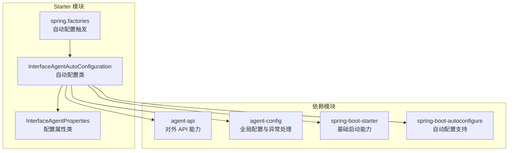
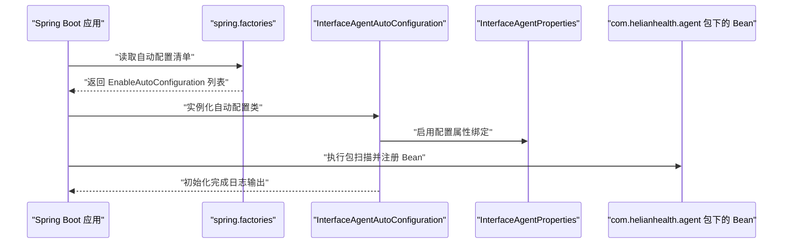
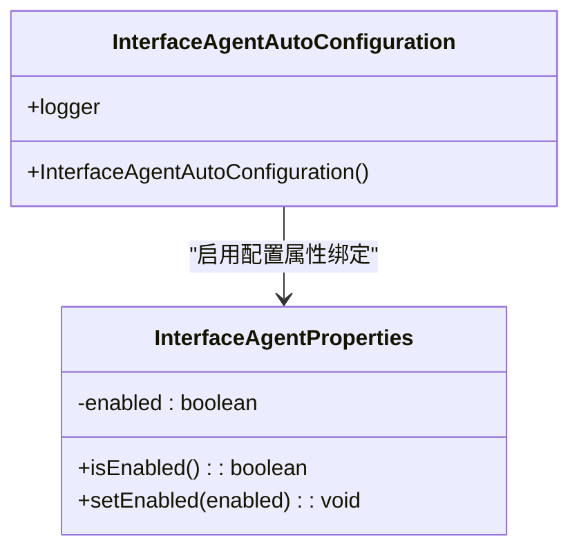
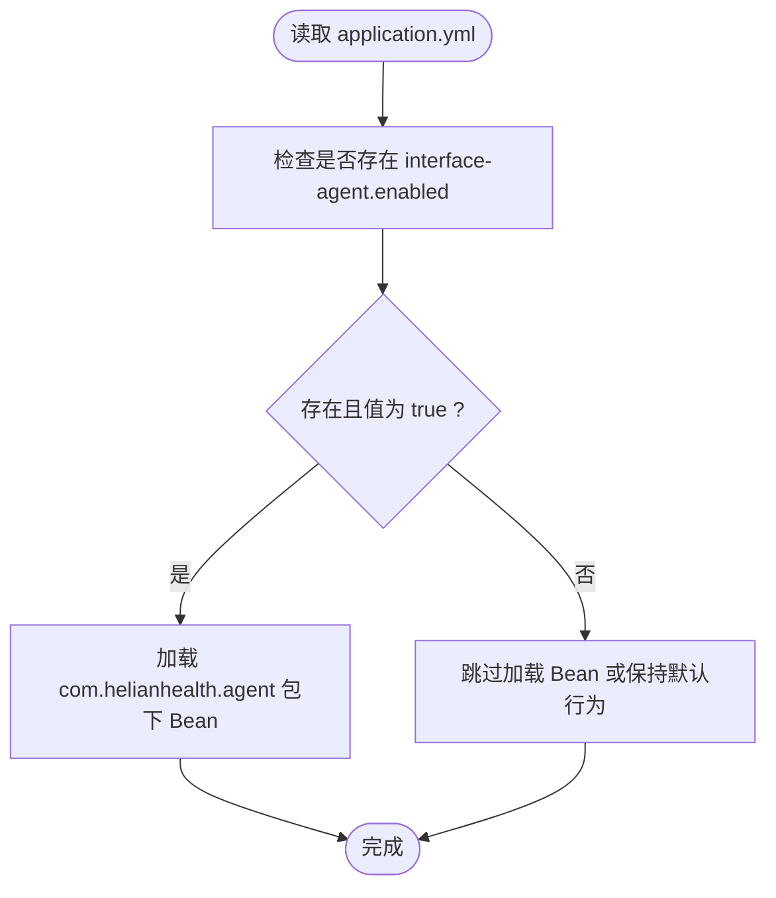
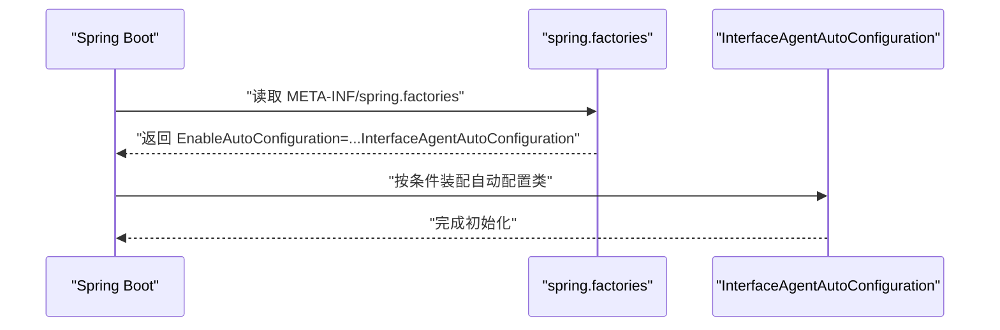
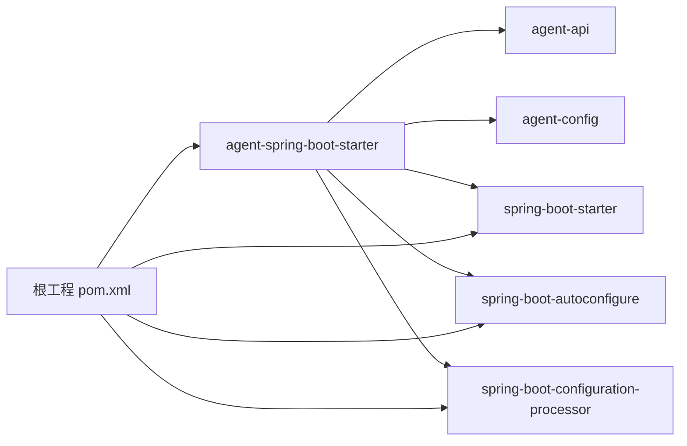

# agent-spring-boot-starter 模块

<cite>
**本文引用的文件列表**
- [InterfaceAgentAutoConfiguration.java](file://agent-spring-boot-starter/src/main/java/com/helianhealth/agent/starter/InterfaceAgentAutoConfiguration.java)
- [InterfaceAgentProperties.java](file://agent-spring-boot-starter/src/main/java/com/helianhealth/agent/starter/InterfaceAgentProperties.java)
- [spring.factories](file://agent-spring-boot-starter/src/main/resources/META-INF/spring.factories)
- [pom.xml（starter）](file://agent-spring-boot-starter/pom.xml)
- [pom.xml（根工程）](file://pom.xml)
- [InterfaceAgentApplication.java](file://agent-web/src/main/java/com/helianhealth/agent/InterfaceAgentApplication.java)
- [application.yml](file://agent-web/src/main/resources/application.yml)
- [application-local.yml](file://agent-web/src/main/resources/application-local.yml)
- [application-prod.yml](file://agent-web/src/main/resources/application-prod.yml)
</cite>

## 目录
1. [简介](#简介)
2. [项目结构](#项目结构)
3. [核心组件](#核心组件)
4. [架构总览](#架构总览)
5. [详细组件分析](#详细组件分析)
6. [依赖关系分析](#依赖关系分析)
7. [性能考量](#性能考量)
8. [故障排查指南](#故障排查指南)
9. [结论](#结论)
10. [附录：第三方项目集成步骤与配置示例](#附录第三方项目集成步骤与配置示例)

## 简介
本文件面向第三方项目集成“agent-spring-boot-starter”自动化集成核心，系统性解析其自动配置原理、配置属性绑定方式以及在Spring Boot中的触发机制。重点包括：
- InterfaceAgentAutoConfiguration 如何基于条件化装配加载各功能模块 Bean
- InterfaceAgentProperties 的结构设计与 application.yml 的绑定方式
- META-INF/spring.factories 中 EnableAutoConfiguration 的触发机制
- 在第三方项目中引入 Starter 的完整步骤与配置示例
- 自动配置的启用/禁用方法

## 项目结构
agent-spring-boot-starter 是一个 Spring Boot Starter 模块，负责：
- 提供自动配置类，按需装配核心能力
- 将配置属性与外部 application.yml 绑定
- 通过 spring.factories 触发自动装配
- 作为其他模块（如 agent-api、agent-config 等）的聚合入口

图表来源
- [InterfaceAgentAutoConfiguration.java](file://agent-spring-boot-starter/src/main/java/com/helianhealth/agent/starter/InterfaceAgentAutoConfiguration.java#L14-L18)
- [InterfaceAgentProperties.java](file://agent-spring-boot-starter/src/main/java/com/helianhealth/agent/starter/InterfaceAgentProperties.java#L8-L14)
- [spring.factories](file://agent-spring-boot-starter/src/main/resources/META-INF/spring.factories#L1-L3)
- [pom.xml（starter）](file://agent-spring-boot-starter/pom.xml#L15-L47)

章节来源
- [pom.xml（starter）](file://agent-spring-boot-starter/pom.xml#L1-L50)
- [pom.xml（根工程）](file://pom.xml#L1-L200)

## 核心组件
- 自动配置类：InterfaceAgentAutoConfiguration
  - 条件化装配：仅当配置项 interface-agent.enabled 为 true 时生效，默认值为 true
  - 属性绑定：启用配置属性绑定，使 application.yml 中的 interface-agent.* 可被注入
  - 包扫描：扫描 com.helianhealth.agent 下的组件，加载各功能模块 Bean
- 配置属性类：InterfaceAgentProperties
  - 前缀绑定：@ConfigurationProperties(prefix = "interface-agent")
  - 单一属性：enabled（布尔），用于控制是否启用 Interface Agent
- 自动装配触发：spring.factories
  - org.springframework.boot.autoconfigure.EnableAutoConfiguration 指向自动配置类

章节来源
- [InterfaceAgentAutoConfiguration.java](file://agent-spring-boot-starter/src/main/java/com/helianhealth/agent/starter/InterfaceAgentAutoConfiguration.java#L14-L18)
- [InterfaceAgentProperties.java](file://agent-spring-boot-starter/src/main/java/com/helianhealth/agent/starter/InterfaceAgentProperties.java#L8-L23)
- [spring.factories](file://agent-spring-boot-starter/src/main/resources/META-INF/spring.factories#L1-L3)

## 架构总览
下图展示 Starter 在 Spring Boot 启动过程中的装配流程与关键交互点。

图表来源
- [spring.factories](file://agent-spring-boot-starter/src/main/resources/META-INF/spring.factories#L1-L3)
- [InterfaceAgentAutoConfiguration.java](file://agent-spring-boot-starter/src/main/java/com/helianhealth/agent/starter/InterfaceAgentAutoConfiguration.java#L14-L18)
- [InterfaceAgentProperties.java](file://agent-spring-boot-starter/src/main/java/com/helianhealth/agent/starter/InterfaceAgentProperties.java#L8-L14)

## 详细组件分析

### 自动配置类：InterfaceAgentAutoConfiguration
- 条件化装配
  - 使用 @ConditionalOnProperty(prefix = "interface-agent", name = "enabled", havingValue = "true", matchIfMissing = true)，表示当配置项 interface-agent.enabled 存在且值为 "true" 时才装配；若未显式设置，则默认生效
- 属性绑定
  - 使用 @EnableConfigurationProperties(InterfaceAgentProperties.class)，将配置属性类纳入 Spring 容器管理
- 包扫描
  - 使用 @ComponentScan(basePackages = "com.helianhealth.agent")，扫描该包下的组件，从而加载各功能模块的 Bean
- 初始化日志
  - 在构造函数中输出初始化日志，便于确认自动配置已生效

图表来源
- [InterfaceAgentAutoConfiguration.java](file://agent-spring-boot-starter/src/main/java/com/helianhealth/agent/starter/InterfaceAgentAutoConfiguration.java#L14-L26)
- [InterfaceAgentProperties.java](file://agent-spring-boot-starter/src/main/java/com/helianhealth/agent/starter/InterfaceAgentProperties.java#L8-L23)

章节来源
- [InterfaceAgentAutoConfiguration.java](file://agent-spring-boot-starter/src/main/java/com/helianhealth/agent/starter/InterfaceAgentAutoConfiguration.java#L14-L26)

### 配置属性类：InterfaceAgentProperties
- 结构设计
  - 采用 @ConfigurationProperties(prefix = "interface-agent")，将 application.yml 中以 interface-agent 开头的键值映射到该类字段
  - 当前仅包含布尔型 enabled 字段，用于控制是否启用 Interface Agent
- 绑定方式
  - 通过 @EnableConfigurationProperties 已在自动配置类中启用绑定
  - Spring Boot 在启动时会将 application.yml 中的 interface-agent.enabled 注入到该类实例中

图表来源
- [InterfaceAgentAutoConfiguration.java](file://agent-spring-boot-starter/src/main/java/com/helianhealth/agent/starter/InterfaceAgentAutoConfiguration.java#L15-L17)
- [InterfaceAgentProperties.java](file://agent-spring-boot-starter/src/main/java/com/helianhealth/agent/starter/InterfaceAgentProperties.java#L8-L14)

章节来源
- [InterfaceAgentProperties.java](file://agent-spring-boot-starter/src/main/java/com/helianhealth/agent/starter/InterfaceAgentProperties.java#L8-L23)

### spring.factories 触发机制
- 文件位置：agent-spring-boot-starter/src/main/resources/META-INF/spring.factories
- 内容要点：org.springframework.boot.autoconfigure.EnableAutoConfiguration 指向 InterfaceAgentAutoConfiguration
- 触发流程：
  - Spring Boot 启动时读取该文件，发现 EnableAutoConfiguration 指向的自动配置类
  - 将该类加入候选自动配置集合，随后根据条件注解进行装配

图表来源
- [spring.factories](file://agent-spring-boot-starter/src/main/resources/META-INF/spring.factories#L1-L3)
- [InterfaceAgentAutoConfiguration.java](file://agent-spring-boot-starter/src/main/java/com/helianhealth/agent/starter/InterfaceAgentAutoConfiguration.java#L14-L18)

章节来源
- [spring.factories](file://agent-spring-boot-starter/src/main/resources/META-INF/spring.factories#L1-L3)

## 依赖关系分析
- starter 模块依赖
  - agent-api：对外 API 能力
  - agent-config：全局配置与异常处理
  - spring-boot-starter：基础启动能力
  - spring-boot-autoconfigure：自动配置支持
  - spring-boot-configuration-processor：可选的配置处理器
- 根工程版本管理
  - 通过父 POM 统一管理 Spring Boot 版本与常用依赖版本

图表来源
- [pom.xml（starter）](file://agent-spring-boot-starter/pom.xml#L15-L47)
- [pom.xml（根工程）](file://pom.xml#L43-L71)

章节来源
- [pom.xml（starter）](file://agent-spring-boot-starter/pom.xml#L1-L50)
- [pom.xml（根工程）](file://pom.xml#L1-L200)

## 性能考量
- 条件化装配减少不必要的 Bean 加载，避免在 disabled 场景下引入额外开销
- 包扫描范围限定在 com.helianhealth.agent，降低扫描成本
- 建议在生产环境明确设置 interface-agent.enabled，避免默认值带来的潜在误判

## 故障排查指南
- 自动配置未生效
  - 检查是否正确引入 starter 依赖
  - 确认 application.yml 中是否设置了 interface-agent.enabled=false 导致被禁用
  - 查看启动日志中是否出现自动配置初始化信息
- Bean 未被加载
  - 确认 com.helianhealth.agent 包下确实存在需要注册的组件
  - 检查组件是否具备 @Component、@Service、@Configuration 等合适的注解
- 配置不生效
  - 确认 application.yml 中键名是否为 interface-agent.enabled
  - 若使用多环境配置文件，请确认当前激活的 profile 正确

章节来源
- [InterfaceAgentAutoConfiguration.java](file://agent-spring-boot-starter/src/main/java/com/helianhealth/agent/starter/InterfaceAgentAutoConfiguration.java#L14-L26)
- [InterfaceAgentProperties.java](file://agent-spring-boot-starter/src/main/java/com/helianhealth/agent/starter/InterfaceAgentProperties.java#L8-L23)

## 结论
agent-spring-boot-starter 通过 spring.factories 触发自动配置，结合 @ConditionalOnProperty 与 @EnableConfigurationProperties 实现了灵活可控的功能装配。InterfaceAgentProperties 以最小结构提供开关能力，配合 application.yml 的简单配置即可完成启用/禁用控制。对于第三方项目，只需引入 starter 依赖并在配置文件中设置相应参数，即可快速启用 Interface Agent 的自动化能力。

## 附录：第三方项目集成步骤与配置示例

### 集成步骤
1. 在第三方项目的 Maven 依赖中添加 agent-spring-boot-starter
   - 引入坐标：groupId=com.helianhealth，artifactId=agent-spring-boot-starter，version=与主工程一致
2. 在第三方项目的 application.yml 中添加 interface-agent 配置
   - 示例键：interface-agent.enabled（布尔）
3. 启动第三方项目，观察启动日志中是否出现自动配置初始化信息
4. 如需扩展或覆盖默认行为，可在第三方项目中继续引入 agent-api、agent-config 等模块，或自定义配置类

章节来源
- [pom.xml（starter）](file://agent-spring-boot-starter/pom.xml#L15-L27)
- [application.yml](file://agent-web/src/main/resources/application.yml#L1-L27)

### 配置示例
- 启用 Interface Agent（默认）
  - 键：interface-agent.enabled
  - 值：true
- 禁用 Interface Agent
  - 键：interface-agent.enabled
  - 值：false
- 多环境示例（参考项目内配置文件）
  - 本地环境：application-local.yml
  - 生产环境：application-prod.yml
  - 其他环境：application-dev-*.yml

章节来源
- [application-local.yml](file://agent-web/src/main/resources/application-local.yml#L1-L35)
- [application-prod.yml](file://agent-web/src/main/resources/application-prod.yml#L1-L21)
- [application.yml](file://agent-web/src/main/resources/application.yml#L1-L27)

### 启用/禁用方法
- 启用（默认）
  - 不设置 interface-agent.enabled 或显式设为 true
- 禁用
  - 在 application.yml 中设置 interface-agent.enabled=false
- 多环境切换
  - 通过 Spring Profile 激活不同环境配置文件，从而影响 interface-agent.enabled 的最终值

章节来源
- [InterfaceAgentAutoConfiguration.java](file://agent-spring-boot-starter/src/main/java/com/helianhealth/agent/starter/InterfaceAgentAutoConfiguration.java#L15-L17)
- [InterfaceAgentProperties.java](file://agent-spring-boot-starter/src/main/java/com/helianhealth/agent/starter/InterfaceAgentProperties.java#L8-L14)
- [application.yml](file://agent-web/src/main/resources/application.yml#L1-L27)