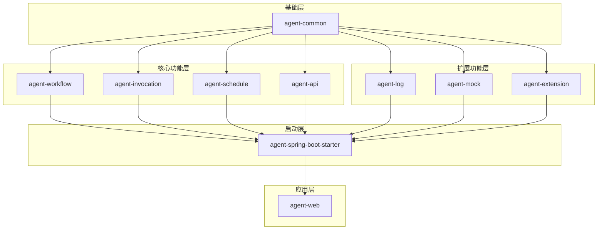
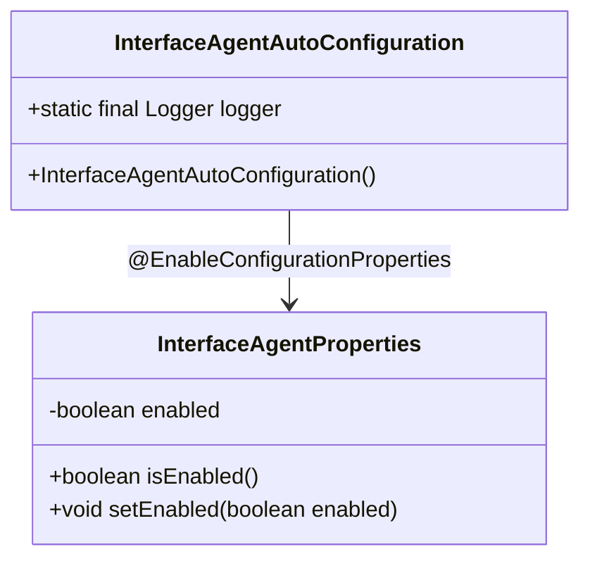
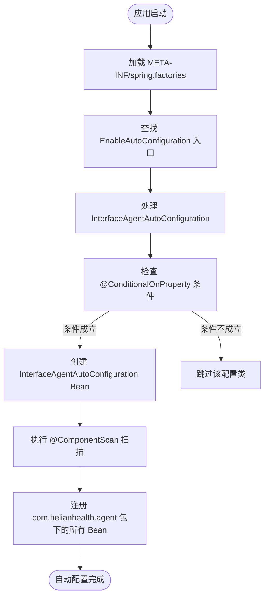
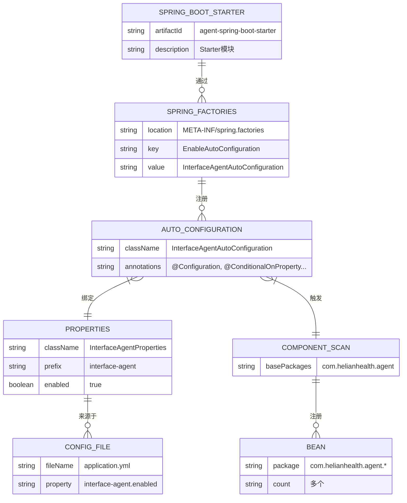

# 自动配置机制

<cite>
**本文档中引用的文件**  
- [InterfaceAgentAutoConfiguration.java](file://agent-spring-boot-starter/src/main/java/com/helianhealth/agent/starter/InterfaceAgentAutoConfiguration.java)
- [InterfaceAgentProperties.java](file://agent-spring-boot-starter/src/main/java/com/helianhealth/agent/starter/InterfaceAgentProperties.java)
- [spring.factories](file://agent-spring-boot-starter/src/main/resources/META-INF/spring.factories)
- [InterfaceAgentApplication.java](file://agent-web/src/main/java/com/helianhealth/agent/InterfaceAgentApplication.java)
- [application.yml](file://agent-web/src/main/resources/application.yml)
- [pom.xml](file://agent-spring-boot-starter/pom.xml)
- [模块化架构说明.md](file://模块化架构说明.md)
</cite>

## 目录
1. [引言](#引言)
2. [项目结构](#项目结构)
3. [核心组件](#核心组件)
4. [架构概述](#架构概述)
5. [详细组件分析](#详细组件分析)
6. [依赖分析](#依赖分析)
7. [性能考虑](#性能考虑)
8. [故障排除指南](#故障排除指南)
9. [结论](#结论)

## 引言
InterfaceAgentAutoConfiguration 是 `interface-agent` 项目中的核心自动配置类，负责在 Spring Boot 应用启动时根据配置条件自动装配相关组件。该配置类通过 `@ConditionalOnProperty` 实现条件化加载，通过 `@EnableConfigurationProperties` 绑定配置属性，并通过 `@ComponentScan` 扫描并注册 `com.helianhealth.agent` 包下的所有 Bean。其注册方式依赖于 `spring.factories` 文件中的 `EnableAutoConfiguration` 入口，这是 Spring Boot 自动配置机制的核心实现方式之一。本文将深入解析该自动配置类的实现原理、加载流程、组件扫描机制，并提供禁用自动配置的方法及性能优化建议。

## 项目结构



**Diagram sources**
- [模块化架构说明.md](file://模块化架构说明.md)

**Section sources**
- [模块化架构说明.md](file://模块化架构说明.md)

## 核心组件

`InterfaceAgentAutoConfiguration` 类是整个 `interface-agent` 项目自动配置的核心。它通过 `@Configuration` 注解声明为一个配置类，在 Spring 容器启动时被处理。该类的构造函数中包含日志输出，用于在配置类初始化时打印启动信息，便于调试和确认自动配置是否生效。

`InterfaceAgentProperties` 类使用 `@ConfigurationProperties` 注解将 `interface-agent` 前缀的配置项（如 `interface-agent.enabled`）绑定到 Java 对象的属性上，实现了类型安全的配置管理。

`spring.factories` 文件是 Spring Boot 自动配置的入口点，它将 `InterfaceAgentAutoConfiguration` 类注册到 `org.springframework.boot.autoconfigure.EnableAutoConfiguration` 的键下，使得 Spring Boot 在启动时能够发现并加载该配置类。

**Section sources**
- [InterfaceAgentAutoConfiguration.java](file://agent-spring-boot-starter/src/main/java/com/helianhealth/agent/starter/InterfaceAgentAutoConfiguration.java#L1-L27)
- [InterfaceAgentProperties.java](file://agent-spring-boot-starter/src/main/java/com/helianhealth/agent/starter/InterfaceAgentProperties.java#L1-L23)
- [spring.factories](file://agent-spring-boot-starter/src/main/resources/META-INF/spring.factories#L1-L2)

## 架构概述

```mermaid
sequenceDiagram
participant App as "Spring Boot应用"
participant SpringBoot as "Spring Boot启动器"
participant Factories as "spring.factories"
participant AutoConfig as "InterfaceAgentAutoConfiguration"
participant Properties as "InterfaceAgentProperties"
participant ComponentScan as "组件扫描"
App->>SpringBoot : SpringApplication.run()
SpringBoot->>Factories : 加载META-INF/spring.factories
Factories->>SpringBoot : 返回EnableAutoConfiguration列表
SpringBoot->>AutoConfig : 加载InterfaceAgentAutoConfiguration
AutoConfig->>Properties : @EnableConfigurationProperties绑定
AutoConfig->>ComponentScan : @ComponentScan扫描com.helianhealth.agent包
ComponentScan->>AutoConfig : 注册发现的Bean
AutoConfig->>App : 自动配置完成
```

**Diagram sources**
- [InterfaceAgentAutoConfiguration.java](file://agent-spring-boot-starter/src/main/java/com/helianhealth/agent/starter/InterfaceAgentAutoConfiguration.java#L1-L27)
- [spring.factories](file://agent-spring-boot-starter/src/main/resources/META-INF/spring.factories#L1-L2)

## 详细组件分析

### InterfaceAgentAutoConfiguration 分析

`InterfaceAgentAutoConfiguration` 类是 `interface-agent` 项目自动配置的核心实现，其作用机制涉及多个 Spring Boot 核心注解。

#### 注解作用机制分析



**Diagram sources**
- [InterfaceAgentAutoConfiguration.java](file://agent-spring-boot-starter/src/main/java/com/helianhealth/agent/starter/InterfaceAgentAutoConfiguration.java#L1-L27)
- [InterfaceAgentProperties.java](file://agent-spring-boot-starter/src/main/java/com/helianhealth/agent/starter/InterfaceAgentProperties.java#L1-L23)

`@Configuration` 注解表明 `InterfaceAgentAutoConfiguration` 是一个 Spring 配置类，其内部定义的 `@Bean` 方法（如果存在）或通过 `@ComponentScan` 发现的组件将被注册到 Spring 应用上下文中。

`@ConditionalOnProperty(prefix = "interface-agent", name = "enabled", havingValue = "true", matchIfMissing = true)` 是条件化装配的关键。该注解的作用机制如下：
- **prefix**: 指定配置属性的前缀为 `interface-agent`。
- **name**: 指定要检查的属性名为 `enabled`。
- **havingValue**: 指定当 `interface-agent.enabled` 的值为 `"true"` 时，条件成立，配置类会被加载。
- **matchIfMissing**: 这是一个关键参数。当配置文件中没有定义 `interface-agent.enabled` 属性时，`matchIfMissing = true` 表示条件**默认成立**，即自动配置类会被加载。这确保了在没有显式禁用的情况下，功能是默认启用的。

`@EnableConfigurationProperties(InterfaceAgentProperties.class)` 注解的作用是启用并注册 `InterfaceAgentProperties` 配置属性类。它会做两件事：
1.  将 `InterfaceAgentProperties` 类注册为一个 Spring Bean。
2.  将 `interface-agent.*` 前缀的所有配置项自动绑定到 `InterfaceAgentProperties` 类的对应字段上（例如，`interface-agent.enabled` 的值会绑定到 `enabled` 字段）。

`@ComponentScan(basePackages = "com.helianhealth.agent")` 注解指示 Spring 容器扫描 `com.helianhealth.agent` 包及其所有子包。在 `interface-agent` 项目中，所有核心功能模块（如 `agent-api`, `agent-workflow`, `agent-invocation` 等）的 Java 类都位于此包路径下。通过此注解，所有被 `@Component`, `@Service`, `@Controller`, `@Repository` 等注解标记的类都会被自动发现并注册为 Spring Bean，从而实现了模块的自动集成。

**Section sources**
- [InterfaceAgentAutoConfiguration.java](file://agent-spring-boot-starter/src/main/java/com/helianhealth/agent/starter/InterfaceAgentAutoConfiguration.java#L1-L27)
- [InterfaceAgentProperties.java](file://agent-spring-boot-starter/src/main/java/com/helianhealth/agent/starter/InterfaceAgentProperties.java#L1-L23)

### Spring Boot 自动配置加载流程

Spring Boot 的自动配置机制是其“约定优于配置”理念的核心体现。`InterfaceAgentAutoConfiguration` 的加载流程遵循标准的 Spring Boot 自动配置过程。



**Diagram sources**
- [spring.factories](file://agent-spring-boot-starter/src/main/resources/META-INF/spring.factories#L1-L2)
- [InterfaceAgentAutoConfiguration.java](file://agent-spring-boot-starter/src/main/java/com/helianhealth/agent/starter/InterfaceAgentAutoConfiguration.java#L1-L27)

1.  **启动入口**: 当一个 Spring Boot 应用（如 `InterfaceAgentApplication`）通过 `SpringApplication.run()` 启动时，Spring Boot 会开始其自动配置流程。
2.  **加载 spring.factories**: Spring Boot 的 `SpringFactoriesLoader` 会扫描所有依赖 JAR 包中的 `META-INF/spring.factories` 文件。
3.  **查找自动配置入口**: 它会读取 `spring.factories` 文件中 `org.springframework.boot.autoconfigure.EnableAutoConfiguration` 键所对应的全限定类名列表。
4.  **加载配置类**: 在本项目中，`agent-spring-boot-starter` 模块的 `spring.factories` 文件明确列出了 `com.helianhealth.agent.starter.InterfaceAgentAutoConfiguration`。因此，Spring Boot 会尝试加载这个类。
5.  **条件评估**: Spring 容器在创建 `InterfaceAgentAutoConfiguration` Bean 之前，会评估其上的 `@ConditionalOnProperty` 注解。容器会检查当前环境的配置（来自 `application.yml` 等）中是否存在 `interface-agent.enabled` 属性，并判断其值是否为 `true`（或属性不存在且 `matchIfMissing=true`）。
6.  **条件化装配**: 如果条件评估为 `true`，则 `InterfaceAgentAutoConfiguration` 类会被实例化，其 `@ComponentScan` 注解会触发对 `com.helianhealth.agent` 包的扫描，从而将所有相关的业务组件加载到 Spring 容器中。如果条件不成立，整个配置类及其扫描行为都会被跳过。

**Section sources**
- [spring.factories](file://agent-spring-boot-starter/src/main/resources/META-INF/spring.factories#L1-L2)
- [InterfaceAgentAutoConfiguration.java](file://agent-spring-boot-starter/src/main/java/com/helianhealth/agent/starter/InterfaceAgentAutoConfiguration.java#L1-L27)
- [InterfaceAgentApplication.java](file://agent-web/src/main/java/com/helianhealth/agent/InterfaceAgentApplication.java#L1-L12)

## 依赖分析



**Diagram sources**
- [pom.xml](file://agent-spring-boot-starter/pom.xml#L1-L49)
- [spring.factories](file://agent-spring-boot-starter/src/main/resources/META-INF/spring.factories#L1-L2)
- [InterfaceAgentAutoConfiguration.java](file://agent-spring-boot-starter/src/main/java/com/helianhealth/agent/starter/InterfaceAgentAutoConfiguration.java#L1-L27)
- [InterfaceAgentProperties.java](file://agent-spring-boot-starter/src/main/java/com/helianhealth/agent/starter/InterfaceAgentProperties.java#L1-L23)
- [application.yml](file://agent-web/src/main/resources/application.yml#L1-L27)

`agent-spring-boot-starter` 模块依赖于 `spring-boot-autoconfigure` 和 `spring-boot-starter`，这是实现自动配置的基础。`spring.factories` 文件是连接 `Starter` 和 Spring Boot 自动配置系统的桥梁。`InterfaceAgentAutoConfiguration` 依赖于 `InterfaceAgentProperties` 进行配置绑定，并通过 `@ComponentScan` 依赖于项目中 `com.helianhealth.agent` 包下的所有组件。

**Section sources**
- [pom.xml](file://agent-spring-boot-starter/pom.xml#L1-L49)
- [spring.factories](file://agent-spring-boot-starter/src/main/resources/META-INF/spring.factories#L1-L2)
- [InterfaceAgentAutoConfiguration.java](file://agent-spring-boot-starter/src/main/java/com/helianhealth/agent/starter/InterfaceAgentAutoConfiguration.java#L1-L27)
- [InterfaceAgentProperties.java](file://agent-spring-boot-starter/src/main/java/com/helianhealth/agent/starter/InterfaceAgentProperties.java#L1-L23)

## 性能考虑

自动配置虽然极大地简化了开发，但也可能对应用启动性能产生影响。

**Section sources**
- [InterfaceAgentAutoConfiguration.java](file://agent-spring-boot-starter/src/main/java/com/helianhealth/agent/starter/InterfaceAgentAutoConfiguration.java#L1-L27)

### 自动配置对启动性能的影响

1.  **类路径扫描开销**: `@ComponentScan` 会扫描指定包下的所有类。随着项目规模增大，`com.helianhealth.agent` 包下的类数量会增加，这会延长 Spring 容器的启动时间。
2.  **条件评估开销**: 虽然单个 `@ConditionalOnProperty` 的评估非常快，但如果项目中引入了大量 Starter，每个 Starter 都有自己的条件注解，累积起来也会产生一定的评估开销。
3.  **Bean 创建开销**: 即使配置类被条件化加载，一旦加载，它可能会创建大量的 Bean。这些 Bean 的实例化和依赖注入过程是启动阶段的主要耗时操作。

### 优化建议

1.  **精确扫描路径**: 确保 `@ComponentScan` 的 `basePackages` 尽可能精确，避免扫描不必要的包，以减少类路径扫描的范围。
2.  **合理使用条件注解**: 对于非核心功能，应使用更精细的条件注解（如 `@ConditionalOnClass`, `@ConditionalOnMissingBean`），确保只有在真正需要时才加载相关配置。
3.  **延迟初始化**: 对于非关键的、启动时不需要立即使用的 Bean，可以考虑使用 `@Lazy` 注解进行延迟初始化，将部分创建开销从启动阶段转移到实际使用时。
4.  **禁用不必要的自动配置**: 如果某些功能模块在特定环境中不需要，应通过配置或排除的方式禁用其自动配置，避免不必要的 Bean 创建。

## 故障排除指南

当 `interface-agent` 的自动配置未按预期工作时，可以按照以下步骤进行排查。

**Section sources**
- [InterfaceAgentAutoConfiguration.java](file://agent-spring-boot-starter/src/main/java/com/helianhealth/agent/starter/InterfaceAgentAutoConfiguration.java#L1-L27)
- [application.yml](file://agent-web/src/main/resources/application.yml#L1-L27)

### 禁用自动配置的方法

1.  **通过配置项控制**: 这是最推荐的方法。在 `application.yml` 或 `application.properties` 中设置 `interface-agent.enabled=false`。由于 `matchIfMissing=true`，只有显式设置为 `false` 才会禁用。
    ```yaml
    interface-agent:
      enabled: false
    ```
2.  **通过 @SpringBootApplication 排除**: 在主应用类上使用 `@SpringBootApplication` 注解的 `exclude` 属性，直接排除 `InterfaceAgentAutoConfiguration` 类。
    ```java
    @SpringBootApplication(exclude = {InterfaceAgentAutoConfiguration.class})
    public class InterfaceAgentApplication {
        public static void main(String[] args) {
            SpringApplication.run(InterfaceAgentApplication.class, args);
        }
    }
    ```
3.  **通过配置文件排除**: 在 `application.yml` 中使用 `spring.autoconfigure.exclude` 属性。
    ```yaml
    spring:
      autoconfigure:
        exclude: com.helianhealth.agent.starter.InterfaceAgentAutoConfiguration
    ```

### 常见问题排查

-   **问题**: 自动配置未生效，相关 Bean 未被创建。
    -   **检查点**: 确认 `agent-spring-boot-starter` 已正确添加到项目的依赖中。
    -   **检查点**: 检查 `spring.factories` 文件是否存在于 JAR 包的 `META-INF` 目录下，且内容正确。
    -   **检查点**: 检查 `interface-agent.enabled` 配置项是否被意外设置为 `false`。
-   **问题**: 自动配置生效，但功能异常。
    -   **检查点**: 查看启动日志，确认 `Interface Agent Auto Configuration initialized!` 日志是否输出，以确认配置类已被加载。
    -   **检查点**: 检查 `com.helianhealth.agent` 包下的关键组件（如 Controller、Service）是否被正确扫描和注册。

## 结论
`InterfaceAgentAutoConfiguration` 类通过 Spring Boot 的自动配置机制，实现了 `interface-agent` 项目的无缝集成。其核心在于 `@ConditionalOnProperty` 的条件化装配和 `spring.factories` 的自动发现。通过 `@ComponentScan`，它能够自动加载所有位于 `com.helianhealth.agent` 包下的业务组件，极大地简化了使用者的配置工作。开发者可以通过配置项或注解的方式灵活地启用或禁用该自动配置。在享受自动配置便利的同时，也应注意其对启动性能的潜在影响，并通过精确扫描、延迟初始化等策略进行优化。