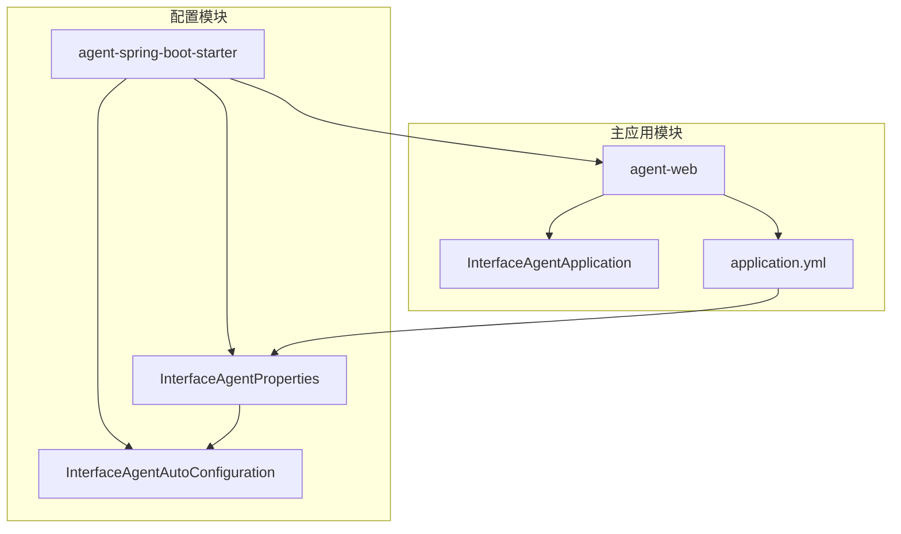
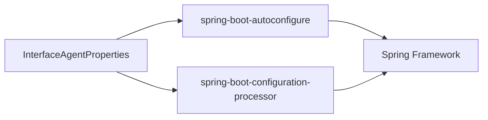

# 配置属性管理

<cite>
**本文档中引用的文件**  
- [InterfaceAgentProperties.java](file://agent-spring-boot-starter/src/main/java/com/helianhealth/agent/starter/InterfaceAgentProperties.java)
- [InterfaceAgentAutoConfiguration.java](file://agent-spring-boot-starter/src/main/java/com/helianhealth/agent/starter/InterfaceAgentAutoConfiguration.java)
- [application.yml](file://agent-web/src/main/resources/application.yml)
- [spring-configuration-metadata.json](file://agent-spring-boot-starter/target/classes/META-INF/spring-configuration-metadata.json)
- [pom.xml](file://agent-spring-boot-starter/pom.xml)
</cite>

## 目录
1. [简介](#简介)
2. [项目结构](#项目结构)
3. [核心组件](#核心组件)
4. [架构概述](#架构概述)
5. [详细组件分析](#详细组件分析)
6. [依赖分析](#依赖分析)
7. [性能考虑](#性能考虑)
8. [故障排除指南](#故障排除指南)
9. [结论](#结论)

## 简介
本文档全面解析 `InterfaceAgentProperties` 配置属性类的设计与实现。重点说明 Spring Boot 的 `@ConfigurationProperties` 注解如何将 `application.yml` 中以 `interface-agent` 为前缀的配置项自动绑定到 Java 属性类字段，涵盖属性命名规范（如驼峰命名与短横线命名的松散绑定）。详细解释 `enabled` 属性默认值为 `true` 的设计意图及其在条件化装配中的关键作用，并演示如何在其他 Bean 中通过 `@Autowired` 注入该属性类来安全地读取配置。同时提供完整的配置示例，说明配置属性的类型安全校验、松散绑定特性以及在 IDE 中的元数据支持（通过 `spring-configuration-metadata.json` 实现），并讨论配置属性的最佳实践。

## 项目结构
本项目采用模块化 Maven 多模块架构，核心配置属性类 `InterfaceAgentProperties` 位于 `agent-spring-boot-starter` 模块中，作为整个 Interface Agent 的启动入口和自动配置中心。该模块被 `agent-web` 等其他模块依赖，实现自动配置的注入。`application.yml` 文件位于 `agent-web` 模块的资源目录下，是外部化配置的主要来源。



**图示来源**
- [InterfaceAgentProperties.java](file://agent-spring-boot-starter/src/main/java/com/helianhealth/agent/starter/InterfaceAgentProperties.java)
- [InterfaceAgentAutoConfiguration.java](file://agent-spring-boot-starter/src/main/java/com/helianhealth/agent/starter/InterfaceAgentAutoConfiguration.java)
- [application.yml](file://agent-web/src/main/resources/application.yml)

**本节来源**
- [InterfaceAgentProperties.java](file://agent-spring-boot-starter/src/main/java/com/helianhealth/agent/starter/InterfaceAgentProperties.java)
- [InterfaceAgentAutoConfiguration.java](file://agent-spring-boot-starter/src/main/java/com/helianhealth/agent/starter/InterfaceAgentAutoConfiguration.java)
- [application.yml](file://agent-web/src/main/resources/application.yml)

## 核心组件
`InterfaceAgentProperties` 是一个标准的 Spring Boot 配置属性类，使用 `@ConfigurationProperties` 注解进行声明。它定义了 `interface-agent` 前缀下的所有可配置属性，目前核心属性为 `enabled`，用于控制整个 Interface Agent 功能的启用与禁用。该类通过 getter 和 setter 方法暴露其属性，符合 JavaBean 规范，以便 Spring 容器进行属性绑定。

**本节来源**
- [InterfaceAgentProperties.java](file://agent-spring-boot-starter/src/main/java/com/helianhealth/agent/starter/InterfaceAgentProperties.java)

## 架构概述
`InterfaceAgentProperties` 的工作流程遵循 Spring Boot 的外部化配置原则。当应用启动时，`InterfaceAgentAutoConfiguration` 类被加载。该类通过 `@EnableConfigurationProperties(InterfaceAgentProperties.class)` 注解，将 `InterfaceAgentProperties` 类注册为一个可配置的 Bean。Spring Boot 的 `ConfigurationPropertiesBindingPostProcessor` 会自动扫描所有被 `@ConfigurationProperties` 注解的 Bean，并根据其 `prefix` 属性（即 `interface-agent`）从 `application.yml` 等配置源中查找匹配的属性，利用松散绑定规则（如 `interface-agent.enabled` 绑定到 `enabled` 字段）完成属性值的注入。

```mermaid
sequenceDiagram
participant App as 应用启动
participant AutoConfig as InterfaceAgentAutoConfiguration
participant Binder as ConfigurationPropertiesBinder
participant YML as application.yml
participant Properties as InterfaceAgentProperties
App->>AutoConfig : 加载配置类
AutoConfig->>AutoConfig : @EnableConfigurationProperties
AutoConfig->>Properties : 创建 Properties Bean
Properties->>Binder : 请求绑定
Binder->>YML : 查找 interface-agent.*
YML-->>Binder : 返回配置值
Binder->>Properties : 设置字段值 (enabled)
Properties-->>AutoConfig : 初始化完成
AutoConfig->>App : 自动配置初始化日志
```

**图示来源**
- [InterfaceAgentProperties.java](file://agent-spring-boot-starter/src/main/java/com/helianhealth/agent/starter/InterfaceAgentProperties.java)
- [InterfaceAgentAutoConfiguration.java](file://agent-spring-boot-starter/src/main/java/com/helianhealth/agent/starter/InterfaceAgentAutoConfiguration.java)
- [application.yml](file://agent-web/src/main/resources/application.yml)

## 详细组件分析
### InterfaceAgentProperties 分析
`InterfaceAgentProperties` 类是配置管理的核心。其设计简洁，仅包含一个 `enabled` 属性，体现了单一职责原则。

#### 配置属性绑定
`@ConfigurationProperties(prefix = "interface-agent")` 注解是实现类型安全配置的关键。它指示 Spring Boot 将配置文件中所有以 `interface-agent.` 开头的属性绑定到此类的字段上。Spring Boot 支持松散绑定（Relaxed Binding），这意味着配置文件中的 `interface-agent.enabled`、`interfaceAgent.enabled` 或 `INTERFACE_AGENT_ENABLED` 都可以成功绑定到 `private boolean enabled` 字段。这种灵活性方便了不同环境下的配置管理。

```mermaid
classDiagram
class InterfaceAgentProperties {
-enabled : boolean
+isEnabled() bool
+setEnabled(enabled bool) void
}
note right of InterfaceAgentProperties
配置前缀 : interface-agent
松散绑定支持 : enabled, enabled, ENABLED
end note
```

**图示来源**
- [InterfaceAgentProperties.java](file://agent-spring-boot-starter/src/main/java/com/helianhealth/agent/starter/InterfaceAgentProperties.java)

#### enabled 属性与条件化装配
`enabled` 属性的默认值被显式设置为 `true`，这体现了“约定优于配置”的设计思想。这意味着，只要项目引入了 `agent-spring-boot-starter`，Interface Agent 功能就会默认启用，无需用户进行额外配置，简化了初始使用。该属性与 `InterfaceAgentAutoConfiguration` 中的 `@ConditionalOnProperty` 注解协同工作。`@ConditionalOnProperty(prefix = "interface-agent", name = "enabled", havingValue = "true", matchIfMissing = true)` 确保了只有当 `interface-agent.enabled` 的值为 `true` 时，自动配置才会生效。`matchIfMissing = true` 参数保证了当配置文件中未明确指定该属性时，也能匹配成功，从而实现了默认启用。

**本节来源**
- [InterfaceAgentProperties.java](file://agent-spring-boot-starter/src/main/java/com/helianhealth/agent/starter/InterfaceAgentProperties.java#L14)
- [InterfaceAgentAutoConfiguration.java](file://agent-spring-boot-starter/src/main/java/com/helianhealth/agent/starter/InterfaceAgentAutoConfiguration.java#L15)

#### 在 Bean 中注入和使用
其他组件可以通过 `@Autowired` 注解将 `InterfaceAgentProperties` 注入为一个普通的 Spring Bean，从而安全地读取配置。这提供了编译时检查，避免了硬编码字符串和类型转换错误。

```java
@Service
public class SomeService {
    private final InterfaceAgentProperties properties;

    @Autowired
    public SomeService(InterfaceAgentProperties properties) {
        this.properties = properties;
    }

    public void doSomething() {
        if (properties.isEnabled()) {
            // 执行与 Interface Agent 相关的逻辑
        }
    }
}
```

**本节来源**
- [InterfaceAgentProperties.java](file://agent-spring-boot-starter/src/main/java/com/helianhealth/agent/starter/InterfaceAgentProperties.java)

### 配置示例与元数据支持
#### 完整配置示例
以下是在 `application.yml` 中配置 `InterfaceAgentProperties` 的示例：

```yaml
# 启用 Interface Agent (默认行为)
interface-agent:
  enabled: true

# 或者，显式禁用 Interface Agent
# interface-agent:
#   enabled: false
```

#### 类型安全与 IDE 支持
为了提供更好的开发体验，项目通过 `spring-boot-configuration-processor` 依赖在编译时生成了 `spring-configuration-metadata.json` 文件。该文件位于 `META-INF` 目录下，包含了 `interface-agent` 配置项的元数据，如名称、类型、描述和默认值。这使得主流 IDE（如 IntelliJ IDEA）能够为 `application.yml` 文件中的 `interface-agent` 配置提供自动补全、悬停提示和语法检查，极大地提升了配置的准确性和效率。

```mermaid
erDiagram
CONFIG||--o{METADATA : "生成"
CONFIG {
string name "interface-agent.enabled"
string type "java.lang.Boolean"
string description "是否启用 Interface Agent"
boolean default_value true
}
METADATA {
string file "spring-configuration-metadata.json"
}
```

**图示来源**
- [spring-configuration-metadata.json](file://agent-spring-boot-starter/target/classes/META-INF/spring-configuration-metadata.json)
- [InterfaceAgentProperties.java](file://agent-spring-boot-starter/src/main/java/com/helianhealth/agent/starter/InterfaceAgentProperties.java)

**本节来源**
- [spring-configuration-metadata.json](file://agent-spring-boot-starter/target/classes/META-INF/spring-configuration-metadata.json)
- [application.yml](file://agent-web/src/main/resources/application.yml)

## 依赖分析
`InterfaceAgentProperties` 类所在的 `agent-spring-boot-starter` 模块依赖于 Spring Boot 的核心库，特别是 `spring-boot-autoconfigure` 和 `spring-boot-configuration-processor`。`spring-boot-autoconfigure` 提供了 `@ConfigurationProperties` 和 `@ConditionalOnProperty` 等核心注解的实现。`spring-boot-configuration-processor` 是一个可选的编译时依赖，用于生成配置元数据，对运行时无影响，但对开发体验至关重要。



**图示来源**
- [pom.xml](file://agent-spring-boot-starter/pom.xml)
- [InterfaceAgentProperties.java](file://agent-spring-boot-starter/src/main/java/com/helianhealth/agent/starter/InterfaceAgentProperties.java)

**本节来源**
- [pom.xml](file://agent-spring-boot-starter/pom.xml)

## 性能考虑
`@ConfigurationProperties` 的绑定过程发生在应用上下文启动期间，属于一次性开销。由于 `InterfaceAgentProperties` 结构简单，其绑定对启动性能的影响可以忽略不计。生成的元数据文件 `spring-configuration-metadata.json` 体积很小，不会对应用的运行时性能或包大小产生显著影响。

## 故障排除指南
*   **配置未生效**：首先检查 `application.yml` 文件中的属性名是否正确（如 `interface-agent.enabled`），并确认其缩进正确。其次，检查 `InterfaceAgentAutoConfiguration` 是否被正确加载（查看启动日志中是否有 "Interface Agent Auto Configuration initialized!" 的信息）。最后，确认 `agent-spring-boot-starter` 模块已被主应用模块正确依赖。
*   **IDE 无提示**：如果在 `application.yml` 中输入 `interface-agent` 没有自动补全，可能是 `spring-configuration-metadata.json` 文件未生成或未被 IDE 识别。请检查 `pom.xml` 中是否包含 `spring-boot-configuration-processor` 依赖，并尝试重新编译项目。

**本节来源**
- [InterfaceAgentProperties.java](file://agent-spring-boot-starter/src/main/java/com/helianhealth/agent/starter/InterfaceAgentProperties.java)
- [InterfaceAgentAutoConfiguration.java](file://agent-spring-boot-starter/src/main/java/com/helianhealth/agent/starter/InterfaceAgentAutoConfiguration.java)
- [application.yml](file://agent-web/src/main/resources/application.yml)

## 结论
`InterfaceAgentProperties` 类的设计充分体现了 Spring Boot 配置管理的最佳实践。通过 `@ConfigurationProperties` 实现了类型安全的外部化配置，利用松散绑定提高了灵活性。`enabled` 属性的默认值设计和 `@ConditionalOnProperty` 的结合，实现了优雅的条件化装配，确保了功能的可插拔性。生成的配置元数据为开发者提供了强大的 IDE 支持。整体设计简洁、健壮且易于维护，是 Spring Boot 应用中配置管理的一个典范。