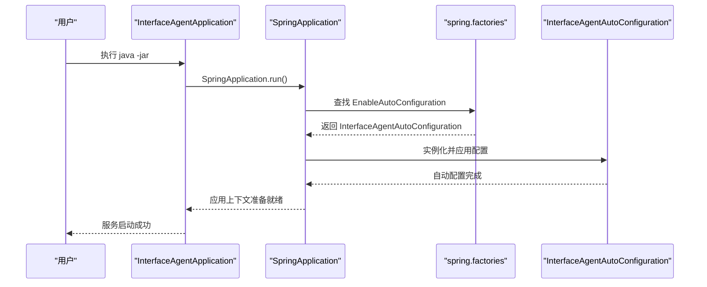
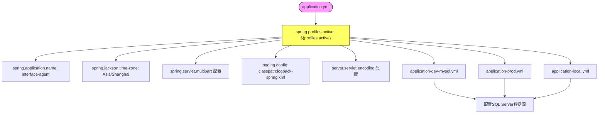
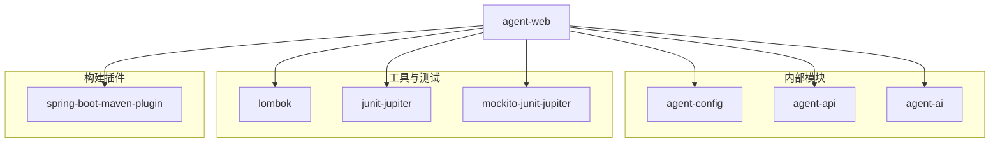

# agent-web 模块

<cite>
**本文档中引用的文件**  
- [InterfaceAgentApplication.java](file://agent-web/src/main/java/com/helianhealth/agent/InterfaceAgentApplication.java)
- [application.yml](file://agent-web/src/main/resources/application.yml)
- [application-dev-mysql.yml](file://agent-web/src/main/resources/application-dev-mysql.yml)
- [application-prod.yml](file://agent-web/src/main/resources/application-prod.yml)
- [application-local.yml](file://agent-web/src/main/resources/application-local.yml)
- [logback-spring.xml](file://agent-web/src/main/resources/logback-spring.xml)
- [pom.xml](file://agent-web/pom.xml)
- [InterfaceAgentAutoConfiguration.java](file://agent-spring-boot-starter/src/main/java/com/helianhealth/agent/starter/InterfaceAgentAutoConfiguration.java)
- [InterfaceAgentProperties.java](file://agent-spring-boot-starter/src/main/java/com/helianhealth/agent/starter/InterfaceAgentProperties.java)
- [spring.factories](file://agent-spring-boot-starter/src/main/resources/META-INF/spring.factories)
</cite>

## 目录
1. [简介](#简介)
2. [项目结构](#项目结构)
3. [核心组件](#核心组件)
4. [架构概述](#架构概述)
5. [详细组件分析](#详细组件分析)
6. [依赖分析](#依赖分析)
7. [性能考虑](#性能考虑)
8. [故障排除指南](#故障排除指南)
9. [结论](#结论)

## 简介
`agent-web` 模块是整个 `interface-agent` 系统的可执行应用入口，负责启动和配置整个应用程序。该模块通过 Spring Boot 的自动配置机制激活 `agent-spring-boot-starter` 中定义的功能，并加载主配置文件 `application.yml` 来设置数据源、日志、服务器端口等核心参数。它还支持多环境配置（如 dev、prod），并通过 Maven 打包为可执行 JAR 文件，使用 `java -jar` 命令即可运行完整服务。

## 项目结构
`agent-web` 模块作为应用的启动入口，包含主启动类、主配置文件以及环境特定的配置文件。其结构清晰，遵循典型的 Spring Boot 应用布局。

```mermaid
graph TD
subgraph "agent-web"
InterfaceAgentApplication["InterfaceAgentApplication.java<br/>主启动类"]
application_yml["application.yml<br/>主配置文件"]
application_dev_mysql["application-dev-mysql.yml<br/>开发环境MySQL配置"]
application_prod["application-prod.yml<br/>生产环境配置"]
application_local["application-local.yml<br/>本地环境配置"]
logback_spring["logback-spring.xml<br/>日志配置"]
pom_xml["pom.xml<br/>Maven构建配置"]
end
InterfaceAgentApplication --> application_yml : "加载配置"
application_yml --> application_dev_mysql : "profile继承"
application_yml --> application_prod : "profile继承"
application_yml --> application_local : "profile继承"
InterfaceAgentApplication --> pom_xml : "指定mainClass"
```

**Diagram sources**
- [InterfaceAgentApplication.java](file://agent-web/src/main/java/com/helianhealth/agent/InterfaceAgentApplication.java)
- [application.yml](file://agent-web/src/main/resources/application.yml)
- [pom.xml](file://agent-web/pom.xml)

**Section sources**
- [InterfaceAgentApplication.java](file://agent-web/src/main/java/com/helianhealth/agent/InterfaceAgentApplication.java)
- [application.yml](file://agent-web/src/main/resources/application.yml)
- [pom.xml](file://agent-web/pom.xml)

## 核心组件

`agent-web` 模块的核心在于 `InterfaceAgentApplication` 主启动类和 `application.yml` 配置文件。主启动类通过 `@SpringBootApplication` 注解启用 Spring Boot 的自动配置机制，而 `application.yml` 则定义了应用的基本行为，包括服务器端口、日志配置和多环境激活策略。

**Section sources**
- [InterfaceAgentApplication.java](file://agent-web/src/main/java/com/helianhealth/agent/InterfaceAgentApplication.java)
- [application.yml](file://agent-web/src/main/resources/application.yml)

## 架构概述

`agent-web` 模块在整个系统中扮演着“门面”角色，它整合了所有其他模块并通过 Spring Boot 启动流程初始化整个应用上下文。其架构依赖于 Spring Boot 的自动配置机制来激活 `agent-spring-boot-starter` 提供的功能。

```mermaid
graph TB
subgraph "agent-web"
Main[InterfaceAgentApplication<br/>主启动类]
Config[application.yml<br/>主配置]
end
subgraph "agent-spring-boot-starter"
AutoConfig[InterfaceAgentAutoConfiguration<br/>自动配置类]
Properties[InterfaceAgentProperties<br/>配置属性]
SpringFactories[spring.factories<br/>自动配置注册]
end
Main --> Config : "加载配置"
Main --> AutoConfig : "@EnableAutoConfiguration"
AutoConfig --> Properties : "@EnableConfigurationProperties"
SpringFactories --> AutoConfig : "注册自动配置"
style Main fill:#f9f,stroke:#333
style Config fill:#bbf,stroke:#333
style AutoConfig fill:#f96,stroke:#333
style Properties fill:#6f9,stroke:#333
style SpringFactories fill:#69f,stroke:#333
```

**Diagram sources**
- [InterfaceAgentApplication.java](file://agent-web/src/main/java/com/helianhealth/agent/InterfaceAgentApplication.java)
- [InterfaceAgentAutoConfiguration.java](file://agent-spring-boot-starter/src/main/java/com/helianhealth/agent/starter/InterfaceAgentAutoConfiguration.java)
- [InterfaceAgentProperties.java](file://agent-spring-boot-starter/src/main/java/com/helianhealth/agent/starter/InterfaceAgentProperties.java)
- [spring.factories](file://agent-spring-boot-starter/src/main/resources/META-INF/spring.factories)

## 详细组件分析

### 主启动类分析

`InterfaceAgentApplication` 是整个应用的入口点，使用标准的 Spring Boot 启动模式。

```mermaid
classDiagram
class InterfaceAgentApplication {
+main(String[] args)
}
note right of InterfaceAgentApplication
主启动类
使用 @SpringBootApplication 注解
调用 SpringApplication.run() 启动应用
end
```

**Diagram sources**
- [InterfaceAgentApplication.java](file://agent-web/src/main/java/com/helianhealth/agent/InterfaceAgentApplication.java)

#### 自动配置机制分析

`agent-spring-boot-starter` 模块通过 `spring.factories` 文件向 Spring Boot 注册自动配置类，从而在 `agent-web` 启动时被自动加载。



**Diagram sources**
- [InterfaceAgentApplication.java](file://agent-web/src/main/java/com/helianhealth/agent/InterfaceAgentApplication.java)
- [spring.factories](file://agent-spring-boot-starter/src/main/resources/META-INF/spring.factories)
- [InterfaceAgentAutoConfiguration.java](file://agent-spring-boot-starter/src/main/java/com/helianhealth/agent/starter/InterfaceAgentAutoConfiguration.java)

#### 配置文件结构分析

`application.yml` 是主配置文件，定义了应用名称、Jackson 序列化时区、Multipart 配置等全局设置，并通过 `spring.profiles.active` 指定当前激活的环境。



**Diagram sources**
- [application.yml](file://agent-web/src/main/resources/application.yml)
- [application-dev-mysql.yml](file://agent-web/src/main/resources/application-dev-mysql.yml)
- [application-prod.yml](file://agent-web/src/main/resources/application-prod.yml)
- [application-local.yml](file://agent-web/src/main/resources/application-local.yml)

**Section sources**
- [application.yml](file://agent-web/src/main/resources/application.yml)
- [application-dev-mysql.yml](file://agent-web/src/main/resources/application-dev-mysql.yml)
- [application-prod.yml](file://agent-web/src/main/resources/application-prod.yml)
- [application-local.yml](file://agent-web/src/main/resources/application-local.yml)

### 日志配置分析

日志系统通过 `logback-spring.xml` 进行配置，支持控制台输出和文件滚动记录，区分 INFO 和 ERROR 级别日志。

```mermaid
classDiagram
class logback-spring.xml {
+ConsoleAppender
+RollingFileInfo
+RollingFileError
+Root Logger(Level=INFO)
}
note right of logback-spring.xml
日志配置文件
定义了控制台和文件输出
支持按大小和时间滚动
区分INFO和ERROR日志
end
```

**Diagram sources**
- [logback-spring.xml](file://agent-web/src/main/resources/logback-spring.xml)

**Section sources**
- [logback-spring.xml](file://agent-web/src/main/resources/logback-spring.xml)

## 依赖分析

`agent-web` 模块依赖于多个内部模块和外部库，通过 Maven 进行管理。



**Diagram sources**
- [pom.xml](file://agent-web/pom.xml)

**Section sources**
- [pom.xml](file://agent-web/pom.xml)

## 性能考虑

`agent-web` 模块本身不包含复杂的业务逻辑，其性能主要取决于所集成的模块和配置。通过使用 Druid 数据源连接池、PageHelper 分页插件和合理的日志级别设置，系统在高并发场景下仍能保持良好性能。建议在生产环境中监控数据库连接池状态和日志输出量。

## 故障排除指南

当 `agent-web` 模块启动失败时，应首先检查以下方面：
- 确认 `spring.profiles.active` 环境变量是否正确设置
- 检查对应环境的数据库连接配置是否正确（URL、用户名、密码）
- 验证数据库驱动是否与配置的数据库类型匹配
- 查看日志文件（`interface-agent_info.log` 和 `interface-agent_error.log`）获取详细错误信息
- 确保 `spring.factories` 文件正确注册了自动配置类

**Section sources**
- [application.yml](file://agent-web/src/main/resources/application.yml)
- [logback-spring.xml](file://agent-web/src/main/resources/logback-spring.xml)

## 结论

`agent-web` 模块作为 `interface-agent` 系统的可执行入口，通过 Spring Boot 的自动配置机制成功整合了 `agent-spring-boot-starter` 和其他功能模块。其灵活的多环境配置体系支持开发、测试和生产环境的无缝切换，而标准化的打包和启动方式使得部署变得简单可靠。该模块的设计体现了现代微服务架构的最佳实践，为系统的稳定运行提供了坚实基础。