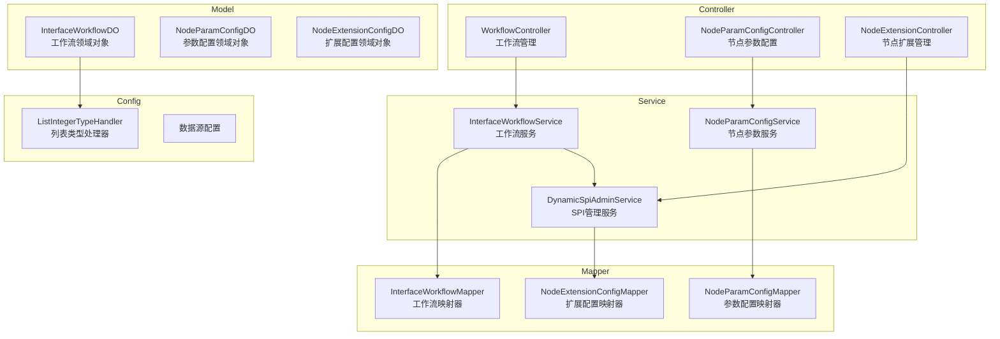
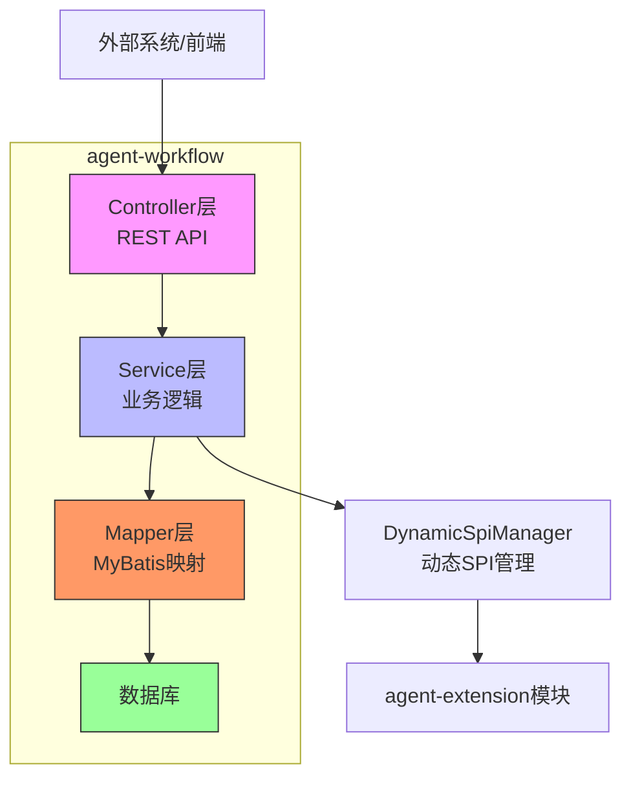
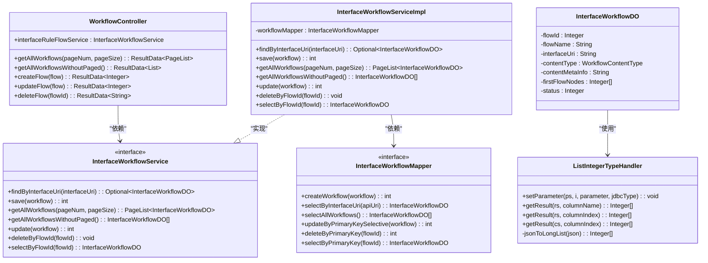
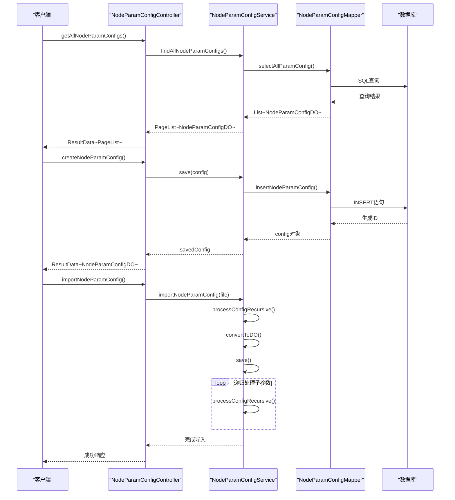
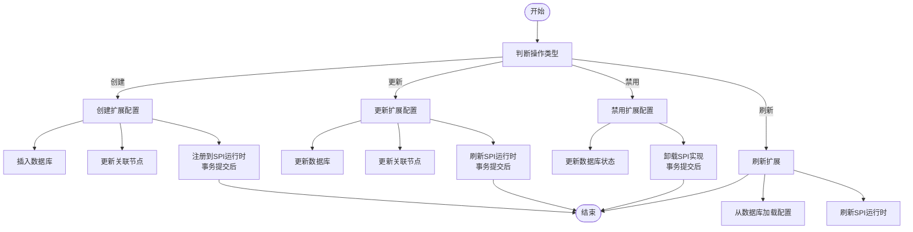
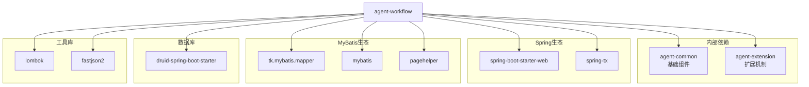

# agent-workflow 模块

<cite>
**本文档引用文件**  
- [WorkflowController.java](file://agent-workflow/src/main/java/com/helianhealth/agent/workflow/controller/WorkflowController.java)
- [InterfaceWorkflowDO.java](file://agent-workflow/src/main/java/com/helianhealth/agent/workflow/model/domain/InterfaceWorkflowDO.java)
- [InterfaceWorkflowServiceImpl.java](file://agent-workflow/src/main/java/com/helianhealth/agent/workflow/service/impl/InterfaceWorkflowServiceImpl.java)
- [NodeParamConfigController.java](file://agent-workflow/src/main/java/com/helianhealth/agent/workflow/controller/NodeParamConfigController.java)
- [NodeExtensionController.java](file://agent-workflow/src/main/java/com/helianhealth/agent/workflow/controller/NodeExtensionController.java)
- [NodeParamConfigDO.java](file://agent-workflow/src/main/java/com/helianhealth/agent/workflow/model/domain/NodeParamConfigDO.java)
- [NodeExtensionConfigDO.java](file://agent-workflow/src/main/java/com/helianhealth/agent/workflow/model/domain/NodeExtensionConfigDO.java)
- [InterfaceWorkflowMapper.xml](file://agent-workflow/src/main/resources/mapper/agent/InterfaceWorkflowMapper.xml)
- [NodeParamConfigMapper.xml](file://agent-workflow/src/main/resources/mapper/agent/NodeParamConfigMapper.xml)
- [ListIntegerTypeHandler.java](file://agent-workflow/src/main/java/com/helianhealth/agent/workflow/config/ListIntegerTypeHandler.java)
- [DynamicSpiAdminService.java](file://agent-workflow/src/main/java/com/helianhealth/agent/workflow/service/extension/DynamicSpiAdminService.java)
- [NodeParamConfigServiceImpl.java](file://agent-workflow/src/main/java/com/helianhealth/agent/workflow/service/impl/NodeParamConfigServiceImpl.java)
- [pom.xml](file://agent-workflow/pom.xml)
</cite>

## 目录
1. [简介](#简介)
2. [项目结构](#项目结构)
3. [核心组件](#核心组件)
4. [架构概述](#架构概述)
5. [详细组件分析](#详细组件分析)
6. [依赖分析](#依赖分析)
7. [性能考虑](#性能考虑)
8. [故障排除指南](#故障排除指南)
9. [结论](#结论)

## 简介
agent-workflow 模块是接口代理系统中的工作流配置中心，负责管理接口工作流、节点参数配置和扩展功能。该模块提供 REST API 接口用于创建、更新、查询和删除工作流及节点参数配置，并通过 MyBatis 实现数据持久化操作。模块与其他组件如 schedule、invocation 协同工作，支持动态 SPI 扩展机制，允许在运行时注册和管理自定义扩展。

## 项目结构
agent-workflow 模块采用典型的分层架构设计，包含 controller、service、mapper、model 等目录。controller 层提供 REST API 接口，service 层处理业务逻辑，mapper 层负责数据库操作，model 层定义数据对象。模块通过 MyBatis 实现 ORM 映射，使用 PageHelper 进行分页处理，并集成 agent-extension 模块实现动态 SPI 扩展功能。

**图示来源**
- [WorkflowController.java](file://agent-workflow/src/main/java/com/helianhealth/agent/workflow/controller/WorkflowController.java)
- [InterfaceWorkflowServiceImpl.java](file://agent-workflow/src/main/java/com/helianhealth/agent/workflow/service/impl/InterfaceWorkflowServiceImpl.java)
- [NodeParamConfigServiceImpl.java](file://agent-workflow/src/main/java/com/helianhealth/agent/workflow/service/impl/NodeParamConfigServiceImpl.java)
- [DynamicSpiAdminService.java](file://agent-workflow/src/main/java/com/helianhealth/agent/workflow/service/extension/DynamicSpiAdminService.java)

**本节来源**
- [agent-workflow/src/main/java](file://agent-workflow/src/main/java)

## 核心组件

agent-workflow 模块的核心组件包括工作流管理、节点参数配置和节点扩展管理三大功能模块。工作流管理提供对工作流的增删改查操作，节点参数配置实现对工作流节点参数的映射和转换规则配置，节点扩展管理支持动态 SPI 扩展的注册和热更新。这些组件通过 REST API 暴露功能，使用 MyBatis 进行数据库操作，并与 agent-extension 模块集成实现动态扩展能力。

**本节来源**
- [WorkflowController.java](file://agent-workflow/src/main/java/com/helianhealth/agent/workflow/controller/WorkflowController.java)
- [NodeParamConfigController.java](file://agent-workflow/src/main/java/com/helianhealth/agent/workflow/controller/NodeParamConfigController.java)
- [NodeExtensionController.java](file://agent-workflow/src/main/java/com/helianhealth/agent/workflow/controller/NodeExtensionController.java)

## 架构概述

agent-workflow 模块采用分层架构设计，从上至下分为控制器层、服务层、数据访问层和模型层。控制器层暴露 REST API 接口，服务层封装业务逻辑，数据访问层通过 MyBatis 实现数据库操作，模型层定义领域对象。模块通过 ListIntegerTypeHandler 自定义类型处理器解决 List<Integer> 类型的序列化问题，使用 DynamicSpiAdminService 实现与 agent-extension 模块的集成，支持动态 SPI 扩展的创建、更新和删除。

**图示来源**
- [WorkflowController.java](file://agent-workflow/src/main/java/com/helianhealth/agent/workflow/controller/WorkflowController.java)
- [InterfaceWorkflowServiceImpl.java](file://agent-workflow/src/main/java/com/helianhealth/agent/workflow/service/impl/InterfaceWorkflowServiceImpl.java)
- [DynamicSpiAdminService.java](file://agent-workflow/src/main/java/com/helianhealth/agent/workflow/service/extension/DynamicSpiAdminService.java)

## 详细组件分析

### 工作流管理分析
工作流管理功能由 WorkflowController、InterfaceWorkflowService 和 InterfaceWorkflowMapper 组件协同实现。WorkflowController 提供 REST API 接口，InterfaceWorkflowService 处理业务逻辑，InterfaceWorkflowMapper 执行数据库操作。该功能支持工作流的创建、更新、查询和删除操作，通过 PageHelper 实现分页查询，使用自定义的 ListIntegerTypeHandler 处理 firstFlowNodes 字段的序列化。

#### 工作流管理类图

**图示来源**
- [WorkflowController.java](file://agent-workflow/src/main/java/com/helianhealth/agent/workflow/controller/WorkflowController.java)
- [InterfaceWorkflowServiceImpl.java](file://agent-workflow/src/main/java/com/helianhealth/agent/workflow/service/impl/InterfaceWorkflowServiceImpl.java)
- [InterfaceWorkflowDO.java](file://agent-workflow/src/main/java/com/helianhealth/agent/workflow/model/domain/InterfaceWorkflowDO.java)
- [ListIntegerTypeHandler.java](file://agent-workflow/src/main/java/com/helianhealth/agent/workflow/config/ListIntegerTypeHandler.java)

**本节来源**
- [WorkflowController.java](file://agent-workflow/src/main/java/com/helianhealth/agent/workflow/controller/WorkflowController.java)
- [InterfaceWorkflowServiceImpl.java](file://agent-workflow/src/main/java/com/helianhealth/agent/workflow/service/impl/InterfaceWorkflowServiceImpl.java)
- [InterfaceWorkflowMapper.xml](file://agent-workflow/src/main/resources/mapper/agent/InterfaceWorkflowMapper.xml)

### 节点参数配置分析
节点参数配置功能由 NodeParamConfigController、NodeParamConfigService 和 NodeParamConfigMapper 组件实现。该功能支持对工作流节点的参数进行前置和后置处理配置，包括参数映射、类型转换、排序等。服务层提供分页查询、创建、更新和删除操作，支持从 JSON 文件批量导入配置，并通过递归方式处理参数的父子层级关系。

#### 节点参数配置序列图

**图示来源**
- [NodeParamConfigController.java](file://agent-workflow/src/main/java/com/helianhealth/agent/workflow/controller/NodeParamConfigController.java)
- [NodeParamConfigServiceImpl.java](file://agent-workflow/src/main/java/com/helianhealth/agent/workflow/service/impl/NodeParamConfigServiceImpl.java)
- [NodeParamConfigMapper.xml](file://agent-workflow/src/main/resources/mapper/agent/NodeParamConfigMapper.xml)

**本节来源**
- [NodeParamConfigController.java](file://agent-workflow/src/main/java/com/helianhealth/agent/workflow/controller/NodeParamConfigController.java)
- [NodeParamConfigServiceImpl.java](file://agent-workflow/src/main/java/com/helianhealth/agent/workflow/service/impl/NodeParamConfigServiceImpl.java)
- [NodeParamConfigMapper.xml](file://agent-workflow/src/main/resources/mapper/agent/NodeParamConfigMapper.xml)

### 节点扩展管理分析
节点扩展管理功能由 NodeExtensionController 和 DynamicSpiAdminService 组件实现。该功能支持动态 SPI 扩展的注册、更新、禁用和卸载操作，通过事务同步机制确保数据库状态与运行时状态的一致性。当创建或更新扩展配置时，系统会在事务提交后自动注册或刷新 SPI 实现；当禁用扩展时，会在事务提交后卸载 SPI 实现。

#### 节点扩展管理流程图

**图示来源**
- [NodeExtensionController.java](file://agent-workflow/src/main/java/com/helianhealth/agent/workflow/controller/NodeExtensionController.java)
- [DynamicSpiAdminService.java](file://agent-workflow/src/main/java/com/helianhealth/agent/workflow/service/extension/DynamicSpiAdminService.java)

**本节来源**
- [NodeExtensionController.java](file://agent-workflow/src/main/java/com/helianhealth/agent/workflow/controller/NodeExtensionController.java)
- [DynamicSpiAdminService.java](file://agent-workflow/src/main/java/com/helianhealth/agent/workflow/service/extension/DynamicSpiAdminService.java)

## 依赖分析

agent-workflow 模块依赖多个内部和外部组件。内部依赖包括 agent-common（提供基础工具和枚举）、agent-extension（提供动态 SPI 功能）；外部依赖包括 Spring Boot 生态（web、tx）、MyBatis 生态（mapper、pagehelper）、Druid（数据库连接池）、Fastjson2（JSON 处理）和 Lombok（代码生成）。模块通过 Maven 依赖管理确保版本一致性，并使用 Spring 的依赖注入机制实现组件间的松耦合。

**图示来源**
- [pom.xml](file://agent-workflow/pom.xml)

**本节来源**
- [pom.xml](file://agent-workflow/pom.xml)

## 性能考虑

agent-workflow 模块在性能方面采取了多项优化措施。首先，使用 PageHelper 实现分页查询，避免一次性加载大量数据导致内存溢出。其次，通过 MyBatis 的一级缓存减少重复数据库查询。对于节点参数配置的批量导入操作，采用递归处理方式支持复杂的父子层级结构，同时通过事务管理确保数据一致性。在动态 SPI 扩展管理中，使用事务同步机制将运行时注册操作延迟到事务提交后执行，避免在事务回滚时出现数据库状态与运行时状态不一致的问题。

此外，模块通过自定义的 ListIntegerTypeHandler 实现 List<Integer> 类型的高效序列化和反序列化，使用 Fastjson2 提供高性能的 JSON 处理能力。对于频繁查询的接口，如工作流列表查询，可以考虑添加二级缓存进一步提升性能。在高并发场景下，建议对数据库连接池（Druid）进行合理配置，确保足够的连接数支持并发请求。

**本节来源**
- [InterfaceWorkflowServiceImpl.java](file://agent-workflow/src/main/java/com/helianhealth/agent/workflow/service/impl/InterfaceWorkflowServiceImpl.java)
- [NodeParamConfigServiceImpl.java](file://agent-workflow/src/main/java/com/helianhealth/agent/workflow/service/impl/NodeParamConfigServiceImpl.java)
- [ListIntegerTypeHandler.java](file://agent-workflow/src/main/java/com/helianhealth/agent/workflow/config/ListIntegerTypeHandler.java)

## 故障排除指南

在使用 agent-workflow 模块时可能遇到以下常见问题及解决方案：

1. **工作流创建失败**：检查请求参数是否完整，特别是 flowName、interfaceUri 等必填字段。查看日志中是否有数据库约束违反错误，如唯一键冲突。

2. **节点参数导入失败**：确认 JSON 文件格式正确，符合 NodeParamConfigImportDTO 的结构要求。检查文件编码是否为 UTF-8，确保特殊字符正确处理。

3. **动态扩展注册失败**：验证源代码的语法正确性，确保类名、接口名与配置一致。检查是否有依赖的类路径问题，确认扩展模式（PROJECT/ONLINE）设置正确。

4. **分页查询结果异常**：确认 pageNum 和 pageSize 参数在合理范围内，避免过大页码导致性能问题。检查数据库连接是否正常，确认 PageHelper 配置正确。

5. **事务同步问题**：当数据库操作成功但运行时注册失败时，系统会出现状态不一致。建议实现监控机制，定期比对数据库配置与运行时注册状态。

**本节来源**
- [WorkflowController.java](file://agent-workflow/src/main/java/com/helianhealth/agent/workflow/controller/WorkflowController.java)
- [NodeParamConfigController.java](file://agent-workflow/src/main/java/com/helianhealth/agent/workflow/controller/NodeParamConfigController.java)
- [DynamicSpiAdminService.java](file://agent-workflow/src/main/java/com/helianhealth/agent/workflow/service/extension/DynamicSpiAdminService.java)

## 结论

agent-workflow 模块作为工作流配置中心，提供了完整的工作流管理、节点参数配置和动态扩展功能。模块采用分层架构设计，通过 REST API 暴露服务，使用 MyBatis 实现数据持久化，并与 agent-extension 模块集成支持动态 SPI 扩展。核心功能包括工作流的增删改查、节点参数的映射配置、批量导入导出以及动态扩展的热更新。模块在性能方面通过分页查询、缓存机制和高效的序列化处理确保系统稳定性，在可靠性方面通过事务管理确保数据一致性。该模块为接口代理系统提供了灵活的工作流配置能力，支持复杂业务场景下的接口集成需求。