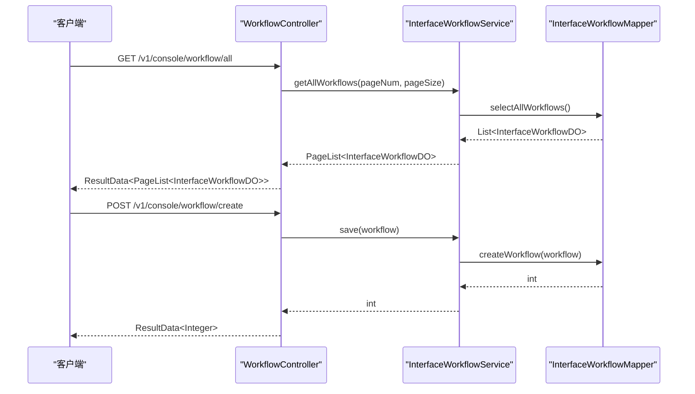
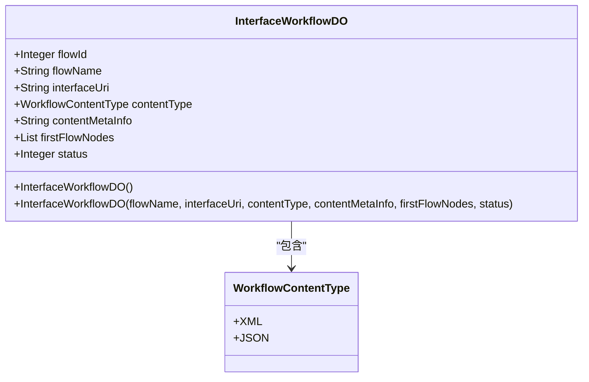
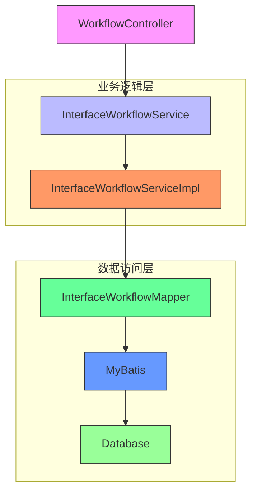
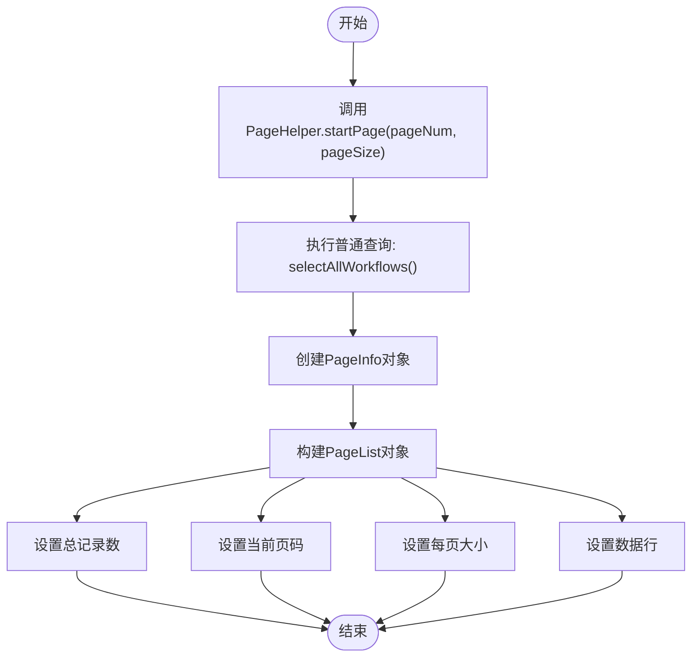

# 工作流管理

<cite>
**本文档引用文件**   
- [WorkflowController.java](file://agent-workflow/src/main/java/com/helianhealth/agent/workflow/controller/WorkflowController.java)
- [InterfaceWorkflowDO.java](file://agent-workflow/src/main/java/com/helianhealth/agent/workflow/model/domain/InterfaceWorkflowDO.java)
- [InterfaceWorkflowServiceImpl.java](file://agent-workflow/src/main/java/com/helianhealth/agent/workflow/service/impl/InterfaceWorkflowServiceImpl.java)
- [InterfaceWorkflowMapper.java](file://agent-workflow/src/main/java/com/helianhealth/agent/workflow/mapper/agent/InterfaceWorkflowMapper.java)
- [InterfaceWorkflowMapper.xml](file://agent-workflow/src/main/resources/mapper/agent/InterfaceWorkflowMapper.xml)
- [ListIntegerTypeHandler.java](file://agent-workflow/src/main/java/com/helianhealth/agent/workflow/config/ListIntegerTypeHandler.java)
- [WorkflowContentType.java](file://agent-common/src/main/java/com/helianhealth/agent/common/enums/WorkflowContentType.java)
- [PageList.java](file://agent-common/src/main/java/com/helianhealth/agent/common/base/PageList.java)
- [ResultData.java](file://agent-common/src/main/java/com/helianhealth/agent/common/base/ResultData.java)
- [ResponseRenderUtils.java](file://agent-common/src/main/java/com/helianhealth/agent/common/utils/ResponseRenderUtils.java)
- [init_mysql.sql](file://doc/init_mysql.sql)
- [init_gauss.sql](file://doc/init_gauss.sql)
- [init_sqlserver.sql](file://doc/init_sqlserver.sql)
</cite>

## 目录
1. [工作流管理API接口](#工作流管理api接口)
2. [实体类与数据库映射](#实体类与数据库映射)
3. [服务层实现与数据交互](#服务层实现与数据交互)
4. [分页逻辑处理](#分页逻辑处理)
5. [实际应用示例](#实际应用示例)
6. [高并发场景下的优化建议](#高并发场景下的优化建议)

## 工作流管理API接口

`WorkflowController`类定义了工作流管理的核心REST API接口，位于`/v1/console/workflow`路径下。该控制器通过依赖注入`InterfaceWorkflowService`服务来处理所有工作流相关的CRUD操作。

控制器提供了以下主要接口：

- **获取工作流列表（分页）**: `GET /v1/console/workflow/all`，支持分页查询，接收`pageNum`和`pageSize`参数
- **获取工作流列表（不分页）**: `GET /v1/console/workflow/all-unpaged`，返回所有启用的工作流
- **创建工作流**: `POST /v1/console/workflow/create`，接收`InterfaceWorkflowDO`对象作为请求体
- **更新工作流**: `POST /v1/console/workflow/update`，接收`InterfaceWorkflowDO`对象作为请求体
- **删除工作流**: `DELETE /v1/console/workflow/delete/{flowId}`，通过路径变量指定要删除的工作流ID

所有接口都遵循统一的响应格式，使用`ResultData`包装返回结果，并通过`ResponseRenderUtils`工具类进行渲染。异常处理采用统一的try-catch块，捕获异常后记录错误日志并返回错误信息。



**图示来源**
- [WorkflowController.java](file://agent-workflow/src/main/java/com/helianhealth/agent/workflow/controller/WorkflowController.java#L35-L45)
- [InterfaceWorkflowServiceImpl.java](file://agent-workflow/src/main/java/com/helianhealth/agent/workflow/service/impl/InterfaceWorkflowServiceImpl.java#L38-L57)
- [InterfaceWorkflowMapper.java](file://agent-workflow/src/main/java/com/helianhealth/agent/workflow/mapper/agent/InterfaceWorkflowMapper.java#L12-L14)

**本节来源**
- [WorkflowController.java](file://agent-workflow/src/main/java/com/helianhealth/agent/workflow/controller/WorkflowController.java#L28-L103)

## 实体类与数据库映射

`InterfaceWorkflowDO`是工作流的核心实体类，使用Lombok注解简化代码，并通过JPA注解与数据库表`interface_workflow`进行映射。

### 实体类字段说明

| 字段名 | 类型 | 数据库列名 | 说明 |
|--------|------|------------|------|
| flowId | Integer | flow_id | 工作流ID，自增主键 |
| flowName | String | flow_name | 工作流名称 |
| interfaceUri | String | interface_uri | 接口URI，与工作流一对一映射 |
| contentType | WorkflowContentType | content_type | 入参格式，枚举类型（JSON/XML） |
| contentMetaInfo | String | content_meta_info | 内容元数据信息 |
| firstFlowNodes | List<Integer> | first_flow_nodes | 工作流首节点ID列表 |
| status | Integer | status | 状态标识，1-启用，0-禁用 |

### 数据库表结构

根据不同数据库的初始化脚本，`interface_workflow`表的结构如下：

```sql
-- MySQL/PostgreSQL/GaussDB 共同字段
CREATE TABLE interface_workflow (
    flow_id INT NOT NULL AUTO_INCREMENT PRIMARY KEY,
    flow_name VARCHAR(100) NULL,
    interface_uri VARCHAR(150) NULL,
    content_type VARCHAR(20) NULL,
    content_meta_info VARCHAR(255) NULL,
    first_flow_nodes VARCHAR(50) NULL,
    status INT NOT NULL DEFAULT 1
);
```

**特殊映射处理**：
- `contentType`字段使用`@Enumerated(EnumType.STRING)`注解，将枚举值以字符串形式存储
- `firstFlowNodes`字段使用自定义的`ListIntegerTypeHandler`类型处理器，将`List<Integer>`序列化为JSON字符串存储在VARCHAR字段中



**图示来源**
- [InterfaceWorkflowDO.java](file://agent-workflow/src/main/java/com/helianhealth/agent/workflow/model/domain/InterfaceWorkflowDO.java#L29-L73)
- [WorkflowContentType.java](file://agent-common/src/main/java/com/helianhealth/agent/common/enums/WorkflowContentType.java#L9-L14)
- [init_mysql.sql](file://doc/init_mysql.sql#L4-L19)

**本节来源**
- [InterfaceWorkflowDO.java](file://agent-workflow/src/main/java/com/helianhealth/agent/workflow/model/domain/InterfaceWorkflowDO.java#L24-L73)
- [WorkflowContentType.java](file://agent-common/src/main/java/com/helianhealth/agent/common/enums/WorkflowContentType.java#L9-L14)
- [init_mysql.sql](file://doc/init_mysql.sql#L4-L19)
- [init_gauss.sql](file://doc/init_gauss.sql#L2-L18)
- [init_sqlserver.sql](file://doc/init_sqlserver.sql#L2-L18)

## 服务层实现与数据交互

`InterfaceWorkflowServiceImpl`是工作流服务的实现类，遵循Spring的组件模型，通过依赖注入`InterfaceWorkflowMapper`与MyBatis进行数据交互。

### 服务接口定义

`InterfaceWorkflowService`接口定义了所有工作流操作的方法契约：

```java
public interface InterfaceWorkflowService {
    Optional<InterfaceWorkflowDO> findByInterfaceUri(String interfaceUri);
    int save(InterfaceWorkflowDO interfaceInstanceDO);
    PageList<InterfaceWorkflowDO> getAllWorkflows(int pageNum, int pageSize);
    List<InterfaceWorkflowDO> getAllWorkflowsWithoutPaged();
    int update(InterfaceWorkflowDO interfaceInstanceDO);
    void deleteByFlowId(Integer flowId);
    InterfaceWorkflowDO selectByFlowId(Integer flowId);
}
```

### 数据访问实现

服务层通过`InterfaceWorkflowMapper`接口与MyBatis交互，该接口继承自`tk.mybatis.mapper.common.Mapper`，自动获得基本的CRUD方法。同时，它还定义了特定于工作流的查询方法：

- `selectByInterfaceUri`: 根据接口URI查询工作流
- `selectAllWorkflows`: 查询所有启用的工作流
- `createWorkflow`: 创建新工作流

MyBatis的SQL映射在`InterfaceWorkflowMapper.xml`文件中定义，包括：

- `createWorkflow`插入语句，使用`useGeneratedKeys="true"`获取自增主键
- `selectByInterfaceUri`和`selectAllWorkflows`查询语句，都包含`status = 1`条件，只返回启用的工作流



**图示来源**
- [InterfaceWorkflowService.java](file://agent-workflow/src/main/java/com/helianhealth/agent/workflow/service/InterfaceWorkflowService.java#L9-L24)
- [InterfaceWorkflowServiceImpl.java](file://agent-workflow/src/main/java/com/helianhealth/agent/workflow/service/impl/InterfaceWorkflowServiceImpl.java#L19-L89)
- [InterfaceWorkflowMapper.java](file://agent-workflow/src/main/java/com/helianhealth/agent/workflow/mapper/agent/InterfaceWorkflowMapper.java#L8-L15)
- [InterfaceWorkflowMapper.xml](file://agent-workflow/src/main/resources/mapper/agent/InterfaceWorkflowMapper.xml#L21-L54)

**本节来源**
- [InterfaceWorkflowServiceImpl.java](file://agent-workflow/src/main/java/com/helianhealth/agent/workflow/service/impl/InterfaceWorkflowServiceImpl.java#L19-L89)
- [InterfaceWorkflowService.java](file://agent-workflow/src/main/java/com/helianhealth/agent/workflow/service/InterfaceWorkflowService.java#L9-L24)
- [InterfaceWorkflowMapper.java](file://agent-workflow/src/main/java/com/helianhealth/agent/workflow/mapper/agent/InterfaceWorkflowMapper.java#L8-L15)
- [InterfaceWorkflowMapper.xml](file://agent-workflow/src/main/resources/mapper/agent/InterfaceWorkflowMapper.xml#L21-L54)

## 分页逻辑处理

系统使用`PageHelper`插件实现分页功能，这是一种MyBatis的分页插件，能够自动拦截SQL查询并添加分页条件。

### 分页实现机制

在`InterfaceWorkflowServiceImpl`的`getAllWorkflows`方法中，分页逻辑的实现步骤如下：

1. 调用`PageHelper.startPage(pageNum, pageSize)`开启分页
2. 执行普通的列表查询`workflowMapper.selectAllWorkflows()`
3. 将查询结果包装为`PageInfo`对象
4. 构建`PageList`对象，设置总记录数、当前页码、每页大小和数据行

`PageList`是系统自定义的分页结果包装类，包含以下字段：
- `total`: 总记录数
- `pageNum`: 当前页码
- `pageSize`: 每页大小
- `rows`: 当前页的数据列表

### 分页流程图



**图示来源**
- [InterfaceWorkflowServiceImpl.java](file://agent-workflow/src/main/java/com/helianhealth/agent/workflow/service/impl/InterfaceWorkflowServiceImpl.java#L40-L52)
- [PageList.java](file://agent-common/src/main/java/com/helianhealth/agent/common/base/PageList.java#L15-L26)

**本节来源**
- [InterfaceWorkflowServiceImpl.java](file://agent-workflow/src/main/java/com/helianhealth/agent/workflow/service/impl/InterfaceWorkflowServiceImpl.java#L38-L57)
- [PageList.java](file://agent-common/src/main/java/com/helianhealth/agent/common/base/PageList.java#L15-L26)

## 实际应用示例

### 创建工作流实例

通过API创建一个工作流的示例：

**请求**:
```http
POST /v1/console/workflow/create
Content-Type: application/json

{
  "flowName": "患者档案创建工作流",
  "interfaceUri": "/api/v1/patient/archive",
  "contentType": "JSON",
  "contentMetaInfo": "{\"patientCode\":\"string\",\"name\":\"string\"}",
  "firstFlowNodes": [1, 2],
  "status": 1
}
```

**响应**:
```json
{
  "code": "200",
  "message": "OK",
  "rsp": 1
}
```

### 查询工作流列表

**请求**:
```http
GET /v1/console/workflow/all?pageNum=1&pageSize=10
```

**响应**:
```json
{
  "code": "200",
  "message": "OK",
  "rsp": {
    "total": 5,
    "pageNum": 1,
    "pageSize": 10,
    "rows": [
      {
        "flowId": 1,
        "flowName": "患者档案创建工作流",
        "interfaceUri": "/api/v1/patient/archive",
        "contentType": "JSON",
        "contentMetaInfo": "{\"patientCode\":\"string\",\"name\":\"string\"}",
        "firstFlowNodes": [1, 2],
        "status": 1
      }
    ]
  }
}
```

### 更新工作流

**请求**:
```http
POST /v1/console/workflow/update
Content-Type: application/json

{
  "flowId": 1,
  "flowName": "更新后的工作流名称",
  "interfaceUri": "/api/v1/patient/archive",
  "contentType": "JSON",
  "contentMetaInfo": "{\"patientCode\":\"string\",\"name\":\"string\"}",
  "firstFlowNodes": [1, 2],
  "status": 1
}
```

### 删除工作流

**请求**:
```http
DELETE /v1/console/workflow/delete/1
```

**响应**:
```json
{
  "code": "200",
  "message": "OK",
  "rsp": "工作流删除成功"
}
```

**本节来源**
- [WorkflowController.java](file://agent-workflow/src/main/java/com/helianhealth/agent/workflow/controller/WorkflowController.java#L65-L103)
- [InterfaceWorkflowDO.java](file://agent-workflow/src/main/java/com/helianhealth/agent/workflow/model/domain/InterfaceWorkflowDO.java#L24-L73)
- [ResponseRenderUtils.java](file://agent-common/src/main/java/com/helianhealth/agent/common/utils/ResponseRenderUtils.java#L6-L19)
- [ResultData.java](file://agent-common/src/main/java/com/helianhealth/agent/common/base/ResultData.java#L8-L83)

## 高并发场景下的优化建议

### 接口幂等性处理

当前的API设计在创建和更新操作上存在潜在的幂等性问题。建议的优化方案：

1. **创建操作幂等性**：在`createWorkflow`方法中，先根据`interfaceUri`查询是否已存在相同的工作流，如果存在则返回已存在的工作流ID而不是创建新的。
2. **更新操作幂等性**：在更新前先查询原记录，比较关键字段是否有变化，如果没有变化则直接返回成功，避免不必要的数据库更新操作。

### 数据库事务管理

当前的删除操作缺乏事务管理，建议添加`@Transactional`注解确保操作的原子性：

```java
@Override
@Transactional(rollbackFor = Exception.class)
public void deleteByFlowId(Integer flowId) {
    // 验证参数
    if (flowId == null) {
        throw new IllegalArgumentException("参数不能为空，flowId 必须存在");
    }
    
    // 可以在这里添加级联删除逻辑
    // nodeParamConfigMapper.deleteByFlowId(flowId);
    // interfaceFlowNodeMapper.deleteByFlowId(flowId);
    
    // 执行删除操作
    workflowMapper.deleteByPrimaryKey(flowId);
}
```

### 性能优化建议

1. **查询缓存**：对于频繁查询但不经常变更的工作流数据，可以引入Redis缓存，减少数据库压力。
2. **批量操作支持**：增加批量创建、批量更新和批量删除接口，减少网络往返次数。
3. **索引优化**：确保`interface_uri`和`status`字段上有适当的数据库索引，提高查询性能。
4. **连接池配置**：优化数据库连接池配置，确保在高并发场景下有足够的连接资源。

### 异常处理增强

1. **细化异常类型**：目前的异常处理较为笼统，建议根据不同的业务场景抛出更具体的异常。
2. **参数校验**：在服务层增加更严格的参数校验，避免无效数据进入数据库。
3. **日志记录**：增强日志记录，特别是在关键操作前后记录操作详情，便于问题排查。

**本节来源**
- [InterfaceWorkflowServiceImpl.java](file://agent-workflow/src/main/java/com/helianhealth/agent/workflow/service/impl/InterfaceWorkflowServiceImpl.java#L69-L88)
- [WorkflowController.java](file://agent-workflow/src/main/java/com/helianhealth/agent/workflow/controller/WorkflowController.java#L93-L103)
- [InterfaceWorkflowDO.java](file://agent-workflow/src/main/java/com/helianhealth/agent/workflow/model/domain/InterfaceWorkflowDO.java#L24-L73)
- [WorkflowBusinessException.java](file://agent-common/src/main/java/com/helianhealth/agent/common/exception/WorkflowBusinessException.java#L6-L40)