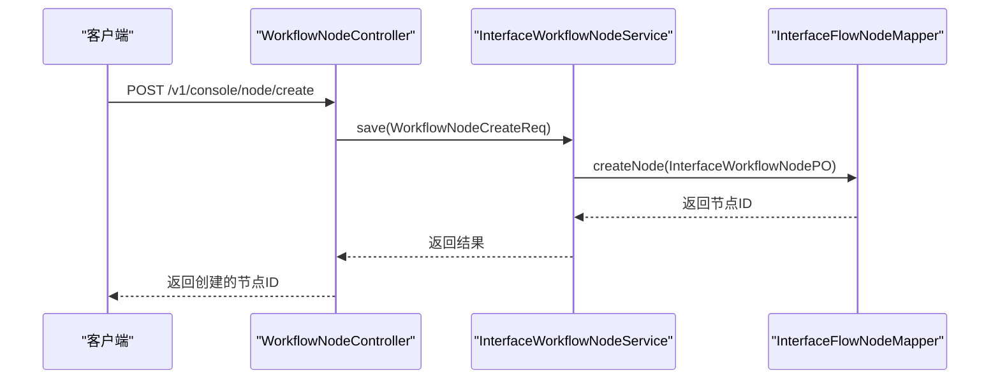
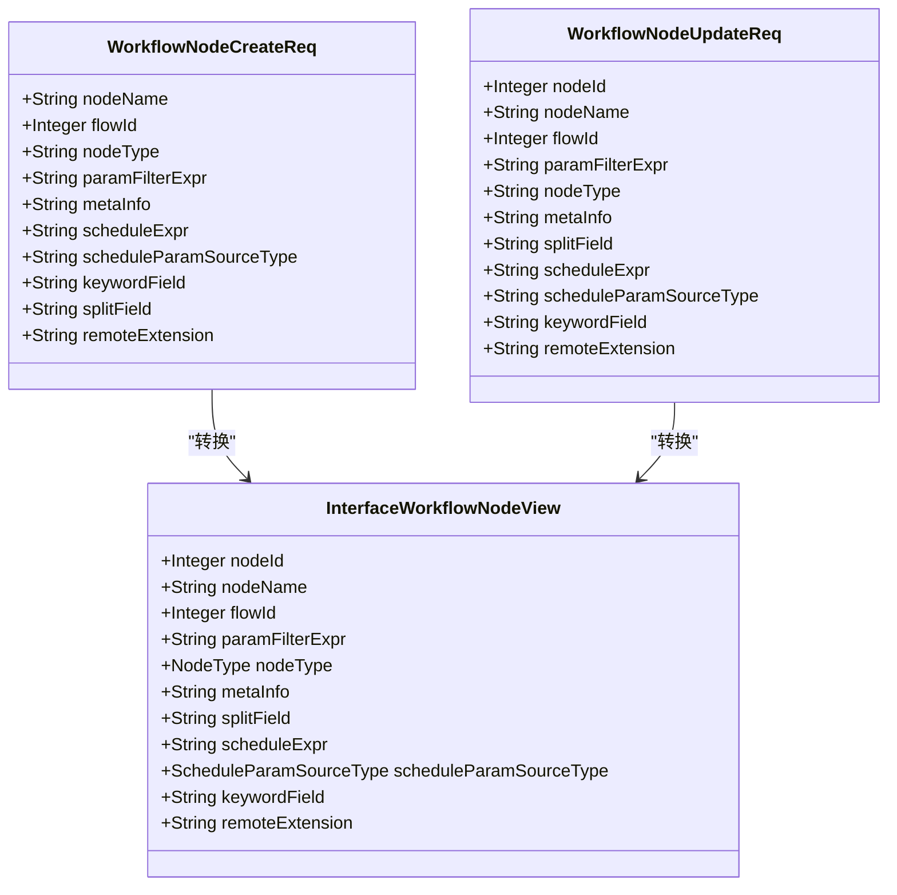
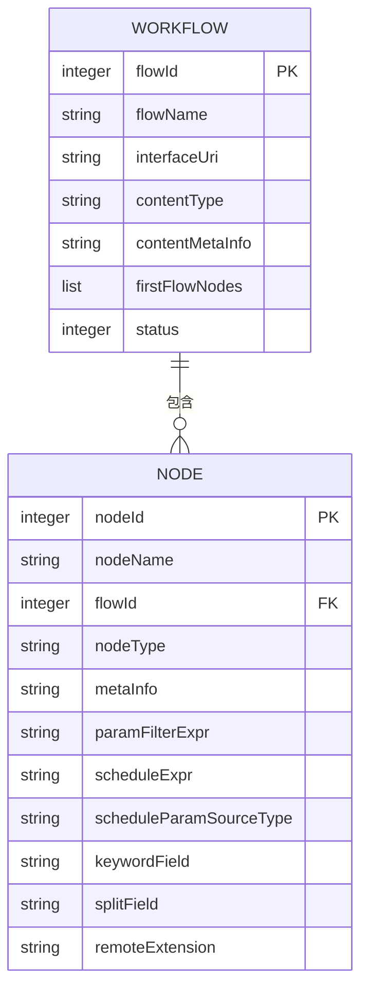
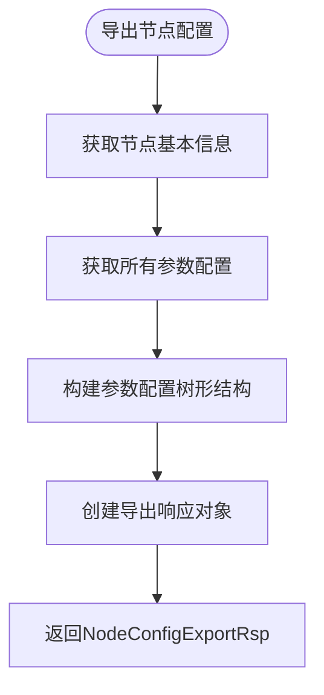
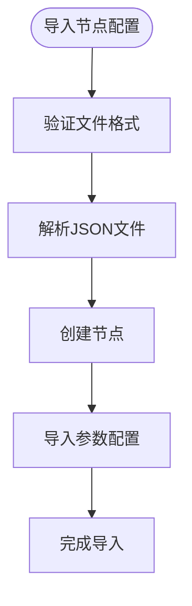
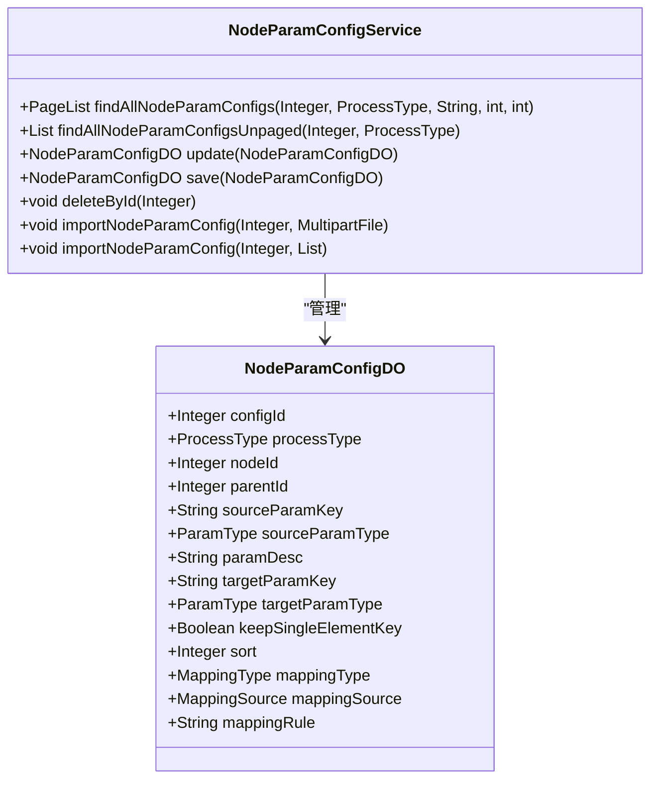
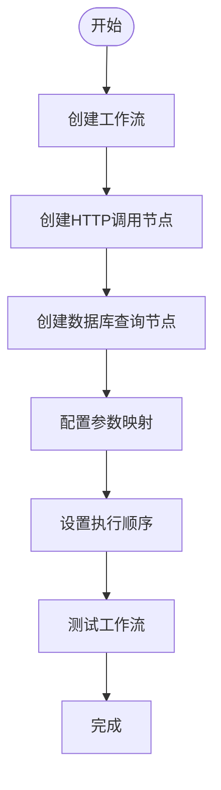
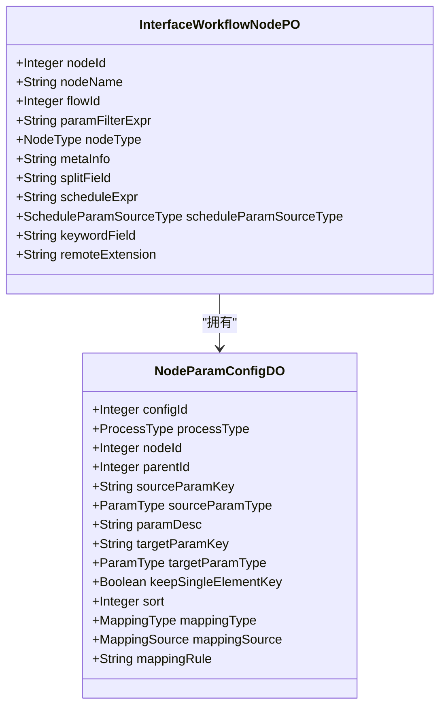

# 工作流节点管理

<cite>
**本文档引用的文件**
- [WorkflowNodeController.java](file://agent-workflow/src/main/java/com/helianhealth/agent/workflow/controller/WorkflowNodeController.java)
- [NodeParamConfigController.java](file://agent-workflow/src/main/java/com/helianhealth/agent/workflow/controller/NodeParamConfigController.java)
- [InterfaceWorkflowNodeService.java](file://agent-workflow/src/main/java/com/helianhealth/agent/workflow/service/InterfaceWorkflowNodeService.java)
- [InterfaceWorkflowNodeServiceImpl.java](file://agent-workflow/src/main/java/com/helianhealth/agent/workflow/service/impl/InterfaceWorkflowNodeServiceImpl.java)
- [WorkflowNodeCreateReq.java](file://agent-workflow/src/main/java/com/helianhealth/agent/workflow/controller/request/WorkflowNodeCreateReq.java)
- [WorkflowNodeUpdateReq.java](file://agent-workflow/src/main/java/com/helianhealth/agent/workflow/controller/request/WorkflowNodeUpdateReq.java)
- [NodeParamConfigDO.java](file://agent-workflow/src/main/java/com/helianhealth/agent/workflow/model/domain/NodeParamConfigDO.java)
- [NodeParamConfigService.java](file://agent-workflow/src/main/java/com/helianhealth/agent/workflow/service/NodeParamConfigService.java)
- [InterfaceWorkflowDO.java](file://agent-workflow/src/main/java/com/helianhealth/agent/workflow/model/domain/InterfaceWorkflowDO.java)
- [WorkflowNodeConvert.java](file://agent-workflow/src/main/java/com/helianhealth/agent/workflow/model/convert/WorkflowNodeConvert.java)
- [InterfaceWorkflowNodeView.java](file://agent-workflow/src/main/java/com/helianhealth/agent/workflow/controller/reponse/InterfaceWorkflowNodeView.java)
- [NodeConfigExportRsp.java](file://agent-workflow/src/main/java/com/helianhealth/agent/workflow/controller/reponse/NodeConfigExportRsp.java)
- [NodeParamConfigExportRsp.java](file://agent-workflow/src/main/java/com/helianhealth/agent/workflow/controller/reponse/NodeParamConfigExportRsp.java)
</cite>

## 目录
1. [工作流节点管理](#工作流节点管理)
2. [核心API功能分析](#核心api功能分析)
3. [节点与工作流的关系](#节点与工作流的关系)
4. [节点配置的导入导出](#节点配置的导入导出)
5. [节点参数配置管理](#节点参数配置管理)
6. [复杂工作流创建示例](#复杂工作流创建示例)
7. [节点ID生成与管理](#节点id生成与管理)

## 核心API功能分析

工作流节点管理功能主要通过`WorkflowNodeController`提供的REST API实现，所有API均以`/v1/console/node`为前缀。该控制器提供了对工作流节点的完整CRUD操作，包括创建、查询、更新和删除。

### 节点创建与更新

节点创建通过`POST /v1/console/node/create`接口实现，接收`WorkflowNodeCreateReq`对象作为请求体。该请求对象包含节点名称、所属工作流ID、节点类型、参数过滤表达式、API实例元数据等关键信息。节点类型支持HTTP、WEBSERVICE、DATABASE和MOCK等多种类型。

**图示来源**
- [WorkflowNodeController.java](file://agent-workflow/src/main/java/com/helianhealth/agent/workflow/controller/WorkflowNodeController.java#L71-L80)
- [InterfaceWorkflowNodeServiceImpl.java](file://agent-workflow/src/main/java/com/helianhealth/agent/workflow/service/impl/InterfaceWorkflowNodeServiceImpl.java#L96-L112)

节点更新通过`POST /v1/console/node/update`接口实现，接收`WorkflowNodeUpdateReq`对象作为请求体。更新操作会保留节点ID不变，仅更新节点的配置信息。

### 节点查询与删除

节点查询提供了分页和非分页两种方式：
- `GET /v1/console/node/all`：分页查询所有节点，支持按工作流ID过滤
- `GET /v1/console/node/all-unpaged`：查询所有节点，不进行分页

节点删除通过`DELETE /v1/console/node/{nodeId}`接口实现，删除指定ID的节点及其所有关联的参数配置。系统采用事务管理确保数据一致性。

**图示来源**
- [WorkflowNodeCreateReq.java](file://agent-workflow/src/main/java/com/helianhealth/agent/workflow/controller/request/WorkflowNodeCreateReq.java)
- [WorkflowNodeUpdateReq.java](file://agent-workflow/src/main/java/com/helianhealth/agent/workflow/controller/request/WorkflowNodeUpdateReq.java)
- [InterfaceWorkflowNodeView.java](file://agent-workflow/src/main/java/com/helianhealth/agent/workflow/controller/reponse/InterfaceWorkflowNodeView.java)

**本节来源**
- [WorkflowNodeController.java](file://agent-workflow/src/main/java/com/helianhealth/agent/workflow/controller/WorkflowNodeController.java)
- [InterfaceWorkflowNodeService.java](file://agent-workflow/src/main/java/com/helianhealth/agent/workflow/service/InterfaceWorkflowNodeService.java)

## 节点与工作流的关系

工作流节点与工作流之间存在明确的父子关系。每个工作流节点都归属于一个特定的工作流，通过`flowId`字段建立关联。工作流作为容器，管理其下的所有节点，而节点则代表工作流中的具体执行步骤。

### 父子关系结构

工作流节点的父子关系体现在两个层面：
1. **工作流与节点的层级关系**：一个工作流可以包含多个节点，形成一对多的关系
2. **节点间的执行顺序**：节点在工作流中按照特定顺序执行，可能形成依赖链

**图示来源**
- [InterfaceWorkflowDO.java](file://agent-workflow/src/main/java/com/helianhealth/agent/workflow/model/domain/InterfaceWorkflowDO.java)
- [InterfaceWorkflowNodePO.java](file://agent-workflow/src/main/java/com/helianhealth/agent/workflow/model/po/InterfaceWorkflowNodePO.java)

### 执行顺序与依赖

节点在工作流中的执行顺序由工作流的调度机制决定。系统支持通过`scheduleExpr`字段配置调度规则表达式（如cron表达式），以及通过`scheduleParamSourceType`字段配置调度参数来源类型。节点间的依赖关系通过参数传递和数据流来实现，前一个节点的输出可以作为后一个节点的输入。

**本节来源**
- [InterfaceWorkflowDO.java](file://agent-workflow/src/main/java/com/helianhealth/agent/workflow/model/domain/InterfaceWorkflowDO.java)
- [InterfaceWorkflowNodeView.java](file://agent-workflow/src/main/java/com/helianhealth/agent/workflow/controller/reponse/InterfaceWorkflowNodeView.java)

## 节点配置的导入导出

系统提供了完整的节点配置导入导出功能，支持通过JSON文件进行配置的迁移和备份。这些功能主要通过`/import-node`和`/export-node`接口实现。

### 配置导出功能

配置导出通过`GET /v1/console/node/export-node/{nodeId}`接口实现，返回`NodeConfigExportRsp`对象。该对象包含节点基本信息和参数配置树形结构。

**图示来源**
- [InterfaceWorkflowNodeServiceImpl.java](file://agent-workflow/src/main/java/com/helianhealth/agent/workflow/service/impl/InterfaceWorkflowNodeServiceImpl.java#L213-L239)
- [NodeConfigExportRsp.java](file://agent-workflow/src/main/java/com/helianhealth/agent/workflow/controller/reponse/NodeConfigExportRsp.java)

### 配置导入功能

配置导入通过`POST /v1/console/node/import-node`接口实现，接收一个JSON格式的文件。系统会先解析JSON文件，然后创建节点并导入参数配置。

**图示来源**
- [InterfaceWorkflowNodeServiceImpl.java](file://agent-workflow/src/main/java/com/helianhealth/agent/workflow/service/impl/InterfaceWorkflowNodeServiceImpl.java#L266-L296)
- [WorkflowNodeConvert.java](file://agent-workflow/src/main/java/com/helianhealth/agent/workflow/model/convert/WorkflowNodeConvert.java)

### JSON文件结构

导出的JSON文件遵循`NodeConfigExportRsp`的结构，包含`nodeInfo`和`paramsConfig`两个主要部分：
- `nodeInfo`：包含节点名称、类型、元数据等基本信息
- `paramsConfig`：包含参数配置的树形结构，支持嵌套

**本节来源**
- [NodeConfigExportRsp.java](file://agent-workflow/src/main/java/com/helianhealth/agent/workflow/controller/reponse/NodeConfigExportRsp.java)
- [InterfaceWorkflowNodeServiceImpl.java](file://agent-workflow/src/main/java/com/helianhealth/agent/workflow/service/impl/InterfaceWorkflowNodeServiceImpl.java)

## 节点参数配置管理

节点参数配置管理通过`NodeParamConfigController`实现，该控制器提供了对节点参数配置的完整管理功能。参数配置与节点通过`nodeId`建立关联，形成一对多的关系。

### 参数配置结构

参数配置的核心是`NodeParamConfigDO`类，包含以下关键字段：
- `processType`：处理类型（前置PRE_PROCESS或后置POST_PROCESS）
- `sourceParamKey`：源参数键名
- `targetParamKey`：目标参数键名
- `mappingType`：映射类型
- `mappingSource`：映射来源
- `mappingRule`：映射规则

**图示来源**
- [NodeParamConfigDO.java](file://agent-workflow/src/main/java/com/helianhealth/agent/workflow/model/domain/NodeParamConfigDO.java)
- [NodeParamConfigService.java](file://agent-workflow/src/main/java/com/helianhealth/agent/workflow/service/NodeParamConfigService.java)

### 参数配置与节点的关联

每个节点可以有多个参数配置，这些配置通过`nodeId`与节点关联。系统支持树形结构的参数配置，通过`parentId`字段实现层级关系。参数配置的处理类型分为前置处理和后置处理，分别在节点执行前和执行后应用。

**本节来源**
- [NodeParamConfigDO.java](file://agent-workflow/src/main/java/com/helianhealth/agent/workflow/model/domain/NodeParamConfigDO.java)
- [NodeParamConfigController.java](file://agent-workflow/src/main/java/com/helianhealth/agent/workflow/controller/NodeParamConfigController.java)

## 复杂工作流创建示例

创建包含多个不同类型节点的复杂工作流需要遵循以下步骤：

### 创建HTTP调用节点

1. 准备`WorkflowNodeCreateReq`对象，设置`nodeType`为"HTTP"
2. 在`metaInfo`字段中提供HTTP请求的元数据，包括URL、请求头、请求方法等
3. 调用`/v1/console/node/create`接口创建节点

### 创建数据库查询节点

1. 准备`WorkflowNodeCreateReq`对象，设置`nodeType`为"DATABASE"
2. 在`metaInfo`字段中提供数据库连接信息、表名、字段等元数据
3. 调用`/v1/console/node/create`接口创建节点

### 配置节点间的数据流

1. 使用`NodeParamConfigController`为每个节点配置参数映射
2. 将前一个节点的输出参数映射到后一个节点的输入参数
3. 设置适当的`processType`（前置或后置处理）

### 完整工作流创建流程

**本节来源**
- [WorkflowNodeController.java](file://agent-workflow/src/main/java/com/helianhealth/agent/workflow/controller/WorkflowNodeController.java)
- [NodeParamConfigController.java](file://agent-workflow/src/main/java/com/helianhealth/agent/workflow/controller/NodeParamConfigController.java)

## 节点ID生成与管理

节点ID的生成和管理是系统的重要组成部分，确保了节点的唯一性和可追溯性。

### ID生成策略

系统采用数据库自增主键策略生成节点ID：
- 在`InterfaceWorkflowNodePO`实体类中，`nodeId`字段使用`@GeneratedValue(strategy = GenerationType.IDENTITY)`注解
- 数据库表`interface_flow_node`的`node_id`字段设置为自增主键
- 每次创建新节点时，数据库自动生成唯一的ID

### ID管理机制

系统通过以下机制管理节点ID：
1. **唯一性保证**：数据库主键约束确保ID的唯一性
2. **持久化存储**：ID与节点信息一起存储在数据库中
3. **引用完整性**：其他表（如参数配置表）通过外键引用节点ID
4. **生命周期管理**：节点删除时，相关ID的引用也被清理

**图示来源**
- [InterfaceWorkflowNodePO.java](file://agent-workflow/src/main/java/com/helianhealth/agent/workflow/model/po/InterfaceWorkflowNodePO.java)
- [NodeParamConfigDO.java](file://agent-workflow/src/main/java/com/helianhealth/agent/workflow/model/domain/NodeParamConfigDO.java)

**本节来源**
- [InterfaceWorkflowNodePO.java](file://agent-workflow/src/main/java/com/helianhealth/agent/workflow/model/po/InterfaceWorkflowNodePO.java)
- [InterfaceWorkflowNodeServiceImpl.java](file://agent-workflow/src/main/java/com/helianhealth/agent/workflow/service/impl/InterfaceWorkflowNodeServiceImpl.java)