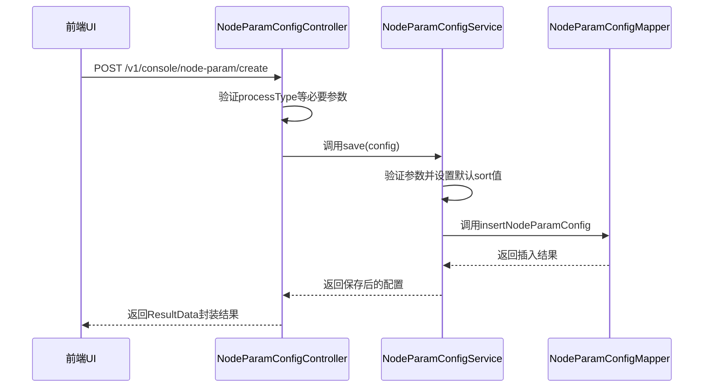
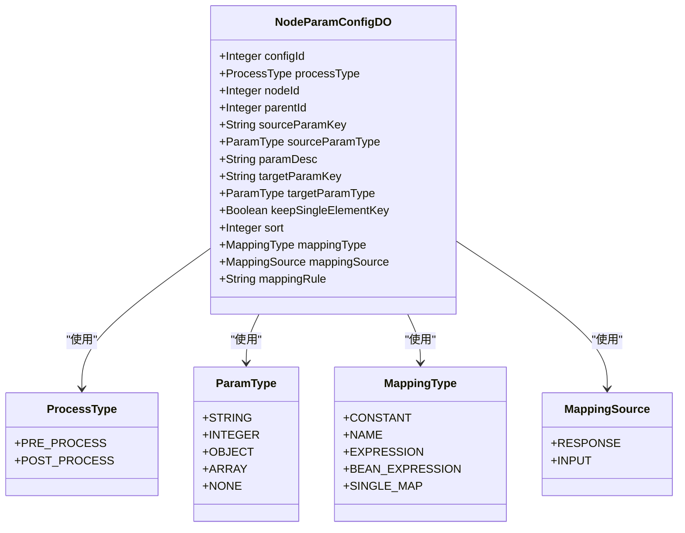
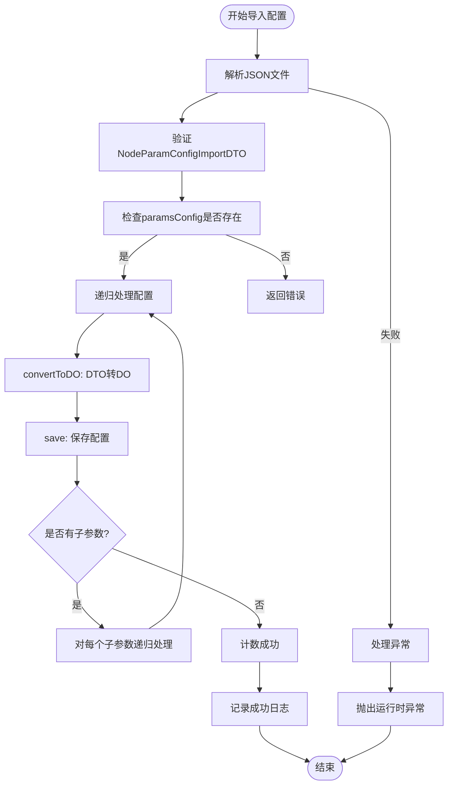

# 节点参数配置

<cite>
**本文档引用文件**  
- [NodeParamConfigController.java](file://agent-workflow/src/main/java/com/helianhealth/agent/workflow/controller/NodeParamConfigController.java)
- [NodeParamConfigDO.java](file://agent-workflow/src/main/java/com/helianhealth/agent/workflow/model/domain/NodeParamConfigDO.java)
- [NodeParamConfigService.java](file://agent-workflow/src/main/java/com/helianhealth/agent/workflow/service/NodeParamConfigService.java)
- [NodeParamConfigServiceImpl.java](file://agent-workflow/src/main/java/com/helianhealth/agent/workflow/service/impl/NodeParamConfigServiceImpl.java)
- [NodeParamConfigMapper.java](file://agent-workflow/src/main/java/com/helianhealth/agent/workflow/mapper/agent/NodeParamConfigMapper.java)
- [NodeParamConfigMapper.xml](file://agent-workflow/src/main/resources/mapper/agent/NodeParamConfigMapper.xml)
- [NodeParamConfigImportDTO.java](file://agent-workflow/src/main/java/com/helianhealth/agent/workflow/model/dto/NodeParamConfigImportDTO.java)
- [ProcessType.java](file://agent-common/src/main/java/com/helianhealth/agent/common/enums/ProcessType.java)
- [ParamType.java](file://agent-common/src/main/java/com/helianhealth/agent/common/enums/ParamType.java)
- [MappingType.java](file://agent-common/src/main/java/com/helianhealth/agent/common/enums/MappingType.java)
- [MappingSource.java](file://agent-common/src/main/java/com/helianhealth/agent/common/enums/MappingSource.java)
- [interface-config-guide.md](file://agent-ai/src/main/resources/interface-config-guide.md)
- [nodeParam.js](file://console-ui/src/api/nodeParam.js)
- [useNodeImportExport.js](file://console-ui/src/composables/useNodeImportExport.js)
- [InterfaceWorkflowNodeServiceImpl.java](file://agent-workflow/src/main/java/com/helianhealth/agent/workflow/service/impl/InterfaceWorkflowNodeServiceImpl.java)
</cite>

## 目录
1. [节点参数配置API接口](#节点参数配置api接口)
2. [NodeParamConfigDO实体类设计](#nodeparamconfigdo实体类设计)
3. [NodeParamConfigService服务层逻辑](#nodeparamconfigservice服务层逻辑)
4. [参数映射配置示例](#参数映射配置示例)
5. [配置导入导出功能](#配置导入导出功能)
6. [复杂嵌套结构配置最佳实践](#复杂嵌套结构配置最佳实践)

## 节点参数配置API接口

`NodeParamConfigController` 提供了对节点参数配置的完整CRUD操作，所有接口均位于 `/v1/console/node-param` 路径下。

### 查询接口
- **获取分页参数配置**：`GET /v1/console/node-param/all`  
  支持通过 `nodeId`、`processType`、`targetParam` 等参数进行过滤查询，返回分页结果。
- **获取无分页参数配置**：`GET /v1/console/node-param/all-unpaged`  
  返回指定节点的所有参数配置，不进行分页处理。

### 创建与更新接口
- **创建参数配置**：`POST /v1/console/node-param/create`  
  接收 `NodeParamConfigDO` 对象作为请求体，创建新的参数配置。控制器会验证 `processType` 等必要字段。
- **更新参数配置**：`POST /v1/console/node-param/update`  
  接收完整的 `NodeParamConfigDO` 对象进行更新，要求 `configId` 必须存在。

### 删除接口
- **删除参数配置**：`DELETE /v1/console/node-param/{configId}`  
  根据配置ID删除指定的参数配置项。



**图示来源**
- [NodeParamConfigController.java](file://agent-workflow/src/main/java/com/helianhealth/agent/workflow/controller/NodeParamConfigController.java#L72-L97)
- [NodeParamConfigServiceImpl.java](file://agent-workflow/src/main/java/com/helianhealth/agent/workflow/service/impl/NodeParamConfigServiceImpl.java#L98-L119)
- [NodeParamConfigMapper.java](file://agent-workflow/src/main/java/com/helianhealth/agent/workflow/mapper/agent/NodeParamConfigMapper.java#L24)

**本节来源**
- [NodeParamConfigController.java](file://agent-workflow/src/main/java/com/helianhealth/agent/workflow/controller/NodeParamConfigController.java#L26-L138)
- [nodeParam.js](file://console-ui/src/api/nodeParam.js#L28-L65)

## NodeParamConfigDO实体类设计

`NodeParamConfigDO` 实体类定义了节点参数配置的核心数据结构，与数据库表 `node_param_config` 直接映射。

### 核心字段说明
- **processType**：处理类型，枚举值为 `PRE_PROCESS`（前置处理）或 `POST_PROCESS`（后置处理）。前置处理用于请求参数映射，将上游入参转换为目标接口所需格式；后置处理用于响应参数映射，将目标接口响应转换为上游期望格式。
- **targetParamKey**：目标参数名，即目标接口所需要的参数名称。这是参数映射的最终目标字段。
- **sourceParamKey**：源参数路径，使用`.`符号访问嵌套对象的字段，如 `request.patientId`。
- **mappingType**：映射规则类型，包括 `CONSTANT`（固定值）、`NAME`（名称映射）、`EXPRESSION`（表达式）等。
- **mappingSource**：映射来源，`RESPONSE` 表示从响应数据取值，`INPUT` 表示从输入参数取值。
- **parentId**：父参数ID，用于构建参数的树形嵌套结构，实现复杂对象的映射。



**图示来源**
- [NodeParamConfigDO.java](file://agent-workflow/src/main/java/com/helianhealth/agent/workflow/model/domain/NodeParamConfigDO.java#L28-L124)
- [ProcessType.java](file://agent-common/src/main/java/com/helianhealth/agent/common/enums/ProcessType.java#L9-L20)
- [ParamType.java](file://agent-common/src/main/java/com/helianhealth/agent/common/enums/ParamType.java#L9-L50)
- [MappingType.java](file://agent-common/src/main/java/com/helianhealth/agent/common/enums/MappingType.java#L9-L35)
- [MappingSource.java](file://agent-common/src/main/java/com/helianhealth/agent/common/enums/MappingSource.java#L9-L20)

**本节来源**
- [NodeParamConfigDO.java](file://agent-workflow/src/main/java/com/helianhealth/agent/workflow/model/domain/NodeParamConfigDO.java#L23-L124)
- [interface-config-guide.md](file://agent-ai/src/main/resources/interface-config-guide.md#L255-L325)

## NodeParamConfigService服务层逻辑

`NodeParamConfigService` 接口定义了参数配置的核心业务逻辑，其实现类 `NodeParamConfigServiceImpl` 处理了参数校验、保存、查询和导入等操作。

### 参数校验与保存逻辑
在 `save` 和 `update` 方法中，服务层会进行严格的参数校验：
- `save` 方法确保 `config` 对象不为空。
- `update` 方法确保 `config` 对象和 `configId` 存在。
- 当 `sort` 字段为空时，自动设置默认值为1，确保参数有明确的执行顺序。

### 查询逻辑
服务层提供了多种查询方法：
- `findAllNodeParamConfigs`：支持分页和多条件过滤查询。
- `findAllNodeParamConfigsUnpaged`：查询所有配置，用于导出等场景。
- `selectPre/PostProcessConfigByNodeId`：根据处理类型查询配置。

### 导入逻辑
导入功能支持从JSON文件或对象列表批量导入配置。核心逻辑在 `importNodeParamConfig` 方法中，通过 `processConfigRecursive` 递归处理父子关系的参数配置，确保树形结构的完整性。



**图示来源**
- [NodeParamConfigServiceImpl.java](file://agent-workflow/src/main/java/com/helianhealth/agent/workflow/service/impl/NodeParamConfigServiceImpl.java#L142-L207)
- [NodeParamConfigServiceImpl.java](file://agent-workflow/src/main/java/com/helianhealth/agent/workflow/service/impl/NodeParamConfigServiceImpl.java#L227-L247)
- [NodeParamConfigImportDTO.java](file://agent-workflow/src/main/java/com/helianhealth/agent/workflow/model/dto/NodeParamConfigImportDTO.java#L12-L41)

**本节来源**
- [NodeParamConfigService.java](file://agent-workflow/src/main/java/com/helianhealth/agent/workflow/service/NodeParamConfigService.java#L11-L30)
- [NodeParamConfigServiceImpl.java](file://agent-workflow/src/main/java/com/helianhealth/agent/workflow/service/impl/NodeParamConfigServiceImpl.java#L26-L278)

## 参数映射配置示例

在工作流执行时，参数映射规则将源数据转换为目标接口的参数。以下是一个从源数据到目标接口的参数映射配置示例：

假设需要将上游请求中的 `patientCode` 映射到目标接口的 `patientId` 字段，并添加一个固定值 `systemId=HL2023`。

```json
[
  {
    "processType": "PRE_PROCESS",
    "sourceParamKey": "patientCode",
    "sourceParamType": "STRING",
    "targetParamKey": "patientId",
    "targetParamType": "STRING",
    "mappingType": "NAME",
    "mappingSource": null,
    "mappingRule": null,
    "sort": 1
  },
  {
    "processType": "PRE_PROCESS",
    "sourceParamKey": null,
    "sourceParamType": "NONE",
    "targetParamKey": "systemId",
    "targetParamType": "STRING",
    "mappingType": "CONSTANT",
    "mappingSource": null,
    "mappingRule": "HL2023",
    "sort": 2
  }
]
```

此配置将：
1. 将上游请求中的 `patientCode` 值直接映射到目标接口的 `patientId` 参数。
2. 为目标接口添加一个固定值 `systemId=HL2023`。

**本节来源**
- [interface-config-guide.md](file://agent-ai/src/main/resources/interface-config-guide.md#L295-L306)

## 配置导入导出功能

系统提供了完整的参数配置导入导出功能，便于配置的备份、迁移和共享。

### 使用示例
- **导出配置**：调用 `GET /v1/console/node-param/export/{nodeId}` 接口，系统将返回包含节点信息和所有参数配置的JSON文件，文件名格式为 `{nodeName}_参数配置_{timestamp}.json`。
- **导入配置**：通过 `POST /v1/console/node-param/import` 接口上传JSON文件，系统会解析文件并递归创建所有参数配置，包括父子层级关系。

前端通过 `useNodeImportExport.js` 中的 `exportNodeParamConfig` 和 `importGlobalNodeConfig` 函数实现这些功能，使用 `FormData` 上传文件，并设置正确的 `Content-Type` 为 `multipart/form-data`。

**本节来源**
- [InterfaceWorkflowNodeServiceImpl.java](file://agent-workflow/src/main/java/com/helianhealth/agent/workflow/service/impl/InterfaceWorkflowNodeServiceImpl.java#L183-L200)
- [useNodeImportExport.js](file://console-ui/src/composables/useNodeImportExport.js#L75-L111)

## 复杂嵌套结构配置最佳实践

当配置复杂嵌套结构时，应遵循以下最佳实践：

1. **合理使用parentId**：通过 `parentId` 字段构建树形结构，确保父子参数的层级关系正确。
2. **设置正确的sort值**：为每个参数配置设置 `sort` 值，控制参数映射的执行顺序。
3. **选择合适的mappingType**：对于简单映射使用 `NAME`，对于复杂转换使用 `EXPRESSION`（SpEL表达式）。
4. **注意keepSingleElementKey**：在数组映射场景中，根据需要设置 `keepSingleElementKey` 决定是否保留单元素的键名。
5. **分步配置与测试**：对于复杂映射，建议分步配置并及时测试，确保每一步都按预期工作。

**本节来源**
- [NodeParamConfigDO.java](file://agent-workflow/src/main/java/com/helianhealth/agent/workflow/model/domain/NodeParamConfigDO.java#L92-L93)
- [interface-config-guide.md](file://agent-ai/src/main/resources/interface-config-guide.md#L287-L288)
- [NodeParamConfigServiceImpl.java](file://agent-workflow/src/main/java/com/helianhealth/agent/workflow/service/impl/NodeParamConfigServiceImpl.java#L227-L247)