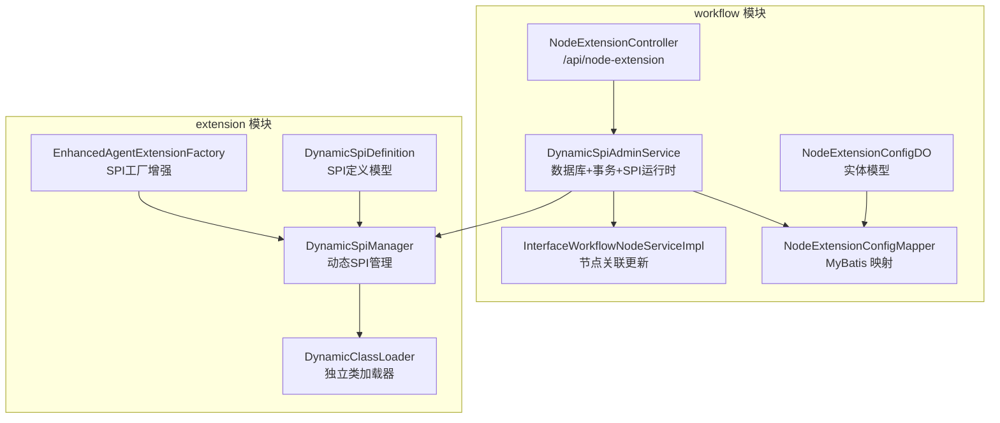
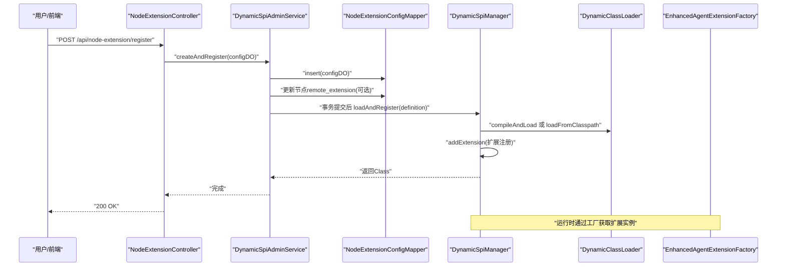
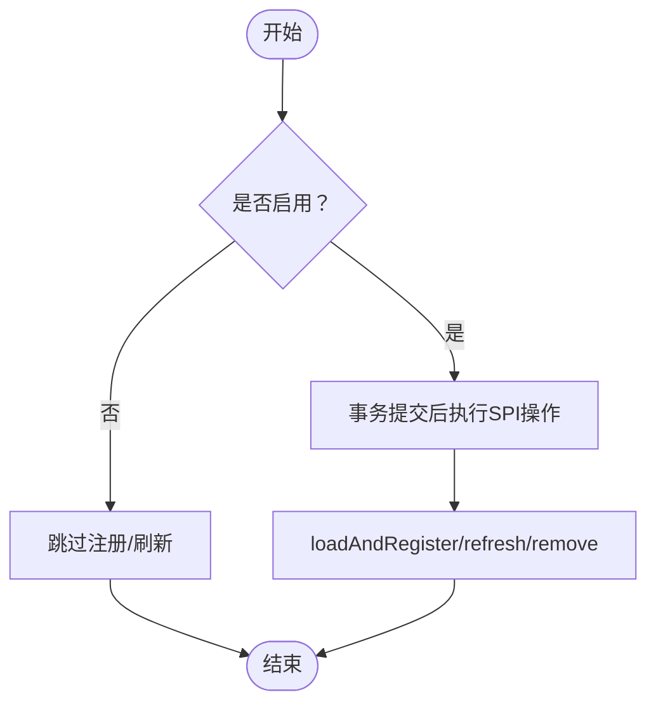
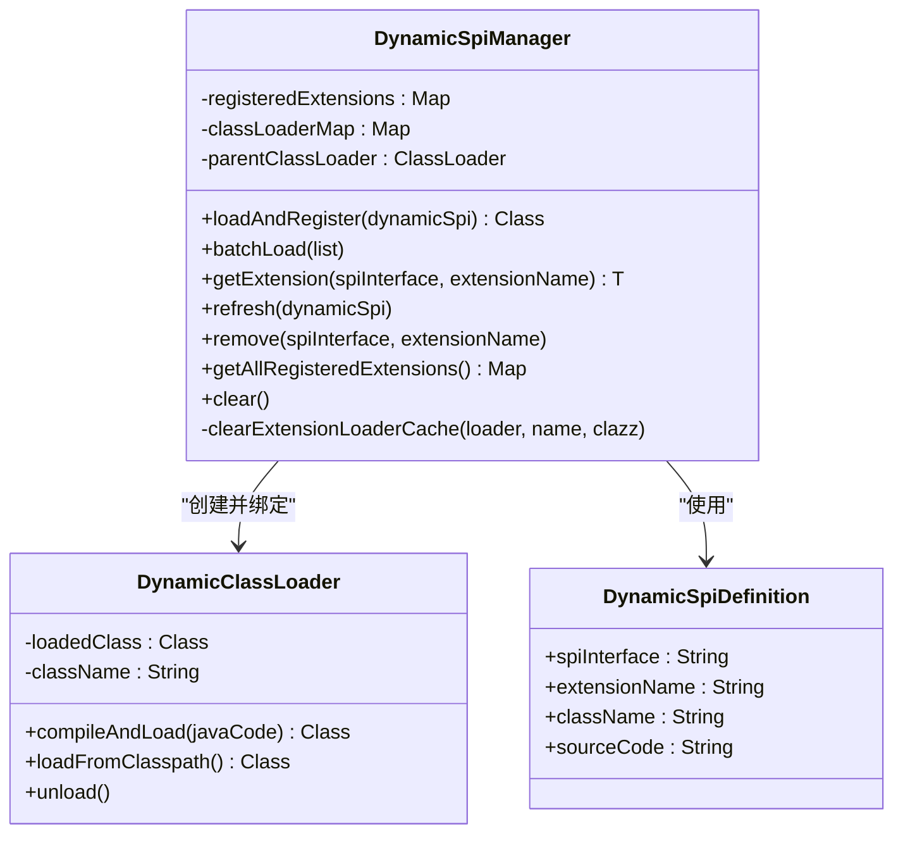
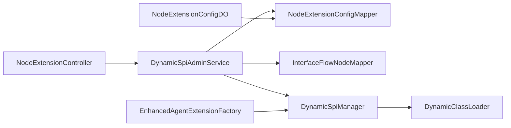

# 节点扩展管理

<cite>
**本文引用的文件**
- [NodeExtensionController.java](file://agent-workflow/src/main/java/com/helianhealth/agent/workflow/controller/NodeExtensionController.java)
- [DynamicSpiAdminService.java](file://agent-workflow/src/main/java/com/helianhealth/agent/workflow/service/extension/DynamicSpiAdminService.java)
- [DynamicSpiManager.java](file://agent-extension/src/main/java/com/helianhealth/agent/extension/spi/dynamic/DynamicSpiManager.java)
- [DynamicClassLoader.java](file://agent-extension/src/main/java/com/helianhealth/agent/extension/spi/dynamic/DynamicClassLoader.java)
- [DynamicSpiDefinition.java](file://agent-extension/src/main/java/com/helianhealth/agent/extension/spi/model/DynamicSpiDefinition.java)
- [NodeExtensionConfigDO.java](file://agent-workflow/src/main/java/com/helianhealth/agent/workflow/model/domain/NodeExtensionConfigDO.java)
- [NodeExtensionConfigMapper.java](file://agent-workflow/src/main/java/com/helianhealth/agent/workflow/mapper/agent/NodeExtensionConfigMapper.java)
- [NodeExtensionConfigMapper.xml](file://agent-workflow/src/main/resources/mapper/agent/NodeExtensionConfigMapper.xml)
- [EnhancedAgentExtensionFactory.java](file://agent-extension/src/main/java/com/helianhealth/agent/extension/factory/EnhancedAgentExtensionFactory.java)
- [InterfaceWorkflowNodeServiceImpl.java](file://agent-workflow/src/main/java/com/helianhealth/agent/workflow/service/impl/InterfaceWorkflowNodeServiceImpl.java)
- [nodeExtension.js](file://console-ui/src/api/nodeExtension.js)
- [NodeExtensionConfig.vue](file://console-ui/src/views/NodeExtensionConfig.vue)
</cite>

## 目录
1. [简介](#简介)
2. [项目结构](#项目结构)
3. [核心组件](#核心组件)
4. [架构总览](#架构总览)
5. [详细组件分析](#详细组件分析)
6. [依赖关系分析](#依赖关系分析)
7. [性能考量](#性能考量)
8. [故障排查指南](#故障排查指南)
9. [结论](#结论)
10. [附录](#附录)

## 简介
本文件深入解析“节点扩展管理”功能，重点说明 NodeExtensionController（/api/node-extension）如何作为桥梁，连接 workflow 模块的配置管理与 extension 模块的动态运行时。文档详细描述 register、update、refresh、disable 等 API 的用途与调用流程，并解释 DynamicSpiAdminService 如何利用 DynamicSpiManager 实现动态代码的编译、加载与注册。最后通过一个自定义数据处理扩展的示例，展示从编写 Java 代码、通过 API 注册到在工作流中调用的完整流程，并强调安全风险（如代码注入）及相应防护措施（如沙箱环境或代码审查机制）。

## 项目结构
该功能横跨两个模块：
- workflow 模块：负责配置持久化、事务一致性保证、与工作流节点的关联以及对外 API 控制器。
- extension 模块：负责动态编译、类加载隔离、SPI 注册与卸载、以及运行时扩展工厂集成。

图表来源
- [NodeExtensionController.java](file://agent-workflow/src/main/java/com/helianhealth/agent/workflow/controller/NodeExtensionController.java#L26-L89)
- [DynamicSpiAdminService.java](file://agent-workflow/src/main/java/com/helianhealth/agent/workflow/service/extension/DynamicSpiAdminService.java#L24-L232)
- [DynamicSpiManager.java](file://agent-extension/src/main/java/com/helianhealth/agent/extension/spi/dynamic/DynamicSpiManager.java#L21-L272)
- [DynamicClassLoader.java](file://agent-extension/src/main/java/com/helianhealth/agent/extension/spi/dynamic/DynamicClassLoader.java#L29-L302)
- [EnhancedAgentExtensionFactory.java](file://agent-extension/src/main/java/com/helianhealth/agent/extension/factory/EnhancedAgentExtensionFactory.java#L23-L109)
- [NodeExtensionConfigDO.java](file://agent-workflow/src/main/java/com/helianhealth/agent/workflow/model/domain/NodeExtensionConfigDO.java#L14-L75)
- [NodeExtensionConfigMapper.java](file://agent-workflow/src/main/java/com/helianhealth/agent/workflow/mapper/agent/NodeExtensionConfigMapper.java#L13-L30)

章节来源
- [NodeExtensionController.java](file://agent-workflow/src/main/java/com/helianhealth/agent/workflow/controller/NodeExtensionController.java#L18-L29)
- [DynamicSpiAdminService.java](file://agent-workflow/src/main/java/com/helianhealth/agent/workflow/service/extension/DynamicSpiAdminService.java#L18-L24)

## 核心组件
- NodeExtensionController：对外暴露 /api/node-extension 下的注册、更新、刷新、禁用、查询已加载扩展、查询启用配置等接口，统一协调 workflow 层与 extension 层。
- DynamicSpiAdminService：封装数据库 CRUD 与 SPI 运行时管理，使用事务同步机制确保数据与运行时一致。
- DynamicSpiManager：负责动态编译/加载、SPI 注册、刷新与卸载，采用独立 ClassLoader 实现类隔离与卸载。
- DynamicClassLoader：基于系统 JDK 编译器进行动态编译，或从 classpath 加载预编译类；每个类绑定一个独立 ClassLoader，支持完全卸载。
- EnhancedAgentExtensionFactory：增强的 Dubbo SPI 工厂，优先从动态 SPI 管理器获取扩展，再回退到 Spring 容器。
- NodeExtensionConfigDO/NodeExtensionConfigMapper：持久化节点扩展配置，包含 SPI 接口、扩展名、类名、源码、启用状态等字段。

章节来源
- [NodeExtensionController.java](file://agent-workflow/src/main/java/com/helianhealth/agent/workflow/controller/NodeExtensionController.java#L31-L89)
- [DynamicSpiAdminService.java](file://agent-workflow/src/main/java/com/helianhealth/agent/workflow/service/extension/DynamicSpiAdminService.java#L26-L231)
- [DynamicSpiManager.java](file://agent-extension/src/main/java/com/helianhealth/agent/extension/spi/dynamic/DynamicSpiManager.java#L40-L97)
- [DynamicClassLoader.java](file://agent-extension/src/main/java/com/helianhealth/agent/extension/spi/dynamic/DynamicClassLoader.java#L53-L119)
- [EnhancedAgentExtensionFactory.java](file://agent-extension/src/main/java/com/helianhealth/agent/extension/factory/EnhancedAgentExtensionFactory.java#L27-L64)
- [NodeExtensionConfigDO.java](file://agent-workflow/src/main/java/com/helianhealth/agent/workflow/model/domain/NodeExtensionConfigDO.java#L14-L75)
- [NodeExtensionConfigMapper.java](file://agent-workflow/src/main/java/com/helianhealth/agent/workflow/mapper/agent/NodeExtensionConfigMapper.java#L13-L30)

## 架构总览
NodeExtensionController 作为入口，将请求委派给 DynamicSpiAdminService；后者在数据库层面对配置进行持久化与更新，并在事务提交后通过 DynamicSpiManager 完成 SPI 的加载/刷新/卸载。运行时扩展通过 EnhancedAgentExtensionFactory 与 Dubbo SPI 体系对接，从而在工作流执行阶段按需获取扩展实例。

图表来源
- [NodeExtensionController.java](file://agent-workflow/src/main/java/com/helianhealth/agent/workflow/controller/NodeExtensionController.java#L48-L56)
- [DynamicSpiAdminService.java](file://agent-workflow/src/main/java/com/helianhealth/agent/workflow/service/extension/DynamicSpiAdminService.java#L39-L67)
- [DynamicSpiManager.java](file://agent-extension/src/main/java/com/helianhealth/agent/extension/spi/dynamic/DynamicSpiManager.java#L54-L97)
- [DynamicClassLoader.java](file://agent-extension/src/main/java/com/helianhealth/agent/extension/spi/dynamic/DynamicClassLoader.java#L53-L119)
- [EnhancedAgentExtensionFactory.java](file://agent-extension/src/main/java/com/helianhealth/agent/extension/factory/EnhancedAgentExtensionFactory.java#L27-L64)

## 详细组件分析

### NodeExtensionController（/api/node-extension）
- 提供以下接口：
  - POST /api/node-extension/register：新增节点扩展配置并注册（若启用则在事务提交后注册）。
  - POST /api/node-extension/update：更新配置并热刷新运行时。
  - POST /api/node-extension/refresh/{codeId}：按配置 ID 刷新指定节点扩展。
  - POST /api/node-extension/disable/{codeId}：禁用并卸载节点扩展。
  - GET /api/node-extension/loaded：查看当前已加载的节点扩展（运行时）。
  - GET /api/node-extension/enabled-configs：列出数据库中启用的配置。
- 控制器直接依赖 DynamicSpiManager 和 DynamicSpiAdminService，实现对 workflow 与 extension 的桥接。

章节来源
- [NodeExtensionController.java](file://agent-workflow/src/main/java/com/helianhealth/agent/workflow/controller/NodeExtensionController.java#L37-L88)

### DynamicSpiAdminService（workflow 层）
- 负责数据库 CRUD 与 SPI 运行时管理，关键方法：
  - createAndRegister：插入配置，必要时更新节点 remote_extension 字段，启用状态下在事务提交后注册 SPI。
  - updateAndRefresh：更新配置并热刷新运行时。
  - refresh：根据 codeId 重新加载 SPI。
  - disableAndUnregister：禁用配置并在事务提交后卸载 SPI。
  - listEnabledConfigs：查询启用的配置。
- 使用 TransactionSynchronization 在事务提交后执行 SPI 操作，确保数据一致性。

图表来源
- [DynamicSpiAdminService.java](file://agent-workflow/src/main/java/com/helianhealth/agent/workflow/service/extension/DynamicSpiAdminService.java#L39-L67)
- [DynamicSpiAdminService.java](file://agent-workflow/src/main/java/com/helianhealth/agent/workflow/service/extension/DynamicSpiAdminService.java#L73-L99)
- [DynamicSpiAdminService.java](file://agent-workflow/src/main/java/com/helianhealth/agent/workflow/service/extension/DynamicSpiAdminService.java#L105-L121)
- [DynamicSpiAdminService.java](file://agent-workflow/src/main/java/com/helianhealth/agent/workflow/service/extension/DynamicSpiAdminService.java#L127-L151)

章节来源
- [DynamicSpiAdminService.java](file://agent-workflow/src/main/java/com/helianhealth/agent/workflow/service/extension/DynamicSpiAdminService.java#L39-L151)

### DynamicSpiManager（extension 层）
- 负责动态编译/加载、SPI 注册、刷新与卸载：
  - loadAndRegister：根据 sourceCode 是否为空选择编译模式或 classpath 模式；校验实现类是否实现 SPI 接口；通过 Dubbo ExtensionLoader 注册；缓存 Class 与 ClassLoader。
  - batchLoad：批量加载启用的配置。
  - getExtension：按 SPI 接口与扩展名获取实例。
  - refresh：先卸载旧实现，再重新加载。
  - remove：从缓存与 Dubbo 内部缓存移除，释放 ClassLoader 并建议 GC。
  - clear：清空所有动态 SPI 并触发 GC。
- 通过反射清理 Dubbo ExtensionLoader 内部缓存，避免残留引用导致无法卸载。

图表来源
- [DynamicSpiManager.java](file://agent-extension/src/main/java/com/helianhealth/agent/extension/spi/dynamic/DynamicSpiManager.java#L21-L272)
- [DynamicClassLoader.java](file://agent-extension/src/main/java/com/helianhealth/agent/extension/spi/dynamic/DynamicClassLoader.java#L29-L302)
- [DynamicSpiDefinition.java](file://agent-extension/src/main/java/com/helianhealth/agent/extension/spi/model/DynamicSpiDefinition.java#L10-L31)

章节来源
- [DynamicSpiManager.java](file://agent-extension/src/main/java/com/helianhealth/agent/extension/spi/dynamic/DynamicSpiManager.java#L54-L147)
- [DynamicClassLoader.java](file://agent-extension/src/main/java/com/helianhealth/agent/extension/spi/dynamic/DynamicClassLoader.java#L53-L119)

### EnhancedAgentExtensionFactory（SPI 工厂增强）
- 当 Dubbo 获取 SPI 扩展时，优先尝试从 DynamicSpiManager 获取动态扩展，否则回退到 Spring 容器查找 Bean。
- 通过 ApplicationContextUtil 获取上下文，避免硬编码依赖。

章节来源
- [EnhancedAgentExtensionFactory.java](file://agent-extension/src/main/java/com/helianhealth/agent/extension/factory/EnhancedAgentExtensionFactory.java#L27-L108)

### NodeExtensionConfigDO 与 NodeExtensionConfigMapper
- NodeExtensionConfigDO：持久化节点扩展配置，包含 SPI 接口、扩展名、类名、源码、描述、扩展方式（PROJECT/ONLINE）、启用状态等。
- NodeExtensionConfigMapper：MyBatis 映射，提供按 ID、按启用状态、按 SPI 接口+扩展名查询，以及插入、更新、删除操作。

章节来源
- [NodeExtensionConfigDO.java](file://agent-workflow/src/main/java/com/helianhealth/agent/workflow/model/domain/NodeExtensionConfigDO.java#L14-L75)
- [NodeExtensionConfigMapper.java](file://agent-workflow/src/main/java/com/helianhealth/agent/workflow/mapper/agent/NodeExtensionConfigMapper.java#L13-L30)
- [NodeExtensionConfigMapper.xml](file://agent-workflow/src/main/resources/mapper/agent/NodeExtensionConfigMapper.xml#L18-L91)

### 前端交互（Console UI）
- 提供 /api/node-extension/* 的调用封装，支持新增、编辑、禁用、刷新列表、查看已加载扩展等功能。
- NodeExtensionConfig.vue 中包含扩展方式（在线/项目）的选择、Java 源码输入、语法校验与格式化等。

章节来源
- [nodeExtension.js](file://console-ui/src/api/nodeExtension.js#L6-L63)
- [NodeExtensionConfig.vue](file://console-ui/src/views/NodeExtensionConfig.vue#L1-L200)

## 依赖关系分析
- NodeExtensionController 依赖 DynamicSpiAdminService 与 DynamicSpiManager。
- DynamicSpiAdminService 依赖 NodeExtensionConfigMapper、InterfaceFlowNodeMapper 与 DynamicSpiManager。
- DynamicSpiManager 依赖 DynamicClassLoader 与 Dubbo ExtensionLoader。
- EnhancedAgentExtensionFactory 依赖 DynamicSpiManager 与 Spring 上下文。
- NodeExtensionConfigDO 与 NodeExtensionConfigMapper 形成持久化闭环。

图表来源
- [NodeExtensionController.java](file://agent-workflow/src/main/java/com/helianhealth/agent/workflow/controller/NodeExtensionController.java#L31-L35)
- [DynamicSpiAdminService.java](file://agent-workflow/src/main/java/com/helianhealth/agent/workflow/service/extension/DynamicSpiAdminService.java#L26-L33)
- [DynamicSpiManager.java](file://agent-extension/src/main/java/com/helianhealth/agent/extension/spi/dynamic/DynamicSpiManager.java#L40-L42)
- [EnhancedAgentExtensionFactory.java](file://agent-extension/src/main/java/com/helianhealth/agent/extension/factory/EnhancedAgentExtensionFactory.java#L66-L82)
- [NodeExtensionConfigDO.java](file://agent-workflow/src/main/java/com/helianhealth/agent/workflow/model/domain/NodeExtensionConfigDO.java#L14-L75)
- [NodeExtensionConfigMapper.java](file://agent-workflow/src/main/java/com/helianhealth/agent/workflow/mapper/agent/NodeExtensionConfigMapper.java#L13-L30)

章节来源
- [NodeExtensionController.java](file://agent-workflow/src/main/java/com/helianhealth/agent/workflow/controller/NodeExtensionController.java#L31-L35)
- [DynamicSpiAdminService.java](file://agent-workflow/src/main/java/com/helianhealth/agent/workflow/service/extension/DynamicSpiAdminService.java#L26-L33)
- [DynamicSpiManager.java](file://agent-extension/src/main/java/com/helianhealth/agent/extension/spi/dynamic/DynamicSpiManager.java#L40-L42)

## 性能考量
- 动态编译：使用系统 JDK 编译器进行编译，编译过程可能较慢且占用 CPU，建议仅在必要时触发（如在线扩展首次注册或刷新）。
- ClassLoader 隔离：每个动态类绑定独立 ClassLoader，便于卸载，但也会增加内存占用与 GC 压力。
- 批量加载：DynamicSpiManager 支持批量加载，workflow 层应确保只传递启用的配置以减少无效开销。
- 缓存策略：registeredExtensions 与 classLoaderMap 为并发容器，读写需注意一致性；Dubbo ExtensionLoader 内部缓存通过反射清理，避免长期驻留。

[本节为通用性能讨论，不直接分析具体文件]

## 故障排查指南
- 编译失败：检查 sourceCode 是否合法，JDK 编译器可用性；查看编译诊断信息定位错误行号。
- SPI 接口不匹配：确认实现类确实实现声明的 SPI 接口，否则会抛出非法参数异常。
- 运行时未找到扩展：确认扩展已在事务提交后注册，且 SPI 接口与扩展名正确；可通过 /api/node-extension/loaded 查看当前已加载扩展。
- 卸载失败：确认 remove 流程已执行，Class 与 ClassLoader 引用已被清除，并建议触发 GC；若仍无法卸载，检查是否存在外部强引用。
- 数据库一致性：若事务回滚，SPI 注册不会发生；若事务已提交但注册失败，需手动补偿处理。

章节来源
- [DynamicSpiManager.java](file://agent-extension/src/main/java/com/helianhealth/agent/extension/spi/dynamic/DynamicSpiManager.java#L82-L85)
- [DynamicSpiManager.java](file://agent-extension/src/main/java/com/helianhealth/agent/extension/spi/dynamic/DynamicSpiManager.java#L211-L246)
- [DynamicSpiAdminService.java](file://agent-workflow/src/main/java/com/helianhealth/agent/workflow/service/extension/DynamicSpiAdminService.java#L163-L180)

## 结论
节点扩展管理通过 NodeExtensionController 将 workflow 的配置管理与 extension 的动态运行时紧密耦合：配置层负责持久化与事务一致性，运行时层负责动态编译、加载与卸载。DynamicSpiAdminService 在事务提交后执行 SPI 操作，确保数据与运行时的一致性；DynamicSpiManager 提供完善的生命周期管理与卸载能力；EnhancedAgentExtensionFactory 将动态扩展无缝接入 Dubbo SPI 体系。整体设计兼顾灵活性与安全性，适合在线扩展与项目扩展两种场景。

[本节为总结性内容，不直接分析具体文件]

## 附录

### API 一览与调用流程
- POST /api/node-extension/register
  - 参数：NodeExtensionConfigDO（含 SPI 接口、扩展名、类名、源码、启用状态等）
  - 流程：插入配置 → 可选更新节点 remote_extension → 启用时事务提交后注册 SPI
- POST /api/node-extension/update
  - 参数：NodeExtensionConfigDO
  - 流程：更新配置 → 同一事务内更新节点 remote_extension → 事务提交后刷新 SPI
- POST /api/node-extension/refresh/{codeId}
  - 参数：路径变量 codeId
  - 流程：根据 codeId 查询配置 → 刷新 SPI
- POST /api/node-extension/disable/{codeId}
  - 参数：路径变量 codeId
  - 流程：禁用配置 → 事务提交后卸载 SPI
- GET /api/node-extension/loaded
  - 返回：当前已加载的扩展映射（SPI 接口#扩展名 -> Class）
- GET /api/node-extension/enabled-configs
  - 返回：数据库中启用的配置列表

章节来源
- [NodeExtensionController.java](file://agent-workflow/src/main/java/com/helianhealth/agent/workflow/controller/NodeExtensionController.java#L37-L88)
- [DynamicSpiAdminService.java](file://agent-workflow/src/main/java/com/helianhealth/agent/workflow/service/extension/DynamicSpiAdminService.java#L39-L151)

### 自定义数据处理扩展示例（从零到运行）
- 步骤 1：在前端选择“在线扩展”，填写扩展名称、实现类全名、描述、启用状态，并粘贴 Java 源码。
- 步骤 2：点击“保存”，调用 /api/node-extension/register，后端插入配置并启用时在事务提交后注册 SPI。
- 步骤 3：在工作流节点中设置 remoteExtension 为该扩展名，运行时通过 EnhancedAgentExtensionFactory 获取扩展实例并执行。
- 步骤 4：若修改代码，调用 /api/node-extension/update 或 /api/node-extension/refresh/{codeId} 触发热刷新。
- 步骤 5：不再使用时调用 /api/node-extension/disable/{codeId} 禁用并卸载。

章节来源
- [NodeExtensionConfig.vue](file://console-ui/src/views/NodeExtensionConfig.vue#L104-L139)
- [nodeExtension.js](file://console-ui/src/api/nodeExtension.js#L26-L63)
- [NodeExtensionController.java](file://agent-workflow/src/main/java/com/helianhealth/agent/workflow/controller/NodeExtensionController.java#L48-L72)
- [DynamicSpiAdminService.java](file://agent-workflow/src/main/java/com/helianhealth/agent/workflow/service/extension/DynamicSpiAdminService.java#L39-L99)
- [DynamicSpiManager.java](file://agent-extension/src/main/java/com/helianhealth/agent/extension/spi/dynamic/DynamicSpiManager.java#L54-L97)

### 安全风险与防护措施
- 风险：在线扩展允许用户提交任意 Java 代码，存在代码注入、恶意执行、资源滥用等风险。
- 防护建议：
  - 沙箱环境：限制编译与运行权限，隔离网络访问与文件系统。
  - 代码审查：对在线扩展源码进行静态扫描与规则校验，拒绝高危 API 调用。
  - 权限控制：仅授权可信用户可创建/更新在线扩展。
  - 资源配额：限制编译时间、内存与线程数，防止资源耗尽。
  - 审计日志：记录每次注册/刷新/卸载事件，便于追踪与回溯。
  - 最小权限：运行时仅暴露必要接口，避免扩展获得全局权限。

[本节为通用安全建议，不直接分析具体文件]