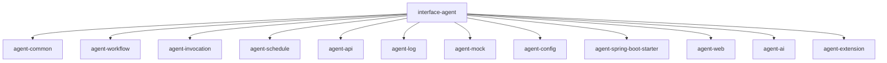
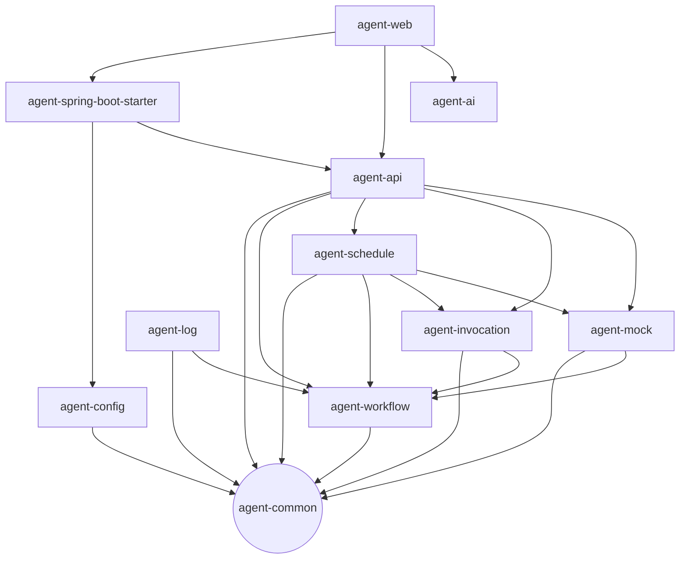
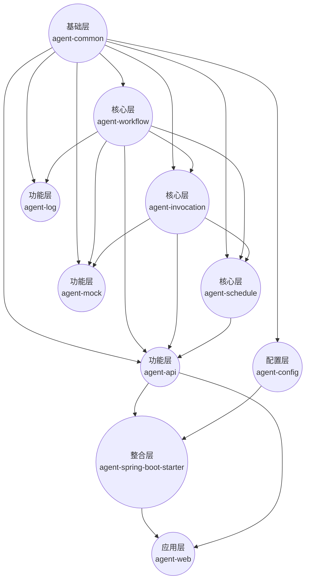

# 模块架构

<cite>
**本文档中引用的文件**  
- [模块化架构说明.md](file://模块化架构说明.md)
- [pom.xml](file://pom.xml)
- [agent-common/pom.xml](file://agent-common/pom.xml)
- [agent-workflow/pom.xml](file://agent-workflow/pom.xml)
- [agent-invocation/pom.xml](file://agent-invocation/pom.xml)
- [agent-schedule/pom.xml](file://agent-schedule/pom.xml)
- [agent-api/pom.xml](file://agent-api/pom.xml)
- [agent-log/pom.xml](file://agent-log/pom.xml)
- [agent-mock/pom.xml](file://agent-mock/pom.xml)
- [agent-spring-boot-starter/pom.xml](file://agent-spring-boot-starter/pom.xml)
- [agent-web/pom.xml](file://agent-web/pom.xml)
- [agent-config/pom.xml](file://agent-config/pom.xml)
- [agent-common/src/main/java/com/helianhealth/agent/common/base/ResultData.java](file://agent-common/src/main/java/com/helianhealth/agent/common/base/ResultData.java)
- [agent-common/src/main/java/com/helianhealth/agent/common/exception/BaseBusinessException.java](file://agent-common/src/main/java/com/helianhealth/agent/common/exception/BaseBusinessException.java)
- [agent-common/src/main/java/com/helianhealth/agent/common/enums/NodeType.java](file://agent-common/src/main/java/com/helianhealth/agent/common/enums/NodeType.java)
- [agent-common/src/main/java/com/helianhealth/agent/common/annotation/Url.java](file://agent-common/src/main/java/com/helianhealth/agent/common/annotation/Url.java)
- [agent-spring-boot-starter/src/main/java/com/helianhealth/agent/starter/InterfaceAgentAutoConfiguration.java](file://agent-spring-boot-starter/src/main/java/com/helianhealth/agent/starter/InterfaceAgentAutoConfiguration.java)
- [agent-web/src/main/java/com/helianhealth/agent/InterfaceAgentApplication.java](file://agent-web/src/main/java/com/helianhealth/agent/InterfaceAgentApplication.java)
</cite>

## 目录
1. [项目结构](#项目结构)
2. [模块依赖关系](#模块依赖关系)
3. [基础层：agent-common](#基础层agent-common)
4. [核心层模块](#核心层模块)
   - [agent-workflow（工作流管理）](#agent-workflow工作流管理)
   - [agent-invocation（远程调用）](#agent-invocation远程调用)
   - [agent-schedule（调度执行）](#agent-schedule调度执行)
5. [功能层模块](#功能层模块)
   - [agent-api（API封装）](#agent-apiapi封装)
   - [agent-log（日志记录）](#agent-log日志记录)
   - [agent-mock（Mock管理）](#agent-mockmock管理)
6. [配置与整合层](#配置与整合层)
   - [agent-config（通用配置）](#agent-config通用配置)
   - [agent-spring-boot-starter（自动配置）](#agent-spring-boot-starter自动配置)
7. [应用入口层：agent-web](#应用入口层agent-web)
8. [依赖链条总结](#依赖链条总结)

## 项目结构

本项目采用模块化分层架构设计，各模块职责清晰，层次分明。整体结构如下：

**图示来源**
- [模块化架构说明.md](file://模块化架构说明.md)

**本节来源**
- [pom.xml](file://pom.xml)
- [模块化架构说明.md](file://模块化架构说明.md)

## 模块依赖关系

系统采用自底向上的依赖结构，形成清晰的调用链条：

**图示来源**
- [模块化架构说明.md](file://模块化架构说明.md)

**本节来源**
- [模块化架构说明.md](file://模块化架构说明.md)

## 基础层：agent-common

`agent-common` 模块作为整个系统的共享基础设施层，为所有上层模块提供基础支持。

### 共享异常处理

该模块定义了统一的异常体系，包括：
- `BaseBusinessException`：业务异常基类，所有业务异常继承此类
- `BusinessCode`：业务错误码枚举
- 各类具体业务异常（如 `WorkflowBusinessException`、`InvokeBusinessException` 等）

这种设计确保了异常处理的一致性和可维护性。

### 工具类与实用方法

提供了常用的工具类：
- `JsonUtils`：JSON序列化与反序列化工具
- `XmlUtils`：XML处理工具
- `ApplicationContextUtil`：Spring应用上下文工具
- `ResponseRenderUtils`：响应渲染工具

### 枚举定义

定义了系统中使用的各种枚举类型：
- `NodeType`：节点类型（HTTP、WebService、Database、NONE）
- `ParamType`：参数类型
- `ProcessType`：处理类型
- `WorkflowContentType`：工作流内容类型
- `MappingType` 和 `MappingSource`：映射类型和来源

### 自定义注解

提供了系统级注解：
- `@Url`：用于标记URL参数

**本节来源**
- [agent-common/pom.xml](file://agent-common/pom.xml)
- [agent-common/src/main/java/com/helianhealth/agent/common/base/ResultData.java](file://agent-common/src/main/java/com/helianhealth/agent/common/base/ResultData.java)
- [agent-common/src/main/java/com/helianhealth/agent/common/exception/BaseBusinessException.java](file://agent-common/src/main/java/com/helianhealth/agent/common/exception/BaseBusinessException.java)
- [agent-common/src/main/java/com/helianhealth/agent/common/enums/NodeType.java](file://agent-common/src/main/java/com/helianhealth/agent/common/enums/NodeType.java)
- [agent-common/src/main/java/com/helianhealth/agent/common/annotation/Url.java](file://agent-common/src/main/java/com/helianhealth/agent/common/annotation/Url.java)

## 核心层模块

### agent-workflow（工作流管理）

`agent-workflow` 模块负责工作流的定义、管理和执行配置，是系统的核心业务模块之一。

#### 主要职责
- 工作流（Workflow）的增删改查
- 工作流节点（Node）的配置管理
- 节点参数配置管理
- 提供工作流相关的API接口

#### 依赖关系
- 依赖 `agent-common` 获取基础组件
- 被 `agent-invocation`、`agent-schedule`、`agent-api` 等多个模块依赖
- 使用 `agent-extension` 实现动态SPI扩展机制

#### 技术实现
- 使用MyBatis作为持久层框架
- 通过Druid连接池管理数据库连接
- 使用PageHelper实现分页功能
- 定义了完整的领域模型（DO、PO、DTO等）

**本节来源**
- [agent-workflow/pom.xml](file://agent-workflow/pom.xml)

### agent-invocation（远程调用）

`agent-invocation` 模块负责实现各种远程调用协议，是系统与外部服务交互的核心。

#### 主要职责
- 实现HTTP、WebService、Database等多种协议的远程调用
- 参数解析和构建
- 调用日志上下文管理
- 通过SPI机制支持可扩展的客户端实现

#### 核心组件
- `HttpProtocolAdapter` 和 `HttpRequestHandler`：HTTP协议适配
- `WebServiceProtocolAdapter` 和 `SoapRequestHandler`：WebService协议适配
- `DatabaseProtocolAdapter` 和 `DatabaseSqlHandler`：数据库协议适配
- `InterfaceClientProxy` 和 `InterfaceRemoteInvoker`：调用代理和远程调用器
- `ParamResolver` 和 `ValueResolver`：参数解析器体系

#### 扩展机制
使用Dubbo SPI机制实现可插拔的远程调用客户端，支持通过配置动态扩展。

**本节来源**
- [agent-invocation/pom.xml](file://agent-invocation/pom.xml)

### agent-schedule（调度执行）

`agent-schedule` 模块负责工作流的调度和执行编排。

#### 主要职责
- 工作流节点的构建和调度
- 流程编排和执行引擎
- 定时任务调度

#### 依赖关系
- 依赖 `agent-common` 和 `agent-workflow`
- 依赖 `agent-invocation` 实现具体调用
- 依赖 `agent-mock` 支持Mock功能
- 被 `agent-api` 模块依赖

#### 核心组件
- `WorkflowScheduler`：工作流调度器
- `WorkFlowNodeBuilder`：工作流节点构建器
- `ParamFilterProcessor`：参数过滤处理器
- `BusinessDataSplitter`：业务数据拆分器

**本节来源**
- [agent-schedule/pom.xml](file://agent-schedule/pom.xml)

## 功能层模块

### agent-api（API封装）

`agent-api` 模块作为系统的对外接口门面层，是外部系统访问的统一入口。

#### 主要职责
- 对外提供统一的API接口
- 接收 `JarvisRequest` 请求
- 实现 `/HLOpenApi/Hjk` 兼容接口
- 提供 `/agent-open-api/**` 通用开放接口
- 控制台相关接口的统一暴露

#### 内部作用
- 基于工作流配置编排各业务模块的调用
- 作为 `workflow`、`schedule`、`invocation`、`mock` 等模块的协调者
- 实现业务逻辑的组合和流转

#### 核心组件
- `ApiController` 和 `MockInvokeController`：API控制器
- `ApiService` 和 `ApiServiceImpl`：API服务接口及实现
- `WorkFlowOrchestrator`：工作流编排器

**本节来源**
- [agent-api/pom.xml](file://agent-api/pom.xml)
- [模块化架构说明.md](file://模块化架构说明.md)

### agent-log（日志记录）

`agent-log` 模块负责接口调用日志的管理和查询。

#### 主要职责
- 记录接口调用日志
- 提供日志查询API
- 管理调用日志数据

#### 核心组件
- `InterfaceInvokeLogDO`：调用日志数据对象
- `InterfaceInvokeLogMapper`：MyBatis Mapper
- `InterfaceInvokeLogService`：日志服务接口
- `ApiLogController`：日志查询控制器

#### 技术实现
- 使用MyBatis作为持久层框架
- 通过Druid连接池管理数据库连接
- 使用PageHelper实现分页功能

**本节来源**
- [agent-log/pom.xml](file://agent-log/pom.xml)

### agent-mock（Mock管理）

`agent-mock` 模块负责Mock数据的配置和管理。

#### 主要职责
- Mock配置的增删改查
- 提供Mock管理API
- 支持在测试环境中模拟外部服务响应

#### 核心组件
- `MockConfigDO`：Mock配置数据对象
- `MockConfigMapper`：MyBatis Mapper
- `MockConfigService`：Mock服务接口
- `MockController`：Mock管理控制器

#### 技术实现
- 使用MyBatis作为持久层框架
- 通过Druid连接池管理数据库连接
- 使用PageHelper实现分页功能

**本节来源**
- [agent-mock/pom.xml](file://agent-mock/pom.xml)

## 配置与整合层

### agent-config（通用配置）

`agent-config` 模块提供系统的通用配置功能。

#### 主要职责
- CORS跨域配置
- 全局异常处理
- 静态资源管理

#### 核心组件
- `CorsConfig`：CORS配置类
- `GlobalExceptionHandler`：全局异常处理器

#### 依赖关系
- 依赖 `agent-common` 获取基础组件
- 被 `agent-spring-boot-starter` 和 `agent-web` 模块依赖

**本节来源**
- [agent-config/pom.xml](file://agent-config/pom.xml)

### agent-spring-boot-starter（自动配置）

`agent-spring-boot-starter` 模块是系统的自动配置核心，负责整合所有功能模块。

#### 主要职责
- Spring Boot自动配置
- 组件扫描
- 条件化配置
- 应用启动配置

#### 核心组件
- `InterfaceAgentAutoConfiguration`：自动配置类，使用 `@ComponentScan` 扫描基础包
- `InterfaceAgentProperties`：配置属性类
- `spring.factories`：Spring Boot自动配置机制的配置文件

#### 配置机制
- 使用 `@ConditionalOnProperty` 实现条件化配置
- 通过 `@EnableConfigurationProperties` 启用配置属性
- 在 `spring.factories` 中注册自动配置类

**本节来源**
- [agent-spring-boot-starter/pom.xml](file://agent-spring-boot-starter/pom.xml)
- [agent-spring-boot-starter/src/main/java/com/helianhealth/agent/starter/InterfaceAgentAutoConfiguration.java](file://agent-spring-boot-starter/src/main/java/com/helianhealth/agent/starter/InterfaceAgentAutoConfiguration.java)

## 应用入口层：agent-web

`agent-web` 模块作为系统的可执行应用入口，负责最终的打包和运行。

#### 主要职责
- 应用启动入口
- 资源配置
- 最终的可执行JAR打包

#### 核心组件
- `InterfaceAgentApplication`：主启动类，使用 `@SpringBootApplication` 注解
- 各种环境配置文件（application-dev-*.yml、application-prod.yml等）
- 日志配置文件（logback-spring.xml）

#### 构建配置
- 使用 `spring-boot-maven-plugin` 进行打包
- 设置最终的JAR名称为 `interface-agent.jar`
- 指定主类为 `com.helianhealth.agent.InterfaceAgentApplication`

**本节来源**
- [agent-web/pom.xml](file://agent-web/pom.xml)
- [agent-web/src/main/java/com/helianhealth/agent/InterfaceAgentApplication.java](file://agent-web/src/main/java/com/helianhealth/agent/InterfaceAgentApplication.java)

## 依赖链条总结

系统从基础层到应用层形成了清晰的依赖链条：

这一分层架构设计具有以下优势：
1. **职责清晰**：每个模块有明确的职责边界
2. **可维护性高**：模块间低耦合，便于独立开发和维护
3. **可扩展性强**：通过SPI机制支持动态扩展
4. **易于测试**：各模块可独立进行单元测试
5. **配置灵活**：通过Spring Boot Starter实现自动配置

**图示来源**
- [模块化架构说明.md](file://模块化架构说明.md)

**本节来源**
- [pom.xml](file://pom.xml)
- [模块化架构说明.md](file://模块化架构说明.md)