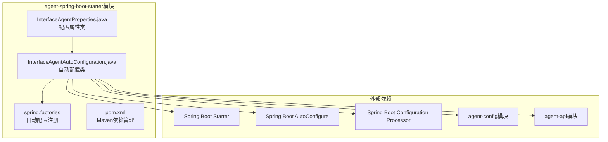
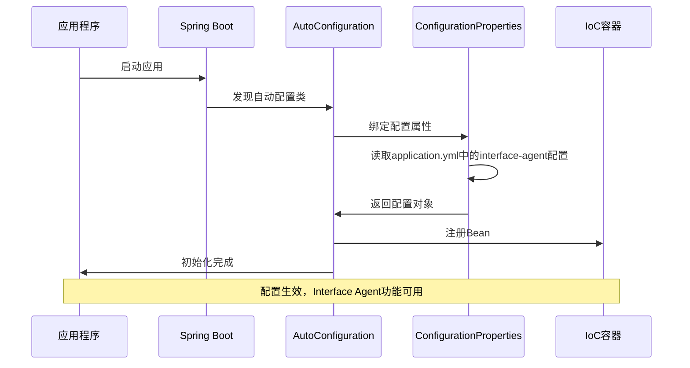
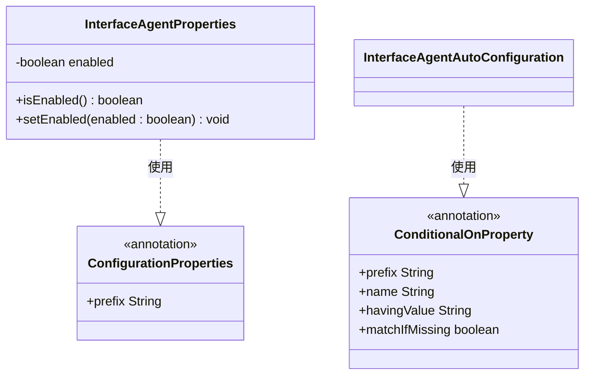
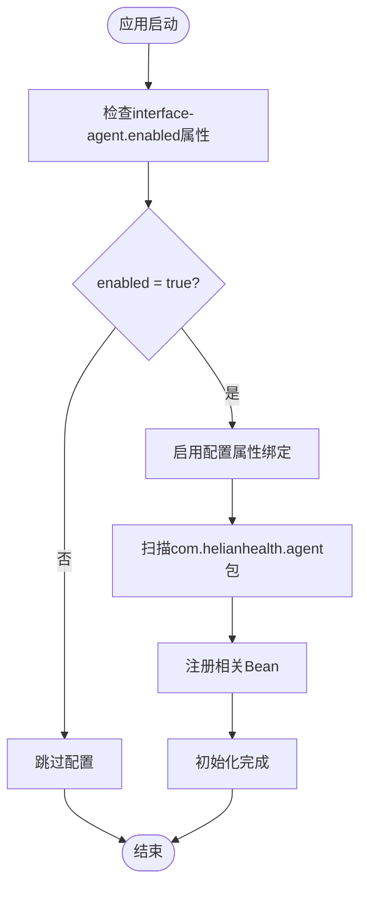

# Starter属性配置

<cite>
**本文档引用的文件**
- [InterfaceAgentProperties.java](file://agent-spring-boot-starter/src/main/java/com/helianhealth/agent/starter/InterfaceAgentProperties.java)
- [InterfaceAgentAutoConfiguration.java](file://agent-spring-boot-starter/src/main/java/com/helianhealth/agent/starter/InterfaceAgentAutoConfiguration.java)
- [spring.factories](file://agent-spring-boot-starter/src/main/resources/META-INF/spring.factories)
- [pom.xml](file://agent-spring-boot-starter/pom.xml)
- [pom.xml](file://pom.xml)
- [application.yml](file://agent-web/src/main/resources/application.yml)
- [application-local.yml](file://agent-web/src/main/resources/application-local.yml)
</cite>

## 目录
1. [简介](#简介)
2. [项目结构](#项目结构)
3. [核心组件](#核心组件)
4. [架构概览](#架构概览)
5. [详细组件分析](#详细组件分析)
6. [配置属性详解](#配置属性详解)
7. [扩展性设计](#扩展性设计)
8. [配置示例](#配置示例)
9. [最佳实践](#最佳实践)
10. [故障排除指南](#故障排除指南)
11. [结论](#结论)

## 简介

agent-spring-boot-starter模块是HelianHealth公司Interface Agent系统的Spring Boot启动器模块。该模块通过自动配置机制为Spring Boot应用程序提供Interface Agent功能的无缝集成。本文档深入分析了该模块暴露的所有可配置属性，重点围绕`InterfaceAgentProperties`类，详细说明其通过`@ConfigurationProperties(prefix = "interface-agent")`暴露的配置命名空间。

该启动器模块目前实现了基础的启用/禁用控制，但设计上预留了充分的扩展空间，指导开发者如何添加新的配置项并实现自动装配。文档将涵盖属性含义、默认值、取值范围、系统行为影响以及完整的配置实践指南。

## 项目结构

agent-spring-boot-starter模块位于项目根目录下的独立子模块中，采用标准的Spring Boot Starter结构：



**图表来源**
- [InterfaceAgentProperties.java](file://agent-spring-boot-starter/src/main/java/com/helianhealth/agent/starter/InterfaceAgentProperties.java#L1-L24)
- [InterfaceAgentAutoConfiguration.java](file://agent-spring-boot-starter/src/main/java/com/helianhealth/agent/starter/InterfaceAgentAutoConfiguration.java#L1-L28)
- [spring.factories](file://agent-spring-boot-starter/src/main/resources/META-INF/spring.factories#L1-L3)

**章节来源**
- [pom.xml](file://agent-spring-boot-starter/pom.xml#L1-L50)
- [pom.xml](file://pom.xml#L12-L25)

## 核心组件

### InterfaceAgentProperties类

`InterfaceAgentProperties`是该模块的核心配置属性类，负责定义所有可配置的参数。该类通过`@ConfigurationProperties(prefix = "interface-agent")`注解将其属性绑定到`interface-agent`命名空间下。

### InterfaceAgentAutoConfiguration类

`InterfaceAgentAutoConfiguration`是自动配置类，负责：
- 条件化启用（基于`interface-agent.enabled`属性）
- 启用配置属性绑定
- 组件扫描和包路径设置
- 日志初始化信息输出

### spring.factories文件

该文件通过SPI机制注册自动配置类，使Spring Boot能够自动发现和加载配置。

**章节来源**
- [InterfaceAgentProperties.java](file://agent-spring-boot-starter/src/main/java/com/helianhealth/agent/starter/InterfaceAgentProperties.java#L8-L23)
- [InterfaceAgentAutoConfiguration.java](file://agent-spring-boot-starter/src/main/java/com/helianhealth/agent/starter/InterfaceAgentAutoConfiguration.java#L14-L27)
- [spring.factories](file://agent-spring-boot-starter/src/main/resources/META-INF/spring.factories#L1-L3)

## 架构概览



**图表来源**
- [InterfaceAgentAutoConfiguration.java](file://agent-spring-boot-starter/src/main/java/com/helianhealth/agent/starter/InterfaceAgentAutoConfiguration.java#L15-L17)
- [spring.factories](file://agent-spring-boot-starter/src/main/resources/META-INF/spring.factories#L1-L3)

## 详细组件分析

### InterfaceAgentProperties类结构分析



**图表来源**
- [InterfaceAgentProperties.java](file://agent-spring-boot-starter/src/main/java/com/helianhealth/agent/starter/InterfaceAgentProperties.java#L8-L23)
- [InterfaceAgentAutoConfiguration.java](file://agent-spring-boot-starter/src/main/java/com/helianhealth/agent/starter/InterfaceAgentAutoConfiguration.java#L15-L17)

### 自动配置流程



**图表来源**
- [InterfaceAgentAutoConfiguration.java](file://agent-spring-boot-starter/src/main/java/com/helianhealth/agent/starter/InterfaceAgentAutoConfiguration.java#L15-L17)

**章节来源**
- [InterfaceAgentProperties.java](file://agent-spring-boot-starter/src/main/java/com/helianhealth/agent/starter/InterfaceAgentProperties.java#L1-L24)
- [InterfaceAgentAutoConfiguration.java](file://agent-spring-boot-starter/src/main/java/com/helianhealth/agent/starter/InterfaceAgentAutoConfiguration.java#L1-L28)

## 配置属性详解

### 当前支持的属性

#### enabled属性

| 属性名 | 类型 | 默认值 | 取值范围 | 描述 | 对系统行为的影响 |
|--------|------|--------|----------|------|------------------|
| interface-agent.enabled | boolean | true | true/false | 控制Interface Agent功能的启用状态 | 当设置为true时，自动配置生效；当设置为false时，跳过自动配置 |

**属性详细说明：**

- **名称**: `interface-agent.enabled`
- **类型**: 布尔类型
- **默认值**: `true`
- **取值范围**: `true` 或 `false`
- **作用域**: 全局配置
- **系统影响**: 
  - `true`: 启动Interface Agent功能，注册相关Bean
  - `false`: 完全禁用Interface Agent功能，不进行任何自动配置

**章节来源**
- [InterfaceAgentProperties.java](file://agent-spring-boot-starter/src/main/java/com/helianhealth/agent/starter/InterfaceAgentProperties.java#L11-L22)
- [InterfaceAgentAutoConfiguration.java](file://agent-spring-boot-starter/src/main/java/com/helianhealth/agent/starter/InterfaceAgentAutoConfiguration.java#L15-L15)

## 扩展性设计

### 预留扩展点

当前版本虽然只实现了`enabled`属性，但设计上预留了充分的扩展空间：

1. **属性扩展**: 可以轻松添加新的配置属性
2. **条件逻辑**: 支持复杂的条件判断
3. **Bean注册**: 可以注册更多类型的Bean
4. **组件扫描**: 支持更广泛的包扫描范围

### 扩展开发指南

#### 添加新配置属性的步骤

1. **修改InterfaceAgentProperties类**：
   ```java
   // 在现有类中添加新属性
   private String newProperty = "defaultValue";
   
   public String getNewProperty() {
       return newProperty;
   }
   
   public void setNewProperty(String newProperty) {
       this.newProperty = newProperty;
   }
   ```

2. **更新自动配置类**（如需要）：
   ```java
   @ConditionalOnProperty(prefix = "interface-agent", name = "enabled", havingValue = "true", matchIfMissing = true)
   @EnableConfigurationProperties({InterfaceAgentProperties.class, NewProperties.class})
   ```

3. **在application.yml中添加配置**：
   ```yaml
   interface-agent:
     enabled: true
     new-property: "custom-value"
   ```

#### 实现自动装配的最佳实践

1. **保持向后兼容**: 新增属性应有合理的默认值
2. **类型安全**: 使用强类型属性而非Object类型
3. **文档完善**: 为每个新属性提供清晰的文档说明
4. **验证逻辑**: 在setter方法中添加必要的验证

**章节来源**
- [InterfaceAgentProperties.java](file://agent-spring-boot-starter/src/main/java/com/helianhealth/agent/starter/InterfaceAgentProperties.java#L8-L23)
- [InterfaceAgentAutoConfiguration.java](file://agent-spring-boot-starter/src/main/java/com/helianhealth/agent/starter/InterfaceAgentAutoConfiguration.java#L15-L17)

## 配置示例

### 基础配置示例

#### 启用Interface Agent功能

```yaml
# application.yml
interface-agent:
  enabled: true
```

#### 禁用Interface Agent功能

```yaml
# application.yml
interface-agent:
  enabled: false
```

### 完整配置示例

```yaml
# application.yml
spring:
  application:
    name: my-interface-agent-app

interface-agent:
  enabled: true

# 其他相关配置
agent-config:
  # 配置agent-config模块的相关属性
  cache:
    enabled: true
    ttl: 3600

agent-api:
  # 配置agent-api模块的相关属性
  timeout: 5000
  retry-count: 3
```

### 环境特定配置

#### 开发环境配置

```yaml
# application-dev.yml
interface-agent:
  enabled: true
  
logging:
  level:
    com.helianhealth.agent: debug
```

#### 生产环境配置

```yaml
# application-prod.yml
interface-agent:
  enabled: true
  
management:
  endpoints:
    web:
      exposure:
        include: health,info,metrics
```

**章节来源**
- [application.yml](file://agent-web/src/main/resources/application.yml#L1-L27)
- [application-local.yml](file://agent-web/src/main/resources/application-local.yml#L1-L35)

## 最佳实践

### 类型安全配置的优势

1. **编译时验证**: 编译器可以在编译阶段发现配置错误
2. **IDE智能提示**: IDE可以提供完整的属性补全和类型提示
3. **重构安全**: 重命名或删除属性时，编译器会及时发现问题
4. **文档化**: 配置属性的类型和默认值在代码中明确可见

### 配置管理最佳实践

1. **分层配置**: 使用profile区分不同环境的配置
2. **集中管理**: 将相关配置放在同一个命名空间下
3. **合理默认值**: 为关键配置提供合理的默认值
4. **文档同步**: 配置变更时同步更新相关文档

### 性能考虑

1. **延迟初始化**: 对于昂贵的Bean，考虑使用延迟初始化
2. **条件装配**: 使用条件注解避免不必要的Bean创建
3. **缓存策略**: 对于频繁访问的配置，考虑添加缓存机制

## 故障排除指南

### 常见问题及解决方案

#### 问题1: 配置不生效

**症状**: 设置`interface-agent.enabled: false`后，Interface Agent功能仍然启用

**可能原因**:
1. 配置文件格式错误
2. 配置键名拼写错误
3. 配置文件未被正确加载

**解决方案**:
1. 检查YAML缩进和格式
2. 确认配置键名为`interface-agent.enabled`
3. 验证配置文件是否在正确的classpath位置

#### 问题2: 自动配置未触发

**症状**: 应用启动时没有看到Interface Agent的初始化日志

**可能原因**:
1. 依赖未正确引入
2. Spring Boot版本不兼容
3. 自动配置类未被发现

**解决方案**:
1. 确认pom.xml中已正确引入starter依赖
2. 检查Spring Boot版本兼容性
3. 验证spring.factories文件是否存在且正确

#### 问题3: 配置属性类型错误

**症状**: 应用启动时报类型转换错误

**可能原因**:
1. 配置值类型与期望类型不匹配
2. 配置值格式不正确

**解决方案**:
1. 检查配置值的数据类型
2. 确保配置值符合预期格式

### 调试技巧

1. **启用调试日志**: 在application.yml中设置`logging.level.com.helianhealth.agent=debug`
2. **检查Bean注册**: 使用`@Autowired`注入配置类验证配置是否正确加载
3. **验证条件注解**: 确认条件注解的表达式正确无误

**章节来源**
- [InterfaceAgentAutoConfiguration.java](file://agent-spring-boot-starter/src/main/java/com/helianhealth/agent/starter/InterfaceAgentAutoConfiguration.java#L22-L26)

## 结论

agent-spring-boot-starter模块通过简洁而强大的设计，为Interface Agent系统提供了灵活的配置管理机制。当前版本虽然只实现了`enabled`属性，但其架构设计充分考虑了未来的扩展需求。

### 主要优势

1. **类型安全**: 通过`@ConfigurationProperties`确保配置的类型安全
2. **条件控制**: 精确的条件装配机制控制功能启停
3. **扩展性强**: 预留的扩展点便于添加新的配置属性
4. **易于使用**: 标准化的Spring Boot配置方式降低使用门槛

### 发展建议

1. **功能丰富化**: 根据实际需求逐步添加更多配置属性
2. **性能优化**: 考虑添加配置缓存和懒加载机制
3. **监控增强**: 添加配置变更的监控和告警机制
4. **文档完善**: 持续更新配置文档，确保与代码同步

该模块为整个Interface Agent系统的配置管理奠定了坚实的基础，通过遵循本文档的最佳实践，开发者可以安全、可靠地管理和扩展配置属性。