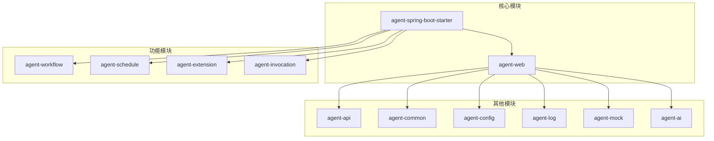
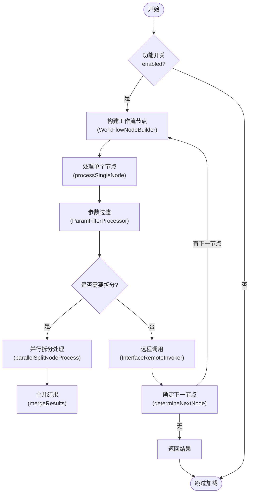
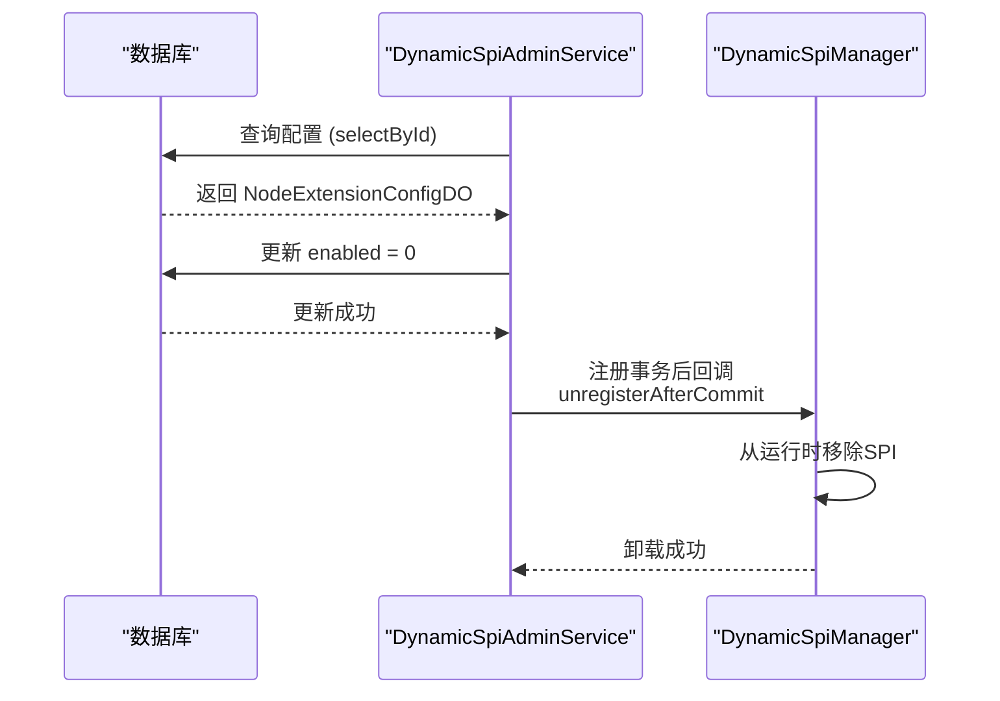
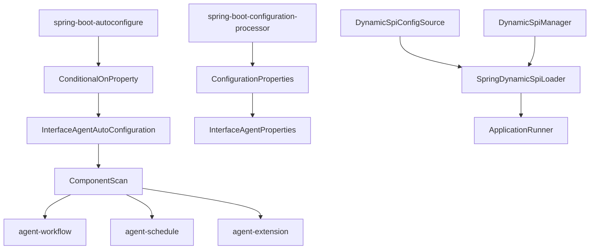

# 功能开关

<cite>
**本文档引用的文件**
- [InterfaceAgentProperties.java](file://agent-spring-boot-starter/src/main/java/com/helianhealth/agent/starter/InterfaceAgentProperties.java)
- [InterfaceAgentAutoConfiguration.java](file://agent-spring-boot-starter/src/main/java/com/helianhealth/agent/starter/InterfaceAgentAutoConfiguration.java)
- [spring.factories](file://agent-spring-boot-starter/src/main/resources/META-INF/spring.factories)
- [application.yml](file://agent-web/src/main/resources/application.yml)
- [application-prod.yml](file://agent-web/src/main/resources/application-prod.yml)
- [application-local.yml](file://agent-web/src/main/resources/application-local.yml)
- [InterfaceAgentApplication.java](file://agent-web/src/main/java/com/helianhealth/agent/InterfaceAgentApplication.java)
- [WorkflowScheduler.java](file://agent-schedule/src/main/java/com/helianhealth/agent/schedule/WorkflowScheduler.java)
- [DynamicSpiAdminService.java](file://agent-workflow/src/main/java/com/helianhealth/agent/workflow/service/extension/DynamicSpiAdminService.java)
- [SpringDynamicSpiLoader.java](file://agent-extension/src/main/java/com/helianhealth/agent/extension/spi/loader/SpringDynamicSpiLoader.java)
</cite>

## 目录
1. [简介](#简介)
2. [项目结构](#项目结构)
3. [核心组件](#核心组件)
4. [架构概述](#架构概述)
5. [详细组件分析](#详细组件分析)
6. [依赖分析](#依赖分析)
7. [性能考虑](#性能考虑)
8. [故障排除指南](#故障排除指南)
9. [结论](#结论)

## 简介
本文档详细介绍了接口代理系统中的功能开关配置机制，重点分析`interface-agent.enabled`配置项的作用与使用场景。该配置项作为全局功能开关，允许开发者在不同环境（如开发、测试、生产）中灵活控制工作流引擎的启用状态，避免在非生产环境中加载不必要的组件，从而提升系统启动效率和运行性能。文档结合`InterfaceAgentProperties`类的实现，深入解析了Spring Boot的`@ConfigurationProperties`注解绑定机制，并提供了在`application.yml`中设置`enabled: false`的实际代码示例及其对系统启动流程的影响。此外，文档还列举了其他可能的功能开关配置模式作为扩展参考，并给出了最佳实践建议。

## 项目结构
本项目采用模块化微服务架构，核心功能被拆分为多个独立的Maven模块，每个模块职责分明，便于维护和扩展。`agent-spring-boot-starter`模块封装了核心的自动配置和功能开关，`agent-web`作为主应用入口，通过引入starter模块来激活功能。`agent-workflow`和`agent-schedule`模块实现了工作流引擎的核心逻辑，而`agent-extension`模块则提供了动态SPI扩展能力。这种结构使得功能开关可以精确地控制整个功能模块的加载。



**图表来源**
- [InterfaceAgentAutoConfiguration.java](file://agent-spring-boot-starter/src/main/java/com/helianhealth/agent/starter/InterfaceAgentAutoConfiguration.java)
- [InterfaceAgentApplication.java](file://agent-web/src/main/java/com/helianhealth/agent/InterfaceAgentApplication.java)

**本节来源**
- [InterfaceAgentAutoConfiguration.java](file://agent-spring-boot-starter/src/main/java/com/helianhealth/agent/starter/InterfaceAgentAutoConfiguration.java)
- [InterfaceAgentApplication.java](file://agent-web/src/main/java/com/helianhealth/agent/InterfaceAgentApplication.java)

## 核心组件
`interface-agent.enabled`是整个系统的核心功能开关，它通过Spring Boot的条件化配置机制，控制着`InterfaceAgentAutoConfiguration`及其他相关组件的加载。当此开关关闭时，不仅工作流调度器（`WorkflowScheduler`）不会被初始化，与之相关的所有服务、控制器和数据访问对象（DAO）都将被排除在Spring应用上下文之外，从而实现了真正的“零加载”。`InterfaceAgentProperties`类作为配置属性的载体，通过`@ConfigurationProperties`注解与`application.yml`文件中的`interface-agent`前缀进行绑定，为功能开关提供了类型安全的访问接口。

**本节来源**
- [InterfaceAgentProperties.java](file://agent-spring-boot-starter/src/main/java/com/helianhealth/agent/starter/InterfaceAgentProperties.java)
- [InterfaceAgentAutoConfiguration.java](file://agent-spring-boot-starter/src/main/java/com/helianhealth/agent/starter/InterfaceAgentAutoConfiguration.java)

## 架构概述
系统的功能开关架构基于Spring Boot的自动配置（Auto-Configuration）和条件化加载（Conditional Loading）机制构建。`agent-spring-boot-starter`模块通过`META-INF/spring.factories`文件声明了`InterfaceAgentAutoConfiguration`为自动配置类。该配置类使用`@ConditionalOnProperty`注解，监听`interface-agent.enabled`属性。当应用启动时，Spring Boot会检查该属性的值，只有在`enabled`为`true`（或未设置，默认为`true`）时，才会执行`@ComponentScan`，扫描并注册`com.helianhealth.agent`包下的所有组件。这确保了功能模块的惰性加载和按需激活。

```mermaid
sequenceDiagram
participant App as "应用启动"
participant Spring as "Spring Boot"
participant Starter as "agent-spring-boot-starter"
participant Config as "InterfaceAgentAutoConfiguration"
participant Properties as "InterfaceAgentProperties"
participant Beans as "组件扫描"
App->>Spring : SpringApplication.run()
Spring->>Starter : 加载 spring.factories
Starter->>Config : 注册自动配置
Config->>Properties : 绑定 interface-agent.*
Properties-->>Config : 返回 enabled 值
alt enabled == true
Config->>Beans : 扫描 com.helianhealth.agent 包
Beans-->>Config : 注册所有组件
Config-->>Spring : 配置完成
else enabled == false
Config-->>Spring : 跳过配置
end
Spring-->>App : 应用启动成功
```

**图表来源**
- [spring.factories](file://agent-spring-boot-starter/src/main/resources/META-INF/spring.factories)
- [InterfaceAgentAutoConfiguration.java](file://agent-spring-boot-starter/src/main/java/com/helianhealth/agent/starter/InterfaceAgentAutoConfiguration.java)
- [InterfaceAgentProperties.java](file://agent-spring-boot-starter/src/main/java/com/helianhealth/agent/starter/InterfaceAgentProperties.java)

## 详细组件分析

### InterfaceAgentProperties 分析
`InterfaceAgentProperties`类是功能开关配置的核心数据模型。它使用Spring Boot的`@ConfigurationProperties`注解，实现了外部配置到Java对象的类型安全绑定。

#### 配置属性绑定机制
```mermaid
classDiagram
class InterfaceAgentProperties {
+boolean enabled
+boolean isEnabled()
+void setEnabled(boolean enabled)
}
note right of InterfaceAgentProperties
使用@ConfigurationProperties(prefix = "interface-agent")
将application.yml中的interface-agent.*属性
自动绑定到此类的字段。
enabled字段的默认值为true。
end note
```

**图表来源**
- [InterfaceAgentProperties.java](file://agent-spring-boot-starter/src/main/java/com/helianhealth/agent/starter/InterfaceAgentProperties.java)

#### 功能开关配置示例
在`application.yml`或其环境特定的变体（如`application-dev.yml`）中，可以通过以下方式配置：

```yaml
interface-agent:
  enabled: false # 全局禁用工作流引擎
```

**本节来源**
- [InterfaceAgentProperties.java](file://agent-spring-boot-starter/src/main/java/com/helianhealth/agent/starter/InterfaceAgentProperties.java)
- [application.yml](file://agent-web/src/main/resources/application.yml)

### 工作流引擎分析
当`interface-agent.enabled`为`true`时，`WorkflowScheduler`等核心工作流组件会被加载。该调度器负责编排工作流节点，支持线性、并行和拆分处理等多种模式。

#### 工作流调度流程


**图表来源**
- [WorkflowScheduler.java](file://agent-schedule/src/main/java/com/helianhealth/agent/schedule/WorkflowScheduler.java)

**本节来源**
- [WorkflowScheduler.java](file://agent-schedule/src/main/java/com/helianhealth/agent/schedule/WorkflowScheduler.java)

### 动态扩展功能分析
系统还支持基于数据库的动态功能开关，例如`DynamicSpiAdminService`中的`disableAndUnregister`方法，允许在运行时通过将数据库中的`enabled`字段设为`0`来禁用特定的SPI扩展。

#### 运行时功能开关


**图表来源**
- [DynamicSpiAdminService.java](file://agent-workflow/src/main/java/com/helianhealth/agent/workflow/service/extension/DynamicSpiAdminService.java)

**本节来源**
- [DynamicSpiAdminService.java](file://agent-workflow/src/main/java/com/helianhealth/agent/workflow/service/extension/DynamicSpiAdminService.java)

## 依赖分析
系统的功能开关依赖于Spring Boot的核心机制。`@ConfigurationProperties`依赖于`spring-boot-configuration-processor`，而条件化配置则依赖于`spring-boot-autoconfigure`。`agent-spring-boot-starter`是所有功能模块的依赖中心，它通过自动配置将`agent-web`与`agent-workflow`、`agent-schedule`等模块连接起来。`SpringDynamicSpiLoader`作为`ApplicationRunner`，在应用启动后加载启用的动态SPI，形成了启动时和运行时的双重开关控制。



**图表来源**
- [InterfaceAgentAutoConfiguration.java](file://agent-spring-boot-starter/src/main/java/com/helianhealth/agent/starter/InterfaceAgentAutoConfiguration.java)
- [SpringDynamicSpiLoader.java](file://agent-extension/src/main/java/com/helianhealth/agent/extension/spi/loader/SpringDynamicSpiLoader.java)

**本节来源**
- [InterfaceAgentAutoConfiguration.java](file://agent-spring-boot-starter/src/main/java/com/helianhealth/agent/starter/InterfaceAgentAutoConfiguration.java)
- [SpringDynamicSpiLoader.java](file://agent-extension/src/main/java/com/helianhealth/agent/extension/spi/loader/SpringDynamicSpiLoader.java)

## 性能考虑
使用`interface-agent.enabled`开关可以显著提升非生产环境的启动性能。当开关关闭时，Spring容器无需解析和初始化数百个与工作流相关的Bean，减少了类加载、依赖注入和AOP代理的开销。此外，避免了数据库连接池的初始化和定时任务的注册，降低了内存占用和CPU使用率。对于大型应用，这可以将启动时间从数十秒缩短至几秒。

## 故障排除指南
如果配置了`interface-agent.enabled: false`但相关组件仍然被加载，请检查以下几点：
1.  确认`InterfaceAgentAutoConfiguration`类上的`@ConditionalOnProperty`注解正确无误。
2.  检查`spring.factories`文件是否正确引用了`InterfaceAgentAutoConfiguration`。
3.  确保`application.yml`文件的路径和内容正确，且没有其他配置文件（如`application-dev.yml`）覆盖了该设置。
4.  查看应用启动日志，确认是否打印了`Interface Agent Auto Configuration initialized!`信息，如果没有，则说明开关生效。

**本节来源**
- [InterfaceAgentAutoConfiguration.java](file://agent-spring-boot-starter/src/main/java/com/helianhealth/agent/starter/InterfaceAgentAutoConfiguration.java)
- [InterfaceAgentProperties.java](file://agent-spring-boot-starter/src/main/java/com/helianhealth/agent/starter/InterfaceAgentProperties.java)

## 结论
`interface-agent.enabled`是一个高效且优雅的全局功能开关，它利用Spring Boot的条件化配置能力，实现了对工作流引擎模块的按需加载。通过在`application.yml`中简单地设置`enabled: false`，即可在开发和测试环境中完全禁用该功能，避免不必要的资源消耗。结合数据库驱动的运行时开关，系统提供了从启动时到运行时的全方位功能控制能力。这种设计模式是微服务和模块化架构中管理复杂功能的优秀实践。