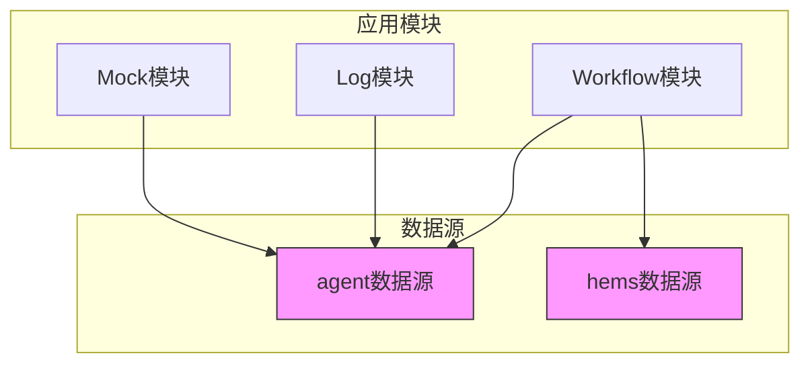
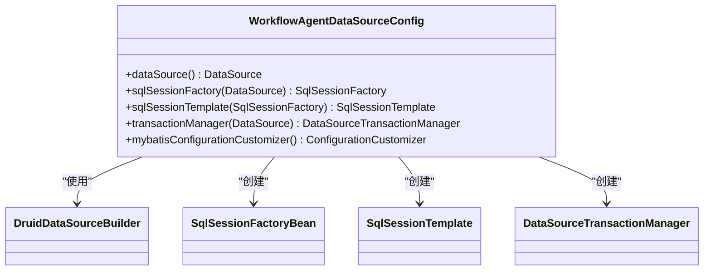
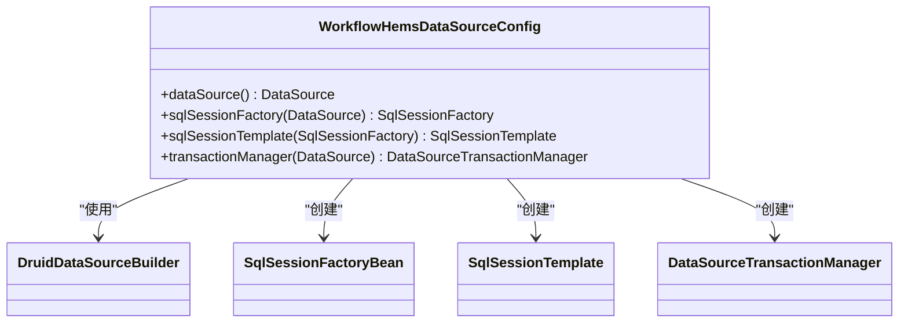
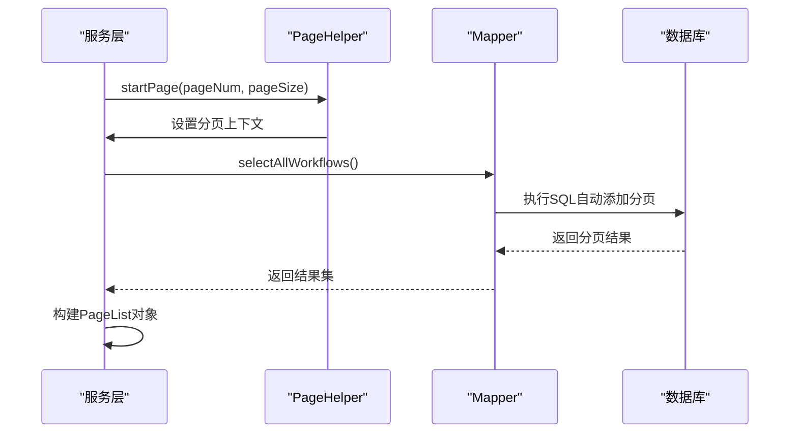
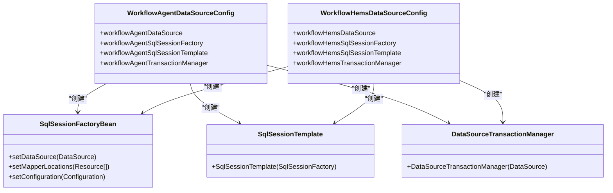
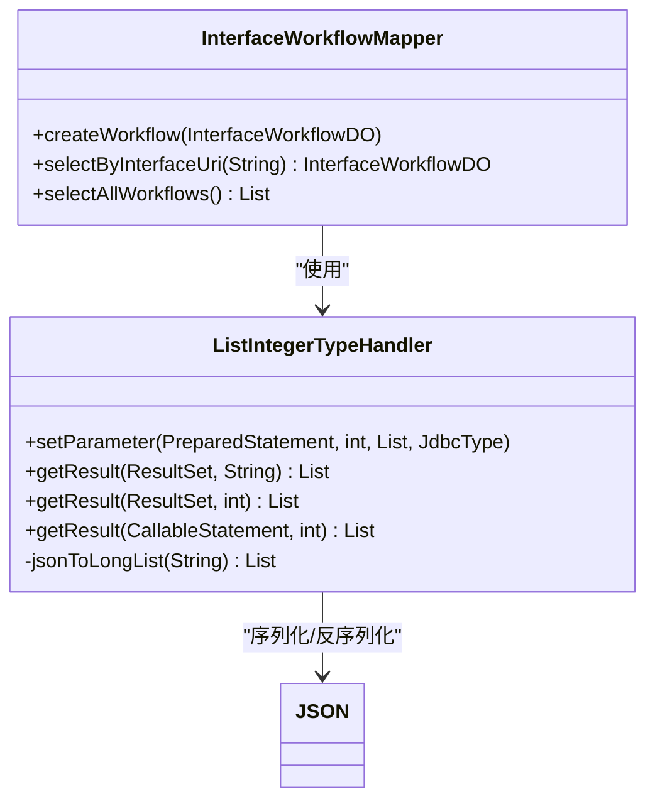

# 数据源配置

<cite>
**本文档引用的文件**   
- [WorkflowAgentDataSourceConfig.java](file://agent-workflow/src/main/java/com/helianhealth/agent/workflow/config/WorkflowAgentDataSourceConfig.java)
- [WorkflowHemsDataSourceConfig.java](file://agent-workflow/src/main/java/com/helianhealth/agent/workflow/config/WorkflowHemsDataSourceConfig.java)
- [LogDataSourceConfig.java](file://agent-log/src/main/java/com/helianhealth/agent/log/config/LogDataSourceConfig.java)
- [MockDataSourceConfig.java](file://agent-mock/src/main/java/com/helianhealth/agent/mock/config/MockDataSourceConfig.java)
- [application-dev-mysql.yml](file://agent-web/src/main/resources/application-dev-mysql.yml)
- [application-dev-sqlserver.yml](file://agent-web/src/main/resources/application-dev-sqlserver.yml)
- [application-dev-gauss.yml](file://agent-web/src/main/resources/application-dev-gauss.yml)
- [init_mysql.sql](file://doc/init_mysql.sql)
- [init_sqlserver.sql](file://doc/init_sqlserver.sql)
- [InterfaceWorkflowMapper.xml](file://agent-workflow/src/main/resources/mapper/agent/InterfaceWorkflowMapper.xml)
- [ListIntegerTypeHandler.java](file://agent-workflow/src/main/java/com/helianhealth/agent/workflow/config/ListIntegerTypeHandler.java)
- [InterfaceWorkflowServiceImpl.java](file://agent-workflow/src/main/java/com/helianhealth/agent/workflow/service/impl/InterfaceWorkflowServiceImpl.java)
- [InterfaceInvokeLogServiceImpl.java](file://agent-log/src/main/java/com/helianhealth/agent/log/service/impl/InterfaceInvokeLogServiceImpl.java)
- [MockConfigServiceImpl.java](file://agent-mock/src/main/java/com/helianhealth/agent/mock/service/impl/MockConfigServiceImpl.java)
</cite>

## 目录
1. [引言](#引言)
2. [数据源配置概述](#数据源配置概述)
3. [核心数据源配置](#核心数据源配置)
4. [Druid连接池配置与性能调优](#druid连接池配置与性能调优)
5. [分页插件PageHelper配置](#分页插件pagehelper配置)
6. [MyBatis多数据源映射与事务管理](#mybatis多数据源映射与事务管理)
7. [常见配置错误及解决方案](#常见配置错误及解决方案)
8. [结论](#结论)

## 引言
本文档详细说明了接口代理系统中agent和hems两个核心数据源的配置方法。系统采用Spring Boot框架，通过Druid连接池管理数据库连接，使用MyBatis作为持久层框架，并实现了多数据源的配置与管理。文档将深入分析数据源的配置方式、连接池参数、分页插件集成以及事务管理策略，为开发人员提供完整的配置指导。

## 数据源配置概述
系统实现了多数据源架构，主要包含agent和hems两个数据源。agent数据源用于存储系统核心配置信息，如工作流定义、节点参数配置等；hems数据源用于连接体软（HEMS）数据库，实现与医疗信息系统的数据交互。系统通过Spring的`@Configuration`注解和`@Bean`注解实现数据源的声明式配置，并利用Druid连接池进行连接管理。

**图示来源**
- [WorkflowAgentDataSourceConfig.java](file://agent-workflow/src/main/java/com/helianhealth/agent/workflow/config/WorkflowAgentDataSourceConfig.java)
- [WorkflowHemsDataSourceConfig.java](file://agent-workflow/src/main/java/com/helianhealth/agent/workflow/config/WorkflowHemsDataSourceConfig.java)
- [LogDataSourceConfig.java](file://agent-log/src/main/java/com/helianhealth/agent/log/config/LogDataSourceConfig.java)
- [MockDataSourceConfig.java](file://agent-mock/src/main/java/com/helianhealth/agent/mock/config/MockDataSourceConfig.java)

## 核心数据源配置
系统通过Java配置类实现数据源的定义和管理。每个数据源都有独立的配置类，负责创建DataSource、SqlSessionFactory、SqlSessionTemplate和TransactionManager等核心组件。

### agent数据源配置
agent数据源配置类`WorkflowAgentDataSourceConfig`位于`agent-workflow`模块中，负责配置与系统核心表的连接。该配置类通过`@ConfigurationProperties(prefix = "spring.datasource.agent")`注解绑定配置文件中的属性。

**图示来源**
- [WorkflowAgentDataSourceConfig.java](file://agent-workflow/src/main/java/com/helianhealth/agent/workflow/config/WorkflowAgentDataSourceConfig.java)

### hems数据源配置
hems数据源配置类`WorkflowHemsDataSourceConfig`同样位于`agent-workflow`模块中，负责配置与体软数据库的连接。与agent数据源类似，它也通过`@ConfigurationProperties(prefix = "spring.datasource.hems")`注解绑定配置属性。

**图示来源**
- [WorkflowHemsDataSourceConfig.java](file://agent-workflow/src/main/java/com/helianhealth/agent/workflow/config/WorkflowHemsDataSourceConfig.java)

### 数据库配置示例
系统提供了针对不同数据库的配置示例，包括MySQL、SQL Server和GaussDB。

#### MySQL配置
在`application-dev-mysql.yml`文件中，agent数据源配置如下：
- **driver-class-name**: com.mysql.cj.jdbc.Driver
- **url**: jdbc:mysql://10.20.4.98:2881/interface_agent?useUnicode=true&characterEncoding=utf8&useSSL=false
- **username**: root@sys
- **password**: LeV4G0ilzPZ2tiAiHOHQ

hems数据源配置如下：
- **driver-class-name**: org.opengauss.Driver
- **url**: jdbc:opengauss://10.20.4.98:5433/mydb?currentSchema=hems
- **username**: myuser
- **password**: Helian!123

**配置来源**
- [application-dev-mysql.yml](file://agent-web/src/main/resources/application-dev-mysql.yml)

#### SQL Server配置
在`application-dev-sqlserver.yml`文件中，agent和hems数据源均使用SQL Server驱动：
- **driver-class-name**: com.microsoft.sqlserver.jdbc.SQLServerDriver
- **url**: jdbc:sqlserver://10.20.4.194:1433;DatabaseName=interface_agent_qhdyfs;encrypt=false;trustServerCertificate=false
- **username**: sa
- **password**: Hjk@2022!@

**配置来源**
- [application-dev-sqlserver.yml](file://agent-web/src/main/resources/application-dev-sqlserver.yml)

#### GaussDB配置
在`application-dev-gauss.yml`文件中，agent和hems数据源均使用GaussDB驱动：
- **driver-class-name**: org.opengauss.Driver
- **url**: jdbc:opengauss://10.20.4.98:5433/mydb?currentSchema=interface_agent2
- **username**: myuser
- **password**: Helian!123

**配置来源**
- [application-dev-gauss.yml](file://agent-web/src/main/resources/application-dev-gauss.yml)

## Druid连接池配置与性能调优
系统采用阿里巴巴的Druid连接池作为数据库连接管理组件。Druid提供了强大的监控和扩展功能，能够有效提升数据库访问性能。

### 连接池核心参数
所有数据源的Druid连接池配置了以下核心参数：
- **initial-size**: 10，初始连接数
- **max-active**: 100，最大活跃连接数
- **min-idle**: 10，最小空闲连接数
- **max-wait**: 60000，获取连接的最大等待时间（毫秒）
- **validation-query**: select 1，连接有效性验证SQL
- **test-while-idle**: true，空闲时检测连接有效性

这些参数的配置确保了系统在高并发场景下能够快速获取数据库连接，同时通过连接有效性检测避免了因长时间空闲导致的连接失效问题。

### 性能调优建议
1. **连接池大小调整**：根据实际并发量调整`max-active`参数，一般建议设置为CPU核心数的2-4倍。
2. **连接超时设置**：合理设置`max-wait`参数，避免因等待连接导致请求超时。
3. **连接有效性检测**：启用`test-while-idle`和`validation-query`，定期检测连接有效性，防止使用已失效的连接。
4. **监控与告警**：利用Druid提供的监控功能，实时监控连接池状态，设置连接使用率告警。

**配置来源**
- [application-dev-mysql.yml](file://agent-web/src/main/resources/application-dev-mysql.yml)
- [application-dev-sqlserver.yml](file://agent-web/src/main/resources/application-dev-sqlserver.yml)
- [application-dev-gauss.yml](file://agent-web/src/main/resources/application-dev-gauss.yml)

## 分页插件PageHelper配置
系统集成了PageHelper分页插件，简化了分页查询的实现。PageHelper通过拦截MyBatis的SQL执行，自动添加分页语句，开发者无需手动编写分页SQL。

### 配置方法
在各环境配置文件中，通过`pagehelper`配置项指定数据库方言：
- MySQL环境：`helper-dialect: mysql`
- SQL Server环境：`helper-dialect: sqlserver`
- GaussDB环境：`helper-dialect: postgresql`

### 使用示例
在服务层代码中，通过`PageHelper.startPage(pageNum, pageSize)`方法开启分页：

**图示来源**
- [InterfaceWorkflowServiceImpl.java](file://agent-workflow/src/main/java/com/helianhealth/agent/workflow/service/impl/InterfaceWorkflowServiceImpl.java)
- [InterfaceInvokeLogServiceImpl.java](file://agent-log/src/main/java/com/helianhealth/agent/log/service/impl/InterfaceInvokeLogServiceImpl.java)
- [MockConfigServiceImpl.java](file://agent-mock/src/main/java/com/helianhealth/agent/mock/service/impl/MockConfigServiceImpl.java)

## MyBatis多数据源映射与事务管理
系统通过MyBatis实现了多数据源的映射与事务管理，确保了数据操作的一致性和完整性。

### 多数据源映射
通过`@MapperScan`注解指定不同数据源的Mapper扫描路径和SqlSessionTemplate：
- agent数据源：`basePackages = {"com.helianhealth.agent.workflow.mapper.agent"}`
- hems数据源：`basePackages = {"com.helianhealth.agent.workflow.mapper.hems"}`

每个数据源都有独立的SqlSessionFactory和SqlSessionTemplate，确保了Mapper接口与正确数据源的绑定。

### 事务管理
系统为每个数据源配置了独立的事务管理器：
- agent数据源事务管理器：`workflowAgentTransactionManager`
- hems数据源事务管理器：`workflowHemsTransactionManager`

**图示来源**
- [WorkflowAgentDataSourceConfig.java](file://agent-workflow/src/main/java/com/helianhealth/agent/workflow/config/WorkflowAgentDataSourceConfig.java)
- [WorkflowHemsDataSourceConfig.java](file://agent-workflow/src/main/java/com/helianhealth/agent/workflow/config/WorkflowHemsDataSourceConfig.java)

### 自定义类型处理器
系统实现了`ListIntegerTypeHandler`自定义类型处理器，用于处理List<Integer>类型的字段。该处理器通过JSON序列化将List对象存储为VARCHAR字段，实现了复杂对象与数据库字段的映射。

**图示来源**
- [ListIntegerTypeHandler.java](file://agent-workflow/src/main/java/com/helianhealth/agent/workflow/config/ListIntegerTypeHandler.java)
- [InterfaceWorkflowMapper.xml](file://agent-workflow/src/main/resources/mapper/agent/InterfaceWorkflowMapper.xml)

## 常见配置错误及解决方案
### 驱动类不匹配
**问题描述**：配置的`driver-class-name`与实际数据库类型不匹配，导致无法加载驱动。
**解决方案**：确保驱动类名正确：
- MySQL: com.mysql.cj.jdbc.Driver
- SQL Server: com.microsoft.sqlserver.jdbc.SQLServerDriver
- GaussDB: org.opengauss.Driver

### URL格式错误
**问题描述**：数据库连接URL格式不正确，导致无法建立连接。
**解决方案**：检查URL格式：
- MySQL: jdbc:mysql://host:port/database?parameters
- SQL Server: jdbc:sqlserver://host:port;DatabaseName=database;parameters
- GaussDB: jdbc:opengauss://host:port/database?parameters

### 连接超时
**问题描述**：数据库连接超时，导致请求失败。
**解决方案**：
1. 检查网络连接是否正常
2. 调整`max-wait`参数值
3. 检查数据库服务器负载情况
4. 确认防火墙设置是否阻止了连接

### 事务管理错误
**问题描述**：跨数据源操作时事务管理不当，导致数据不一致。
**解决方案**：
1. 避免在单个事务中操作多个数据源
2. 使用分布式事务解决方案（如Seata）
3. 通过业务逻辑保证最终一致性

## 结论
本文档详细介绍了接口代理系统中agent和hems数据源的配置方法。系统通过Spring Boot的多数据源配置机制，结合Druid连接池和MyBatis持久层框架，实现了高效、稳定的数据库访问。通过合理的连接池参数配置和分页插件集成，系统能够应对高并发场景下的数据访问需求。同时，通过自定义类型处理器和事务管理机制，确保了数据操作的一致性和完整性。开发人员应遵循本文档的配置指导，避免常见配置错误，确保系统稳定运行。