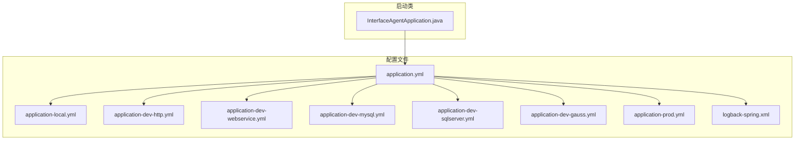
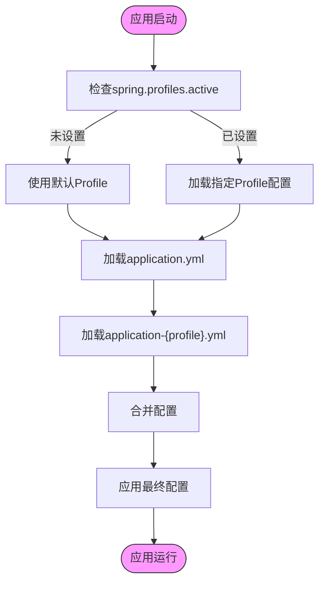
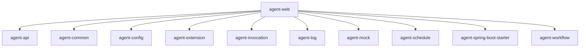
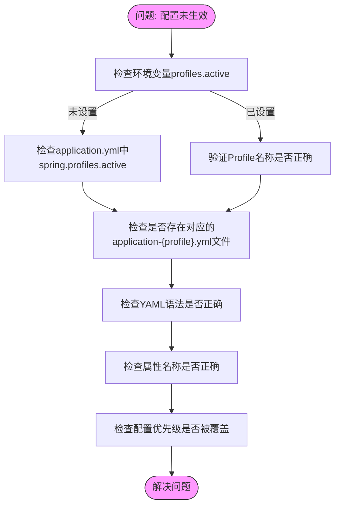

# 环境配置

<cite>
**本文档引用的文件**  
- [application.yml](file://agent-web/src/main/resources/application.yml)
- [application-local.yml](file://agent-web/src/main/resources/application-local.yml)
- [application-dev-http.yml](file://agent-web/src/main/resources/application-dev-http.yml)
- [application-dev-webservice.yml](file://agent-web/src/main/resources/application-dev-webservice.yml)
- [application-dev-mysql.yml](file://agent-web/src/main/resources/application-dev-mysql.yml)
- [application-dev-sqlserver.yml](file://agent-web/src/main/resources/application-dev-sqlserver.yml)
- [application-dev-gauss.yml](file://agent-web/src/main/resources/application-dev-gauss.yml)
- [application-prod.yml](file://agent-web/src/main/resources/application-prod.yml)
- [logback-spring.xml](file://agent-web/src/main/resources/logback-spring.xml)
- [InterfaceAgentApplication.java](file://agent-web/src/main/java/com/helianhealth/agent/InterfaceAgentApplication.java)
</cite>

## 目录
1. [简介](#简介)
2. [项目结构](#项目结构)
3. [核心组件](#核心组件)
4. [架构概述](#架构概述)
5. [详细组件分析](#详细组件分析)
6. [依赖分析](#依赖分析)
7. [性能考虑](#性能考虑)
8. [故障排除指南](#故障排除指南)
9. [结论](#结论)

## 简介
本文档系统性地介绍了基于Spring Profile的多环境配置管理机制，重点说明`application.yml`中`spring.profiles.active`变量的用途，以及如何通过外部参数动态指定激活的配置文件。文档详细对比了`dev`、`local`、`prod`等不同环境配置文件的差异与适用场景，并列举了HTTP、WebService、数据库等各类协议对应的开发环境配置文件（如`application-dev-http.yml`）及其作用。同时提供了配置文件切换的实际操作步骤和验证方法，说明了配置优先级规则，并包含常见问题如配置未生效、环境变量冲突的排查指南。

## 项目结构
本项目采用模块化架构，核心配置文件位于`agent-web`模块的`src/main/resources/`目录下。项目通过Spring Boot的Profile机制实现多环境配置管理，支持本地开发、多种开发环境和生产环境的灵活切换。



**Diagram sources**
- [application.yml](file://agent-web/src/main/resources/application.yml)
- [application-local.yml](file://agent-web/src/main/resources/application-local.yml)
- [application-dev-http.yml](file://agent-web/src/main/resources/application-dev-http.yml)
- [application-dev-webservice.yml](file://agent-web/src/main/resources/application-dev-webservice.yml)
- [application-dev-mysql.yml](file://agent-web/src/main/resources/application-dev-mysql.yml)
- [application-dev-sqlserver.yml](file://agent-web/src/main/resources/application-dev-sqlserver.yml)
- [application-dev-gauss.yml](file://agent-web/src/main/resources/application-dev-gauss.yml)
- [application-prod.yml](file://agent-web/src/main/resources/application-prod.yml)
- [logback-spring.xml](file://agent-web/src/main/resources/logback-spring.xml)
- [InterfaceAgentApplication.java](file://agent-web/src/main/java/com/helianhealth/agent/InterfaceAgentApplication.java)

**Section sources**
- [application.yml](file://agent-web/src/main/resources/application.yml)
- [application-local.yml](file://agent-web/src/main/resources/application-local.yml)
- [application-dev-http.yml](file://agent-web/src/main/resources/application-dev-http.yml)
- [application-dev-webservice.yml](file://agent-web/src/main/resources/application-dev-webservice.yml)
- [application-dev-mysql.yml](file://agent-web/src/main/resources/application-dev-mysql.yml)
- [application-dev-sqlserver.yml](file://agent-web/src/main/resources/application-dev-sqlserver.yml)
- [application-dev-gauss.yml](file://agent-web/src/main/resources/application-dev-gauss.yml)
- [application-prod.yml](file://agent-web/src/main/resources/application-prod.yml)

## 核心组件
项目的核心配置管理机制基于Spring Boot的Profile功能，通过`spring.profiles.active`属性动态激活不同的配置文件。主配置文件`application.yml`定义了基础配置和占位符，而具体的环境配置文件则覆盖特定环境的设置，如数据库连接、服务器端口等。

**Section sources**
- [application.yml](file://agent-web/src/main/resources/application.yml)
- [application-local.yml](file://agent-web/src/main/resources/application-local.yml)
- [application-dev-http.yml](file://agent-web/src/main/resources/application-dev-http.yml)
- [application-dev-webservice.yml](file://agent-web/src/main/resources/application-dev-webservice.yml)
- [application-dev-mysql.yml](file://agent-web/src/main/resources/application-dev-mysql.yml)
- [application-dev-sqlserver.yml](file://agent-web/src/main/resources/application-dev-sqlserver.yml)
- [application-dev-gauss.yml](file://agent-web/src/main/resources/application-dev-gauss.yml)
- [application-prod.yml](file://agent-web/src/main/resources/application-prod.yml)

## 架构概述
本项目的配置管理架构采用Spring Boot的标准Profile机制，通过主配置文件与多个环境特定配置文件的组合实现灵活的环境切换。`application.yml`作为主配置文件，定义了所有环境共享的基础配置，而`application-{profile}.yml`文件则针对特定环境提供覆盖配置。

```mermaid
graph TB
A[启动应用] --> B{检查spring.profiles.active}
B --> |未指定| C[使用默认Profile]
B --> |指定| D[加载对应Profile配置]
C --> E[加载application.yml]
D --> F[加载application-{profile}.yml]
E --> G[合并配置]
F --> G
G --> H[应用最终配置]
```

**Diagram sources**
- [application.yml](file://agent-web/src/main/resources/application.yml)
- [application-local.yml](file://agent-web/src/main/resources/application-local.yml)
- [application-dev-http.yml](file://agent-web/src/main/resources/application-dev-http.yml)
- [application-dev-webservice.yml](file://agent-web/src/main/resources/application-dev-webservice.yml)
- [application-dev-mysql.yml](file://agent-web/src/main/resources/application-dev-mysql.yml)
- [application-dev-sqlserver.yml](file://agent-web/src/main/resources/application-dev-sqlserver.yml)
- [application-dev-gauss.yml](file://agent-web/src/main/resources/application-dev-gauss.yml)
- [application-prod.yml](file://agent-web/src/main/resources/application-prod.yml)

## 详细组件分析

### Spring Profile配置机制分析
Spring Profile机制通过`spring.profiles.active`属性控制激活的配置文件。在`application.yml`中，该属性被设置为`${profiles.active}`，允许通过外部参数动态指定激活的Profile。

```mermaid
classDiagram
class ApplicationYml {
+spring.profiles.active : ${profiles.active}
+server.port : 8099
+logging.config : classpath : logback-spring.xml
}
class ApplicationLocalYml {
+spring.profiles : local
+server.port : 8099
+datasource.agent.url : jdbc : sqlserver : //192.168.0.107 : 1433;DatabaseName=interface_agent
}
class ApplicationDevHttpYml {
+spring.profiles : dev-http
+server.port : 8099
+datasource.agent.url : jdbc : sqlserver : //10.20.4.245 : 1433;DatabaseName=interface_agent_http
}
class ApplicationDevWebserviceYml {
+spring.profiles : dev-webservice
+server.port : 8099
+datasource.agent.url : jdbc : sqlserver : //10.20.4.245 : 1433;DatabaseName=interface_agent_webservice
}
class ApplicationDevMysqlYml {
+spring.profiles : dev-mysql
+server.port : 8099
+datasource.agent.url : jdbc : mysql : //10.20.4.98 : 2881/interface_agent
}
class ApplicationDevSqlserverYml {
+spring.profiles : dev-sqlserver
+server.port : 8099
+datasource.agent.url : jdbc : sqlserver : //10.20.4.194 : 1433;DatabaseName=interface_agent_qhdyfs
}
class ApplicationDevGaussYml {
+spring.profiles : dev-gauss
+server.port : 8088
+datasource.agent.url : jdbc : opengauss : //10.20.4.98 : 5433/mydb?currentSchema=interface_agent2
}
class ApplicationProdYml {
+spring.profiles : prod
+server.port : 8099
+datasource.agent.url : jdbc : opengauss : //172.16.16.147 : 5433/mydb?currentSchema=interface_agent
}
ApplicationYml <|-- ApplicationLocalYml
ApplicationYml <|-- ApplicationDevHttpYml
ApplicationYml <|-- ApplicationDevWebserviceYml
ApplicationYml <|-- ApplicationDevMysqlYml
ApplicationYml <|-- ApplicationDevSqlserverYml
ApplicationYml <|-- ApplicationDevGaussYml
ApplicationYml <|-- ApplicationProdYml
```

**Diagram sources**
- [application.yml](file://agent-web/src/main/resources/application.yml)
- [application-local.yml](file://agent-web/src/main/resources/application-local.yml)
- [application-dev-http.yml](file://agent-web/src/main/resources/application-dev-http.yml)
- [application-dev-webservice.yml](file://agent-web/src/main/resources/application-dev-webservice.yml)
- [application-dev-mysql.yml](file://agent-web/src/main/resources/application-dev-mysql.yml)
- [application-dev-sqlserver.yml](file://agent-web/src/main/resources/application-dev-sqlserver.yml)
- [application-dev-gauss.yml](file://agent-web/src/main/resources/application-dev-gauss.yml)
- [application-prod.yml](file://agent-web/src/main/resources/application-prod.yml)

**Section sources**
- [application.yml](file://agent-web/src/main/resources/application.yml)
- [application-local.yml](file://agent-web/src/main/resources/application-local.yml)
- [application-dev-http.yml](file://agent-web/src/main/resources/application-dev-http.yml)
- [application-dev-webservice.yml](file://agent-web/src/main/resources/application-dev-webservice.yml)
- [application-dev-mysql.yml](file://agent-web/src/main/resources/application-dev-mysql.yml)
- [application-dev-sqlserver.yml](file://agent-web/src/main/resources/application-dev-sqlserver.yml)
- [application-dev-gauss.yml](file://agent-web/src/main/resources/application-dev-gauss.yml)
- [application-prod.yml](file://agent-web/src/main/resources/application-prod.yml)

### 配置文件优先级与合并规则
Spring Boot在启动时会按照特定顺序加载和合并配置文件，优先级从高到低如下：
1. 命令行参数
2. `application-{profile}.properties`或`application-{profile}.yml`文件
3. `application.properties`或`application.yml`文件
4. 默认属性



**Diagram sources**
- [application.yml](file://agent-web/src/main/resources/application.yml)
- [application-local.yml](file://agent-web/src/main/resources/application-local.yml)
- [application-dev-http.yml](file://agent-web/src/main/resources/application-dev-http.yml)
- [application-dev-webservice.yml](file://agent-web/src/main/resources/application-dev-webservice.yml)
- [application-dev-mysql.yml](file://agent-web/src/main/resources/application-dev-mysql.yml)
- [application-dev-sqlserver.yml](file://agent-web/src/main/resources/application-dev-sqlserver.yml)
- [application-dev-gauss.yml](file://agent-web/src/main/resources/application-dev-gauss.yml)
- [application-prod.yml](file://agent-web/src/main/resources/application-prod.yml)

**Section sources**
- [application.yml](file://agent-web/src/main/resources/application.yml)
- [application-local.yml](file://agent-web/src/main/resources/application-local.yml)
- [application-dev-http.yml](file://agent-web/src/main/resources/application-dev-http.yml)
- [application-dev-webservice.yml](file://agent-web/src/main/resources/application-dev-webservice.yml)
- [application-dev-mysql.yml](file://agent-web/src/main/resources/application-dev-mysql.yml)
- [application-dev-sqlserver.yml](file://agent-web/src/main/resources/application-dev-sqlserver.yml)
- [application-dev-gauss.yml](file://agent-web/src/main/resources/application-dev-gauss.yml)
- [application-prod.yml](file://agent-web/src/main/resources/application-prod.yml)

## 依赖分析
项目通过Maven进行依赖管理，各模块之间通过明确的依赖关系组织。`agent-web`模块作为主应用模块，依赖其他功能模块，并包含所有环境配置文件。



**Diagram sources**
- [pom.xml](file://agent-web/pom.xml)

**Section sources**
- [pom.xml](file://agent-web/pom.xml)

## 性能考虑
多环境配置机制对性能的影响主要体现在应用启动阶段，因为Spring需要加载和解析多个配置文件。建议在生产环境中使用精简的配置文件，并避免不必要的Profile激活。

## 故障排除指南
### 配置未生效问题排查
当配置未按预期生效时，可按照以下步骤进行排查：



**Diagram sources**
- [application.yml](file://agent-web/src/main/resources/application.yml)
- [application-local.yml](file://agent-web/src/main/resources/application-local.yml)
- [application-dev-http.yml](file://agent-web/src/main/resources/application-dev-http.yml)
- [application-dev-webservice.yml](file://agent-web/src/main/resources/application-dev-webservice.yml)
- [application-dev-mysql.yml](file://agent-web/src/main/resources/application-dev-mysql.yml)
- [application-dev-sqlserver.yml](file://agent-web/src/main/resources/application-dev-sqlserver.yml)
- [application-dev-gauss.yml](file://agent-web/src/main/resources/application-dev-gauss.yml)
- [application-prod.yml](file://agent-web/src/main/resources/application-prod.yml)

**Section sources**
- [application.yml](file://agent-web/src/main/resources/application.yml)
- [application-local.yml](file://agent-web/src/main/resources/application-local.yml)
- [application-dev-http.yml](file://agent-web/src/main/resources/application-dev-http.yml)
- [application-dev-webservice.yml](file://agent-web/src/main/resources/application-dev-webservice.yml)
- [application-dev-mysql.yml](file://agent-web/src/main/resources/application-dev-mysql.yml)
- [application-dev-sqlserver.yml](file://agent-web/src/main/resources/application-dev-sqlserver.yml)
- [application-dev-gauss.yml](file://agent-web/src/main/resources/application-dev-gauss.yml)
- [application-prod.yml](file://agent-web/src/main/resources/application-prod.yml)

### 环境变量冲突问题
当多个环境变量可能导致配置冲突时，应遵循Spring Boot的配置优先级规则，确保高优先级的配置能够正确覆盖低优先级的配置。

## 结论
本文档详细介绍了基于Spring Profile的多环境配置管理机制，涵盖了配置文件的结构、激活方式、优先级规则以及常见问题的排查方法。通过合理使用`spring.profiles.active`属性和外部参数，可以实现灵活的环境切换，满足不同部署环境的需求。建议在实际使用中遵循最佳实践，确保配置的一致性和可维护性。