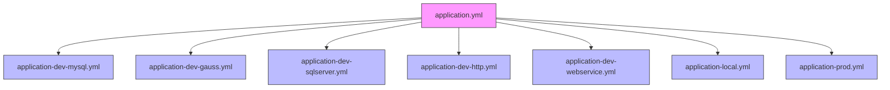
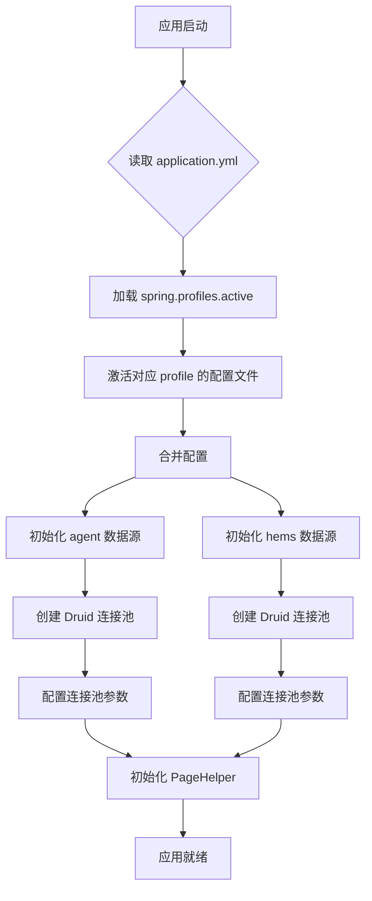

# 配置说明

<cite>
**本文档中引用的文件**  
- [application.yml](file://agent-web/src/main/resources/application.yml)
- [application-dev-mysql.yml](file://agent-web/src/main/resources/application-dev-mysql.yml)
- [application-prod.yml](file://agent-web/src/main/resources/application-prod.yml)
- [InterfaceAgentProperties.java](file://agent-spring-boot-starter/src/main/java/com/helianhealth/agent/starter/InterfaceAgentProperties.java)
- [InterfaceAgentAutoConfiguration.java](file://agent-spring-boot-starter/src/main/java/com/helianhealth/agent/starter/InterfaceAgentAutoConfiguration.java)
- [WorkflowAgentDataSourceConfig.java](file://agent-workflow/src/main/java/com/helianhealth/agent/workflow/config/WorkflowAgentDataSourceConfig.java)
- [WorkflowHemsDataSourceConfig.java](file://agent-workflow/src/main/java/com/helianhealth/agent/workflow/config/WorkflowHemsDataSourceConfig.java)
- [MockDataSourceConfig.java](file://agent-mock/src/main/java/com/helianhealth/agent/mock/config/MockDataSourceConfig.java)
- [LogDataSourceConfig.java](file://agent-log/src/main/java/com/helianhealth/agent/log/config/LogDataSourceConfig.java)
- [application-dev-gauss.yml](file://agent-web/src/main/resources/application-dev-gauss.yml)
- [application-dev-sqlserver.yml](file://agent-web/src/main/resources/application-dev-sqlserver.yml)
- [application-dev-http.yml](file://agent-web/src/main/resources/application-dev-http.yml)
- [application-dev-webservice.yml](file://agent-web/src/main/resources/application-dev-webservice.yml)
- [application-local.yml](file://agent-web/src/main/resources/application-local.yml)
- [spring.factories](file://agent-spring-boot-starter/src/main/resources/META-INF/spring.factories)
</cite>

## 目录
1. [简介](#简介)
2. [核心配置文件结构](#核心配置文件结构)
3. [数据源配置详解](#数据源配置详解)
4. [工作流引擎启用配置](#工作流引擎启用配置)
5. [多环境配置管理](#多环境配置管理)
6. [分页插件与数据库连接池配置](#分页插件与数据库连接池配置)
7. [完整配置示例](#完整配置示例)
8. [最佳实践与注意事项](#最佳实践与注意事项)

## 简介
本配置说明文档旨在为系统管理员和开发人员提供全面的配置指导，涵盖 `application.yml` 中所有关键配置项的详细解释。文档重点说明了 `agent` 和 `hems` 两个数据源的配置方法，包括驱动类名、连接URL、用户名和密码等核心参数。同时，文档介绍了如何通过 `interface-agent.enabled` 配置项控制工作流引擎的启用状态，以及如何管理和切换不同环境的配置文件（如 `application-dev-mysql.yml`、`application-prod.yml` 等）。此外，文档还详细列出了 `agent-spring-boot-starter` 模块中 `InterfaceAgentProperties` 类暴露的所有可配置属性，并提供了数据库连接池（Druid）和分页插件（PageHelper）的配置指导。

**Section sources**
- [application.yml](file://agent-web/src/main/resources/application.yml)
- [InterfaceAgentProperties.java](file://agent-spring-boot-starter/src/main/java/com/helianhealth/agent/starter/InterfaceAgentProperties.java)

## 核心配置文件结构
系统采用 Spring Boot 的标准配置机制，主配置文件为 `application.yml`，位于 `agent-web/src/main/resources/` 目录下。该文件定义了应用的基本属性，如服务端口、应用名称、日志配置等。环境特定的配置则通过多个 `application-{profile}.yml` 文件实现，这些文件会覆盖主配置文件中的相应设置。



**Diagram sources**
- [application.yml](file://agent-web/src/main/resources/application.yml)
- [application-dev-mysql.yml](file://agent-web/src/main/resources/application-dev-mysql.yml)
- [application-prod.yml](file://agent-web/src/main/resources/application-prod.yml)

**Section sources**
- [application.yml](file://agent-web/src/main/resources/application.yml)

## 数据源配置详解
系统配置了两个独立的数据源：`agent` 和 `hems`，分别用于连接不同的数据库。这两个数据源的配置均遵循 Spring Boot 的标准数据源配置格式，并使用 Alibaba Druid 作为连接池实现。

### agent 数据源配置
`agent` 数据源是系统的核心数据源，用于存储工作流、节点配置、日志等核心业务数据。其配置项包括：

- **driver-class-name**: 数据库驱动类名。根据数据库类型不同而变化，例如 MySQL 使用 `com.mysql.cj.jdbc.Driver`，OpenGauss 使用 `org.opengauss.Driver`。
- **url**: 数据库连接URL，包含主机地址、端口、数据库名和必要的连接参数。
- **username**: 数据库用户名。
- **password**: 数据库密码。
- **initial-size**: 连接池初始化时创建的连接数。
- **max-active**: 连接池中允许的最大活动连接数。
- **min-idle**: 连接池中保持的最小空闲连接数。
- **max-wait**: 从连接池获取连接的最大等待时间（毫秒）。
- **validation-query**: 用于验证连接有效性的SQL语句。
- **test-while-idle**: 是否在连接空闲时进行有效性验证。

### hems 数据源配置
`hems` 数据源用于连接体软（Hems）数据库，通常用于查询患者信息、检查报告等医疗数据。其配置结构与 `agent` 数据源完全相同，但连接的是不同的数据库实例。

```mermaid
classDiagram
class WorkflowAgentDataSourceConfig {
+dataSource() DataSource
+sqlSessionFactory(DataSource) SqlSessionFactory
+sqlSessionTemplate(SqlSessionFactory) SqlSessionTemplate
+transactionManager(DataSource) DataSourceTransactionManager
}
class WorkflowHemsDataSourceConfig {
+dataSource() DataSource
+sqlSessionFactory(DataSource) SqlSessionFactory
+sqlSessionTemplate(SqlSessionFactory) SqlSessionTemplate
+transactionManager(DataSource) DataSourceTransactionManager
}
WorkflowAgentDataSourceConfig --> "spring.datasource.agent" : 配置前缀
WorkflowHemsDataSourceConfig --> "spring.datasource.hems" : 配置前缀
WorkflowAgentDataSourceConfig ..> DruidDataSourceBuilder : 使用
WorkflowHemsDataSourceConfig ..> DruidDataSourceBuilder : 使用
```

**Diagram sources**
- [WorkflowAgentDataSourceConfig.java](file://agent-workflow/src/main/java/com/helianhealth/agent/workflow/config/WorkflowAgentDataSourceConfig.java)
- [WorkflowHemsDataSourceConfig.java](file://agent-workflow/src/main/java/com/helianhealth/agent/workflow/config/WorkflowHemsDataSourceConfig.java)

**Section sources**
- [application-dev-mysql.yml](file://agent-web/src/main/resources/application-dev-mysql.yml)
- [application-dev-gauss.yml](file://agent-web/src/main/resources/application-dev-gauss.yml)
- [WorkflowAgentDataSourceConfig.java](file://agent-workflow/src/main/java/com/helianhealth/agent/workflow/config/WorkflowAgentDataSourceConfig.java)
- [WorkflowHemsDataSourceConfig.java](file://agent-workflow/src/main/java/com/helianhealth/agent/workflow/config/WorkflowHemsDataSourceConfig.java)

## 工作流引擎启用配置
系统通过 `interface-agent.enabled` 配置项来控制工作流引擎的启用状态。该配置项由 `agent-spring-boot-starter` 模块中的 `InterfaceAgentProperties` 类定义，并通过 `InterfaceAgentAutoConfiguration` 类实现条件化自动配置。

### 配置属性说明
- **interface-agent.enabled**: 布尔类型，用于启用或禁用 Interface Agent 的所有功能。默认值为 `true`，表示启用。当设置为 `false` 时，系统将不会加载任何与 Interface Agent 相关的组件和配置。

### 自动配置机制
`InterfaceAgentAutoConfiguration` 类使用了 `@ConditionalOnProperty` 注解，确保只有当 `interface-agent.enabled` 属性为 `true` 时，相关的自动配置才会生效。这种设计允许用户在不修改代码的情况下，通过简单的配置切换来启用或禁用整个工作流引擎。

```mermaid
classDiagram
class InterfaceAgentProperties {
-enabled : boolean
+isEnabled() boolean
+setEnabled(boolean) void
}
class InterfaceAgentAutoConfiguration {
+InterfaceAgentAutoConfiguration()
}
InterfaceAgentAutoConfiguration --> InterfaceAgentProperties : 依赖
InterfaceAgentAutoConfiguration ..> @ConditionalOnProperty : 条件注解
```

**Diagram sources**
- [InterfaceAgentProperties.java](file://agent-spring-boot-starter/src/main/java/com/helianhealth/agent/starter/InterfaceAgentProperties.java)
- [InterfaceAgentAutoConfiguration.java](file://agent-spring-boot-starter/src/main/java/com/helianhealth/agent/starter/InterfaceAgentAutoConfiguration.java)

**Section sources**
- [InterfaceAgentProperties.java](file://agent-spring-boot-starter/src/main/java/com/helianhealth/agent/starter/InterfaceAgentProperties.java)
- [InterfaceAgentAutoConfiguration.java](file://agent-spring-boot-starter/src/main/java/com/helianhealth/agent/starter/InterfaceAgentAutoConfiguration.java)

## 多环境配置管理
系统通过 Spring Profile 机制支持多环境配置，允许为不同的部署环境（如开发、测试、生产）提供独立的配置文件。

### 环境配置文件列表
- `application-dev-mysql.yml`: 开发环境，使用 MySQL 数据库。
- `application-dev-gauss.yml`: 开发环境，使用 OpenGauss 数据库。
- `application-dev-sqlserver.yml`: 开发环境，使用 SQL Server 数据库。
- `application-dev-http.yml`: 开发环境，用于 HTTP 接口测试。
- `application-dev-webservice.yml`: 开发环境，用于 WebService 接口测试。
- `application-local.yml`: 本地开发环境配置。
- `application-prod.yml`: 生产环境配置。

### 配置切换方式
通过设置 `spring.profiles.active` 属性来激活特定的配置文件。该属性可以在 `application.yml` 中通过 `${profiles.active}` 占位符从系统环境变量或 JVM 参数中读取，也可以直接在命令行中指定。

```bash
# 启动应用并指定使用 MySQL 开发环境配置
java -jar interface-agent.jar --spring.profiles.active=dev-mysql

# 或通过环境变量设置
export profiles.active=prod
java -jar interface-agent.jar
```

**Section sources**
- [application.yml](file://agent-web/src/main/resources/application.yml)
- [application-dev-mysql.yml](file://agent-web/src/main/resources/application-dev-mysql.yml)
- [application-dev-gauss.yml](file://agent-web/src/main/resources/application-dev-gauss.yml)
- [application-dev-sqlserver.yml](file://agent-web/src/main/resources/application-dev-sqlserver.yml)
- [application-dev-http.yml](file://agent-web/src/main/resources/application-dev-http.yml)
- [application-dev-webservice.yml](file://agent-web/src/main/resources/application-dev-webservice.yml)
- [application-local.yml](file://agent-web/src/main/resources/application-local.yml)
- [application-prod.yml](file://agent-web/src/main/resources/application-prod.yml)

## 分页插件与数据库连接池配置
系统集成了 PageHelper 分页插件和 Alibaba Druid 数据库连接池，以提供高效的数据库访问能力。

### 分页插件 (PageHelper) 配置
PageHelper 的方言（dialect）需要根据实际使用的数据库进行设置，以确保生成正确的分页SQL语句。
- **MySQL**: `helper-dialect: mysql`
- **OpenGauss / PostgreSQL**: `helper-dialect: postgresql`
- **SQL Server**: `helper-dialect: sqlserver`

### 数据库连接池 (Druid) 配置
Druid 连接池提供了丰富的监控和管理功能。核心配置项已在数据源配置中说明。此外，系统在 `DatabaseApiClientManager` 中也定义了默认的连接池参数，确保动态创建的数据源也具有合理的性能配置。



**Diagram sources**
- [application-dev-mysql.yml](file://agent-web/src/main/resources/application-dev-mysql.yml)
- [application-prod.yml](file://agent-web/src/main/resources/application-prod.yml)
- [DatabaseApiClientManager.java](file://agent-invocation/src/main/java/com/helianhealth/agent/invocation/remote/manager/DatabaseApiClientManager.java)

**Section sources**
- [application-dev-mysql.yml](file://agent-web/src/main/resources/application-dev-mysql.yml)
- [application-prod.yml](file://agent-web/src/main/resources/application-prod.yml)
- [DatabaseApiClientManager.java](file://agent-invocation/src/main/java/com/helianhealth/agent/invocation/remote/manager/DatabaseApiClientManager.java)

## 完整配置示例
以下是一个完整的 `application-dev-mysql.yml` 配置文件示例：

```yaml
server:
  port: 8099

spring:
  profiles: dev-mysql
  datasource:
    agent:
      type: com.alibaba.druid.pool.DruidDataSource
      driver-class-name: com.mysql.cj.jdbc.Driver
      url: jdbc:mysql://10.20.4.98:2881/interface_agent?useUnicode=true&characterEncoding=utf8&useSSL=false
      username: root@sys
      password: LeV4G0ilzPZ2tiAiHOHQ
      initial-size: 10
      max-active: 100
      min-idle: 10
      max-wait: 60000
      validation-query: select 1
      test-while-idle: true
    hems:
      type: com.alibaba.druid.pool.DruidDataSource
      driver-class-name: org.opengauss.Driver
      url: jdbc:opengauss://10.20.4.98:5433/mydb?currentSchema=hems
      username: myuser
      password: Helian!123
      initial-size: 10
      max-active: 100
      min-idle: 10
      max-wait: 60000
      validation-query: select 1
      test-while-idle: true

pagehelper:
  helper-dialect: mysql

interface-agent:
  enabled: true
```

**Section sources**
- [application-dev-mysql.yml](file://agent-web/src/main/resources/application-dev-mysql.yml)

## 最佳实践与注意事项
1. **密码安全**: 配置文件中的数据库密码应避免明文存储，建议使用配置中心或环境变量进行管理。
2. **连接池调优**: `initial-size`、`max-active` 等参数应根据实际应用的并发量进行调整，避免资源浪费或连接不足。
3. **环境隔离**: 生产环境的配置文件 (`application-prod.yml`) 应严格管理，避免与开发环境配置混淆。
4. **配置生效**: 修改配置后，必须重启应用才能使新配置生效。
5. **Profile 优先级**: 当多个 Profile 被激活时，后激活的 Profile 配置会覆盖先激活的 Profile 中的同名配置项。
6. **自动配置**: `agent-spring-boot-starter` 通过 `spring.factories` 文件注册了 `InterfaceAgentAutoConfiguration`，确保其能在应用启动时被自动加载。

**Section sources**
- [application.yml](file://agent-web/src/main/resources/application.yml)
- [InterfaceAgentAutoConfiguration.java](file://agent-spring-boot-starter/src/main/java/com/helianhealth/agent/starter/InterfaceAgentAutoConfiguration.java)
- [spring.factories](file://agent-spring-boot-starter/src/main/resources/META-INF/spring.factories)