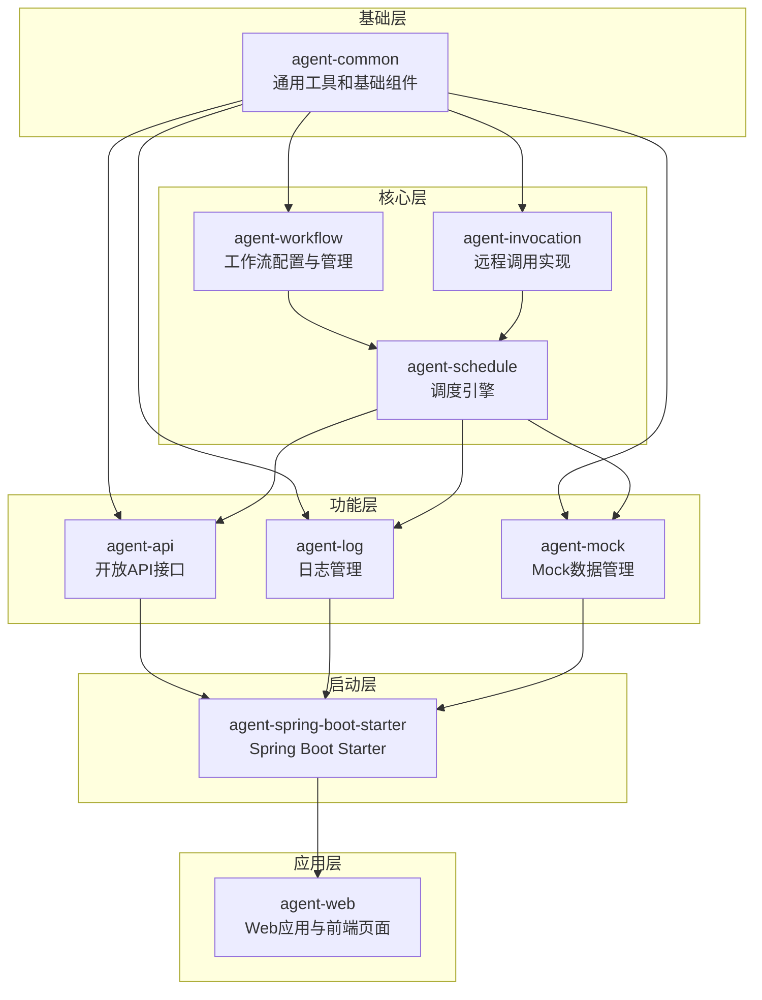
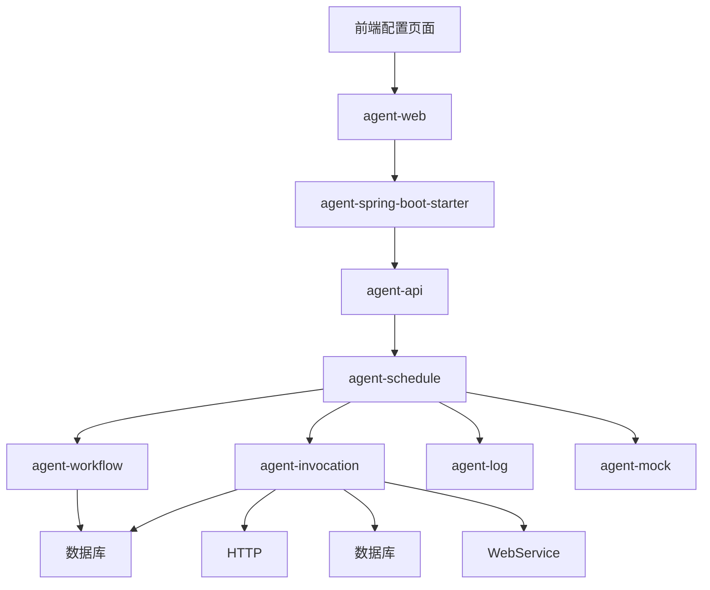
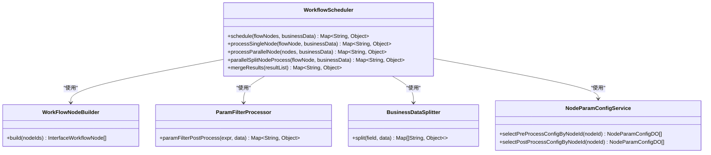
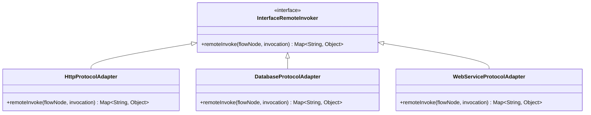
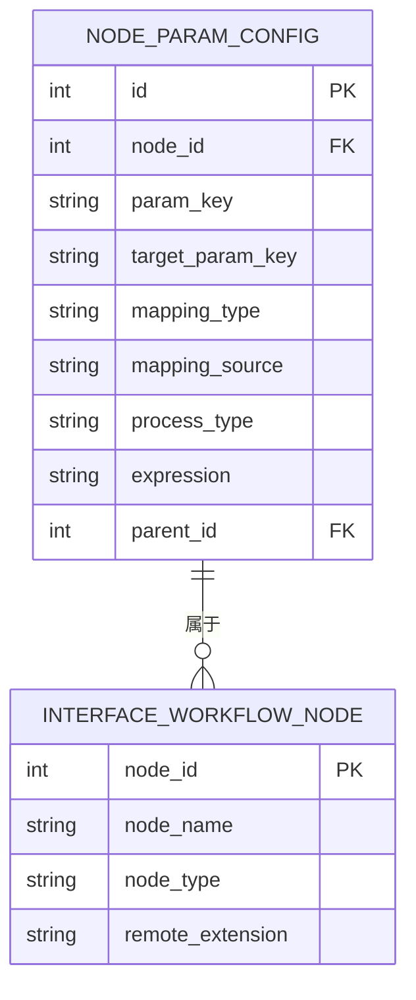
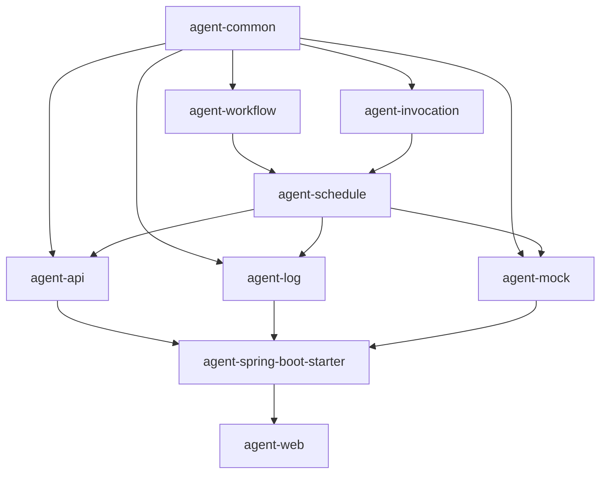

# 项目概述

<cite>
**本文档引用的文件**  
- [README.md](file://README.md)
- [pom.xml](file://pom.xml)
- [InterfaceAgentApplication.java](file://agent-web/src/main/java/com/helianhealth/agent/InterfaceAgentApplication.java)
- [console-ui/package.json](file://console-ui/package.json)
- [WorkflowScheduler.java](file://agent-schedule/src/main/java/com/helianhealth/agent/schedule/WorkflowScheduler.java)
- [ApiService.java](file://agent-api/src/main/java/com/helianhealth/agent/api/service/ApiService.java)
- [NodeType.java](file://agent-common/src/main/java/com/helianhealth/agent/common/enums/NodeType.java)
- [ProductSolutions.vue](file://console-ui/src/views/ProductSolutions.vue)
- [InterfaceAgentAutoConfiguration.java](file://agent-spring-boot-starter/src/main/java/com/helianhealth/agent/starter/InterfaceAgentAutoConfiguration.java)
- [EnhancedAgentExtensionFactory.java](file://agent-extension/src/main/java/com/helianhealth/agent/extension/factory/EnhancedAgentExtensionFactory.java)
- [agent-ai/README.md](file://agent-ai/README.md)
</cite>

## 目录

1. [简介](#简介)
2. [项目结构](#项目结构)
3. [核心组件](#核心组件)
4. [架构概览](#架构概览)
5. [详细组件分析](#详细组件分析)
6. [依赖分析](#依赖分析)
7. [性能考量](#性能考量)
8. [故障排除指南](#故障排除指南)
9. [结论](#结论)

## 简介

interface-agent-dev 是一个基于 Spring Boot 的可插拔工作流引擎，旨在解决企业级系统集成中的接口对接难题。该项目通过配置化设计，将传统的编码实现转变为可视化配置，支持 HTTP、数据库、WebService 等多种调用方式，并提供前端配置页面，使非技术人员也能参与接口配置。项目既可作为独立应用运行，也可通过 `agent-spring-boot-starter` 集成到其他 Spring Boot 项目中，具备高度的灵活性和可扩展性。

**Section sources**
- [README.md](file://README.md#L1-L284)

## 项目结构

interface-agent-dev 采用模块化架构，各模块职责清晰，层次分明。项目主要由以下模块组成：

- **agent-common**：通用工具和基础组件，提供异常处理、工具类、公共常量与枚举等。
- **agent-workflow**：工作流配置与管理，负责工作流的创建、更新、删除等操作。
- **agent-invocation**：远程调用实现，支持 HTTP、数据库、WebService 等多种协议。
- **agent-schedule**：调度引擎，负责工作流的调度和执行。
- **agent-api**：开放 API 接口，提供对外服务。
- **agent-log**：日志管理，记录调用日志并提供查询功能。
- **agent-mock**：Mock 数据管理，支持节点级 Mock 配置。
- **agent-config**：公共配置，包括 CORS、异常处理、静态资源等。
- **agent-spring-boot-starter**：Spring Boot 自动配置 Starter，支持项目集成。
- **agent-web**：Web 应用与前端页面，作为可执行入口。
- **agent-ai**：AI 相关功能模块，支持智能表达式生成、接口文档分析等。

**Diagram sources**
- [README.md](file://README.md#L16-L30)
- [pom.xml](file://pom.xml#L12-L25)

**Section sources**
- [README.md](file://README.md#L16-L30)
- [pom.xml](file://pom.xml#L12-L25)

## 核心组件

### 可插拔工作流引擎

interface-agent-dev 的核心是一个可插拔工作流引擎，支持多种调用方式（HTTP、数据库、WebService），并通过配置化设计实现接口对接的零编码。用户可以通过前端配置页面，无需编写代码即可完成工作流的创建和参数映射。

### 可视化配置界面

项目提供基于 Vue.js 的前端配置页面，用户可以通过可视化界面配置工作流、节点和参数映射。配置信息存储在数据库中，支持导入导出，便于复用和管理。

### 动态扩展能力

通过 Dubbo SPI 机制，项目支持动态扩展，运行时加载扩展，无需重启服务。用户可以自定义扩展类，通过动态 SPI 管理器加载，实现新协议的接入。

### Mock 支持

内置 Mock 功能，支持节点级 Mock 配置，方便测试和调试。用户可以为每个节点配置 Mock 响应数据，支持多场景切换，脱离三方环境进行开发。

**Section sources**
- [README.md](file://README.md#L7-L14)
- [ProductSolutions.vue](file://console-ui/src/views/ProductSolutions.vue#L1-L800)

## 架构概览

interface-agent-dev 采用分层架构，从基础层到应用层，各模块职责清晰，依赖关系明确。项目通过 Spring Boot Starter 实现自动配置，支持独立运行和集成使用两种模式。

**Diagram sources**
- [README.md](file://README.md#L203-L238)
- [pom.xml](file://pom.xml#L12-L25)

**Section sources**
- [README.md](file://README.md#L203-L238)
- [pom.xml](file://pom.xml#L12-L25)

## 详细组件分析

### 工作流调度器

`WorkflowScheduler` 是工作流引擎的核心组件，负责编排整个工作流。它支持单节点、多节点并行调度，并通过 SpEL 表达式实现条件流转。调度器使用线程池异步执行任务，自动合并结果，支持字段拆分并行处理。

**Diagram sources**
- [WorkflowScheduler.java](file://agent-schedule/src/main/java/com/helianhealth/agent/schedule/WorkflowScheduler.java#L1-L276)

**Section sources**
- [WorkflowScheduler.java](file://agent-schedule/src/main/java/com/helianhealth/agent/schedule/WorkflowScheduler.java#L1-L276)

### 远程调用实现

`InterfaceRemoteInvoker` 是远程调用的统一接口，通过 Dubbo SPI 机制，支持 HTTP、数据库、WebService 等多种协议。每个协议实现该接口，框架根据节点配置自动选择对应的协议实现。

**Diagram sources**
- [agent-invocation/src/main/java/com/helianhealth/agent/invocation/remote/InterfaceRemoteInvoker.java](file://agent-invocation/src/main/java/com/helianhealth/agent/invocation/remote/InterfaceRemoteInvoker.java)
- [agent-invocation/src/main/java/com/helianhealth/agent/invocation/remote/http/HttpProtocolAdapter.java](file://agent-invocation/src/main/java/com/helianhealth/agent/invocation/remote/http/HttpProtocolAdapter.java)
- [agent-invocation/src/main/java/com/helianhealth/agent/invocation/remote/database/DatabaseProtocolAdapter.java](file://agent-invocation/src/main/java/com/helianhealth/agent/invocation/remote/database/DatabaseProtocolAdapter.java)
- [agent-invocation/src/main/java/com/helianhealth/agent/invocation/remote/webService/WebServiceProtocolAdapter.java](file://agent-invocation/src/main/java/com/helianhealth/agent/invocation/remote/webService/WebServiceProtocolAdapter.java)

**Section sources**
- [agent-invocation/src/main/java/com/helianhealth/agent/invocation/remote/InterfaceRemoteInvoker.java](file://agent-invocation/src/main/java/com/helianhealth/agent/invocation/remote/InterfaceRemoteInvoker.java)
- [agent-invocation/src/main/java/com/helianhealth/agent/invocation/remote/http/HttpProtocolAdapter.java](file://agent-invocation/src/main/java/com/helianhealth/agent/invocation/remote/http/HttpProtocolAdapter.java)
- [agent-invocation/src/main/java/com/helianhealth/agent/invocation/remote/database/DatabaseProtocolAdapter.java](file://agent-invocation/src/main/java/com/helianhealth/agent/invocation/remote/database/DatabaseProtocolAdapter.java)
- [agent-invocation/src/main/java/com/helianhealth/agent/invocation/remote/webService/WebServiceProtocolAdapter.java](file://agent-invocation/src/main/java/com/helianhealth/agent/invocation/remote/webService/WebServiceProtocolAdapter.java)

### 参数映射配置

项目支持树形参数映射配置，支持复杂嵌套结构转换。通过数据库存储的树形参数配置，支持前置（请求）和后置（响应）双向映射，配合 SpEL 表达式，可处理任意复杂的参数转换。

**Diagram sources**
- [agent-workflow/src/main/java/com/helianhealth/agent/workflow/model/domain/NodeParamConfigDO.java](file://agent-workflow/src/main/java/com/helianhealth/agent/workflow/model/domain/NodeParamConfigDO.java)
- [agent-workflow/src/main/java/com/helianhealth/agent/workflow/model/po/InterfaceWorkflowNodePO.java](file://agent-workflow/src/main/java/com/helianhealth/agent/workflow/model/po/InterfaceWorkflowNodePO.java)

**Section sources**
- [agent-workflow/src/main/java/com/helianhealth/agent/workflow/model/domain/NodeParamConfigDO.java](file://agent-workflow/src/main/java/com/helianhealth/agent/workflow/model/domain/NodeParamConfigDO.java)
- [agent-workflow/src/main/java/com/helianhealth/agent/workflow/model/po/InterfaceWorkflowNodePO.java](file://agent-workflow/src/main/java/com/helianhealth/agent/workflow/model/po/InterfaceWorkflowNodePO.java)

## 依赖分析

项目依赖关系清晰，基础层（agent-common）被所有其他模块依赖，核心层（agent-workflow、agent-invocation、agent-schedule）依赖基础层，功能层（agent-api、agent-log、agent-mock）依赖核心层，启动层（agent-spring-boot-starter）依赖功能层，应用层（agent-web）依赖启动层。

**Diagram sources**
- [pom.xml](file://pom.xml#L12-L25)

**Section sources**
- [pom.xml](file://pom.xml#L12-L25)

## 性能考量

- **线程池隔离**：使用专用线程池 `WorkFlowNodeExecutor` 执行并行任务，避免影响主线程。
- **异步编排**：通过 `CompletableFuture` 实现异步任务编排，自动等待所有任务完成。
- **结果合并**：递归合并嵌套结构，数组类型自动聚合，对象类型递归合并，保留所有节点返回值。
- **动态扩展**：支持运行时编译加载 Java 源码，每个动态类使用独立 `ClassLoader` 隔离，支持完整类卸载和热更新。

**Section sources**
- [WorkflowScheduler.java](file://agent-schedule/src/main/java/com/helianhealth/agent/schedule/WorkflowScheduler.java#L1-L276)
- [EnhancedAgentExtensionFactory.java](file://agent-extension/src/main/java/com/helianhealth/agent/extension/factory/EnhancedAgentExtensionFactory.java#L1-L110)

## 故障排除指南

- **依赖缺失**：确保所有模块的依赖已正确配置，特别是 `agent-common` 和 `agent-spring-boot-starter`。
- **配置错误**：检查 `application.yml` 中的数据源配置，确保数据库连接正常。
- **SPI 扩展失败**：确认 SPI 扩展类已正确实现 `InterfaceRemoteInvoker` 接口，并在 `META-INF/dubbo` 目录下注册。
- **前端页面无法访问**：确保 `agent-web` 模块已正确启动，前端静态资源已正确打包。

**Section sources**
- [README.md](file://README.md#L48-L73)
- [agent-spring-boot-starter/pom.xml](file://agent-spring-boot-starter/pom.xml#L1-L50)

## 结论

interface-agent-dev 作为一个可插拔工作流引擎，通过配置化设计和动态扩展能力，解决了企业级系统集成中的接口对接难题。项目支持多种调用方式，提供可视化配置界面，既可作为独立应用运行，也可通过 Spring Boot Starter 集成到其他项目中。其模块化架构和清晰的依赖关系，使得项目易于维护和扩展。未来，通过 AI 赋能，项目将进一步降低接入门槛，提升配置效率。

**Section sources**
- [README.md](file://README.md#L1-L284)
- [ProductSolutions.vue](file://console-ui/src/views/ProductSolutions.vue#L1-L800)
- [agent-ai/README.md](file://agent-ai/README.md#L1-L53)