# 接口配置框架参考文档

本文档用于指导AI如何根据业务需求生成完整的接口配置，包括工作流、节点和参数映射配置。

---

## 目录

0. [三方接口对接指南](#三方接口对接指南)
1. [节点配置](#节点配置)
   - 1.1 [节点配置介绍](#节点配置介绍)
   - 1.2 [节点MCP接口](#节点mcp接口)
2. [工作流配置](#工作流配置)
   - 2.1 [工作流配置介绍](#工作流配置介绍)
   - 2.2 [工作流MCP接口](#工作流mcp接口)
3. [节点参数映射配置](#节点参数映射配置)
   - 3.1 [常规参数映射](#常规参数映射)
   - 3.2 [嵌套参数映射](#嵌套参数映射)
   - 3.3 [参数映射MCP接口](#参数映射mcp接口)
4. [节点扩展配置](#节点扩展配置)
5. [配置示例](#配置示例)

---

## 三方接口对接指南

本章节专门为AI提供完整的三方接口对接指导，帮助AI理解**如何根据客户提供的接口文档自动生成完整的配置**。

### 对接流程图

```mermaid
graph TD
    Start([收到三方接口文档]) --> Analyze[AI分析三方接口文档]
    
    Analyze --> A1[识别接口类型]
    A1 --> A2[提取URL/连接/认证信息]
    A2 --> A3[提取三方入参/出参结构]
    
    A3 --> Check{⚠️强制确认卡点}
    Check --> C1[AI推断上游系统]
    C1 --> C2{AI判断结果}
    
    C2 -->|包含HIS/收费/体检等关键词| C3[✓ 三方系统确认]
    C2 -->|包含HTTP/WebService/DB| C3
    C2 -->|无法明确判断| C4[? 需要人工确认]
    
    C3 --> C5[❌ 必须确认上游信息]
    C4 --> C5
    
    C5 --> C6{人工确认}
    C6 -->|选择| C7[上游系统类型]
    C7 --> C8[□ Jarvis 标准]
    C7 --> C9[□ 其他系统]
    
    C8 --> C10[选择业务类型]
    C10 --> C11[□ 建档 □ 账单 □ 申请单 □ 报告]
    C11 --> C12[引用 business/jarvis_*.md]
    
    C9 --> C13[要求提供上游入参示例]
    
    C12 --> Confirmed[✓ 确认完成]
    C13 --> Confirmed
    
    Confirmed --> Step1[步骤1: 创建节点]
    Step1 --> S1_1[调用MCP接口创建节点]
    S1_1 --> S1_2[获得nodeId]
    
    S1_2 --> Step2[步骤2: 配置参数映射]
    
    Step2 --> S2_Info[明确数据流向]
    S2_Info --> S2_Flow[前置: 上游入参→三方入参<br/>后置: 三方响应→上游响应]
    
    S2_Flow --> S2_Pre[配置前置处理]
    S2_Pre --> S2_P1{字段映射类型?}
    S2_P1 -->|字段名相同| S2_P2[NAME映射]
    S2_P1 -->|需要转换| S2_P3[EXPRESSION映射]
    S2_P1 -->|固定值| S2_P4[CONSTANT映射]
    
    S2_P2 --> S2_P5{结构类型?}
    S2_P3 --> S2_P5
    S2_P4 --> S2_P5
    
    S2_P5 -->|嵌套对象| S2_P6[父节点+childParams子节点]
    S2_P5 -->|数组| S2_P7[数组节点+虚拟节点+元素]
    S2_P5 -->|基本类型| S2_P8[直接配置]
    
    S2_P6 --> S2_Post[配置后置处理]
    S2_P7 --> S2_Post
    S2_P8 --> S2_Post
    
    S2_Post --> S2_R1[状态码转换<br/>result='0'→code='200']
    S2_R1 --> S2_R2[配置响应字段映射]
    S2_R2 --> S2_R3{响应来源?}
    S2_R3 -->|从三方响应取值| S2_R4[mappingSource=RESPONSE]
    S2_R3 -->|需补充入参数据| S2_R5[同时使用INPUT+RESPONSE]
    
    S2_R4 --> S2_Done[调用MCP导入参数映射]
    S2_R5 --> S2_Done
    
    S2_Done --> Step3[步骤3: 创建工作流]
    Step3 --> S3_1[设置interfaceUri]
    S3_1 --> S3_2{调用方是谁?}
    S3_2 -->|Jarvis| S3_3[使用BusinessMethod]
    S3_2 -->|三方系统| S3_4[使用自定义URI]
    
    S3_3 --> S3_5[设置contentType]
    S3_4 --> S3_5
    S3_5 --> S3_6[关联firstFlowNodes]
    S3_6 --> S3_7[调用MCP创建工作流]
    
    S3_7 --> Step4[步骤4: 验证对接]
    Step4 --> V1[关闭Mock开关]
    V1 --> V2[上游发起真实调用]
    V2 --> V3[查看调用日志]
    V3 --> V4{链路是否正常?}
    
    V4 -->|是| End([✓ 对接完成])
    V4 -->|否| Debug[排查问题]
    Debug --> D1{问题类型?}
    D1 -->|参数映射错误| S2_Pre
    D1 -->|节点配置错误| Step1
    D1 -->|工作流配置错误| Step3
```



### 关键决策点说明

#### 1. 上游系统识别（⚠️ 关键卡点）

**AI智能判断**：
- 三方文档包含HIS/收费/体检等关键词 → 确认为三方系统
- 接口类型为HTTP/WebService/Database → 确认为三方接口

**强制人工确认**：
- ☐ 上游系统类型：☐ Jarvis  ☐ 其他系统
- ☐ 业务类型：☐ 建档  ☐ 账单  ☐ 申请单  ☐ 报告
- ☐ 上游入参来源：
  - ☐ Jarvis标准（引用 `business/jarvis_*.md`）
  - ☐ 自定义入参（需提供示例）

❌ **未完成确认，禁止继续配置！**

#### 2. 数据流向明确

**前置处理**：
- `sourceParamKey`: 上游字段（Jarvis或其他上游系统）
- `targetParamKey`: 三方接口字段

**后置处理**：
- `sourceParamKey`: 三方响应字段
- `targetParamKey`: 上游响应字段
- `mappingSource`: 指定数据来源（RESPONSE/INPUT）

#### 3. 字段映射类型选择

- **NAME**：字段名相同且类型一致
- **EXPRESSION**：需要转换（性别、状态码等）
- **CONSTANT**：固定值（系统标识等）

#### 4. 嵌套结构处理

- **对象**：父节点(OBJECT) + `childParams`子节点
- **数组**：数组节点(ARRAY) + 虚拟节点 + 元素字段

#### 5. 后置处理数据来源

- **响应完整**：`mappingSource=RESPONSE`
- **需补充入参数据**：同时使用`INPUT`和`RESPONSE`

#### 6. 工作流URI设置

- **Jarvis调用**：使用`BusinessMethod`（如`CreateArchives`）
- **三方系统调用**：使用自定义URI（如`queryPatient`）

---

### 对接流程总览

对接一个三方接口需要完成**四个核心步骤**：

```
步骤0: 确认上游信息 (⚠️ 必须)
  ├─ AI智能分析：识别三方系统特征
  ├─ 人工确认：上游系统类型（Jarvis/其他）
  ├─ 人工确认：业务类型（建档/账单/申请单/报告）
  └─ 获取上游入参：引用jarvis_*.md 或 要求提供示例
  
步骤1: 创建节点 (Node)
  └─ 定义调用三方接口的元信息（URL、请求头等）
  
步骤2: 配置参数映射 (ParamMapping)
  ├─ 前置处理: 上游入参 → 三方入参
  └─ 后置处理: 三方响应 → 上游响应
  
步骤3: 创建工作流 (Workflow)
  └─ 关联节点，定义对外接口URI
  
步骤4: 验证对接
  ├─ 关闭Mock开关
  ├─ 上游发起真实调用
  ├─ 查看调用日志
  └─ 根据结果排查问题
```

---

### 步骤0：确认上游信息（⚠️ 关键卡点）

**此步骤不可跳过！** 没有上游入参定义，无法配置正确的参数映射。

#### AI智能分析（第一步）

AI会自动分析三方文档，识别：

**检查项** | **判断依据** | **结论**
---|---|---
业务关键词 | 包含HIS、收费、体检等 | 三方系统确认 ✓
接口类型 | HTTP、WebService、Database | 三方接口确认 ✓
字段命名 | 包含系统特定前缀（his_、pacs_） | 三方字段确认 ✓

**AI推断结果示例：**
```
✓ 三方系统：收费建档系统（HTTP接口）
? 上游系统：需要确认
  
AI推荐：
- 如果对接Jarvis → 使用 business/jarvis_archive.md
- 如果对接其他系统 → 请提供上游入参示例
```

#### 强制人工确认（第二步）

**即使AI已推断，仍需确认以下信息：**

☐ **上游系统类型**：
  - ☐ Jarvis标准系统
  - ☐ 其他上游系统（请注明：________）

☐ **业务类型**：
  - ☐ 建档业务
  - ☐ 账单业务
  - ☐ 申请单业务
  - ☐ 报告查询业务
  - ☐ 其他（请注明：________）

☐ **上游入参来源**：
  - ☐ 使用Jarvis标准（将引用 `business/jarvis_{business_type}.md`）
  - ☐ 自定义入参（请附上入参示例JSON）

❌ **未完成上述确认，禁止继续配置！**

#### 对话示例

```
AI：我已分析您提供的三方接口文档：
✓ 三方系统：收费系统
✓ 接口类型：HTTP POST application/json
✓ 7个接口：查询档案、创建档案、推送收费...

⚠️ 我需要确认上游信息：
1. 上游系统是Jarvis还是其他系统？
2. 如果是Jarvis → 是建档业务吗？我将使用 jarvis_archive.md
3. 如果是其他系统 → 请提供上游系统调用时的入参示例

用户：上游是Jarvis，建档业务

AI：✓ 确认配置信息：
- 上游：Jarvis建档接口（jarvis_archive.md）
- 三方：收费系统7个接口
- 前置处理：Jarvis标准字段 → 收费系统字段
- 后置处理：收费响应 → Jarvis标准响应

开始生成配置...
```

### 步骤1：创建节点

根据三方接口类型选择对应的节点类型：

#### HTTP接口节点创建

**分析要点**：
- 提取接口URL（必填）
- 提取HTTP请求方法（默认POST）
- 提取请求头信息（如认证token、Content-Type）
- 选择关键字字段用于日志追踪

**MCP接口调用**：
```bash
POST /v1/ai/mcp/workflow-node/create
```

**请求示例**：
```json
{
  "nodeName": "创建个人建档接口",
  "nodeType": "HTTP",
  "metaInfo": "{\"url\":\"http://his.example.com/api/createPatient\",\"method\":\"POST\",\"headers\":{\"Content-Type\":\"application/json\",\"Authorization\":\"Bearer xxx\"}}",
  "keywordField": "patientCode",
  "flowId": null
}
```

**响应获取nodeId**：
```json
{
  "code": "200",
  "rsp": 8
}
```
记录返回的`nodeId=8`，后续配置参数映射时使用。

#### WebService接口节点创建

**分析要点**：
- 提取WSDL地址或SOAP请求URL
- 提取SOAP请求模板，使用`${inputParam}`占位符
- 分析响应格式，配置业务数据定位方式

**请求示例**：
```json
{
  "nodeName": "PACS申请单接口",
  "nodeType": "WEBSERVICE",
  "metaInfo": "{\"url\":\"http://pacs.example.com/soap\",\"soupTemplate\":\"<soapenv:Envelope>...</soapenv:Envelope>\",\"elementName\":\"request\"}",
  "keywordField": "applyId"
}
```

#### Database节点创建

**分析要点**：
- 提取数据库连接信息（驱动、URL、用户名、密码）
- 编写SQL模板，使用`{paramName}`占位符

**请求示例**：
```json
{
  "nodeName": "查询报告数据",
  "nodeType": "DATABASE",
  "metaInfo": "{\"driverClassName\":\"com.microsoft.sqlserver.jdbc.SQLServerDriver\",\"url\":\"jdbc:sqlserver://...\",\"username\":\"user\",\"password\":\"pass\",\"operation\":\"SELECT\",\"sqlTemplate\":\"SELECT * FROM Report WHERE patientCode={PatientCode}\"}"
}
```

---

### 步骤2：配置参数映射

参数映射是对接的**核心**，需要配置**前置处理**和**后置处理**两部分。

#### 前置处理：构建三方入参

**任务**：将上游系统（Jarvis）的入参转换为三方接口要求的格式。

**分析步骤**：
1. 对比上游入参字段与三方入参字段
2. 字段名相同且类型一致 → 使用`NAME`映射
3. 字段名不同但含义相同 → 使用`NAME`映射，配置不同的key
4. 需要固定值 → 使用`CONSTANT`映射
5. 需要转换逻辑（如性别码转换） → 使用`EXPRESSION`映射
6. 处理嵌套对象 → 创建父节点 + 子节点
7. 处理数组 → 创建数组节点 + 虚拟节点 + 元素字段

**示例场景**：Jarvis建档接口 → HIS建档接口

**Jarvis入参**：
```json
{
  "patientCode": "P001",
  "name": "张三",
  "sex": "1",
  "idCard": "110101199001011234"
}
```

**HIS接口要求**：
```json
{
  "patNo": "P001",
  "patientName": "张三",
  "gender": "男",
  "certNo": "110101199001011234",
  "source": "JARVIS"
}
```

**生成的参数映射**：
```json
[
  {
    "processType": "PRE_PROCESS",
    "sourceParamKey": "patientCode",
    "sourceParamType": "STRING",
    "targetParamKey": "patNo",
    "targetParamType": "STRING",
    "mappingType": "NAME",
    "paramDesc": "患者编号"
  },
  {
    "processType": "PRE_PROCESS",
    "sourceParamKey": "name",
    "sourceParamType": "STRING",
    "targetParamKey": "patientName",
    "targetParamType": "STRING",
    "mappingType": "NAME",
    "paramDesc": "患者姓名"
  },
  {
    "processType": "PRE_PROCESS",
    "sourceParamKey": "sex",
    "sourceParamType": "STRING",
    "targetParamKey": "gender",
    "targetParamType": "STRING",
    "mappingType": "EXPRESSION",
    "mappingRule": "#data == '1' ? '男' : '女'",
    "paramDesc": "性别转换"
  },
  {
    "processType": "PRE_PROCESS",
    "sourceParamKey": "idCard",
    "sourceParamType": "STRING",
    "targetParamKey": "certNo",
    "targetParamType": "STRING",
    "mappingType": "NAME",
    "paramDesc": "身份证号"
  },
  {
    "processType": "PRE_PROCESS",
    "sourceParamType": "NONE",
    "targetParamKey": "source",
    "targetParamType": "STRING",
    "mappingType": "CONSTANT",
    "mappingRule": "JARVIS",
    "paramDesc": "数据来源标识"
  }
]
```

#### 后置处理：处理三方响应

**任务**：将三方接口的响应转换为上游系统要求的格式。

**分析步骤**：
1. 分析三方响应结构
2. 对比上游要求的响应结构
3. 配置`mappingSource`：
   - `RESPONSE` - 从三方响应中取值
   - `INPUT` - 从原始上游入参中取值（当三方响应不完整时）
4. 处理状态码映射（将三方状态码转为统一的200/-1）

**示例场景**：HIS建档响应 → Jarvis响应

**HIS响应**：
```json
{
  "returnCode": "1",
  "message": "创建成功",
  "hisPatientId": "HIS123456"
}
```

**Jarvis要求的响应**：
```json
{
  "code": "200",
  "message": "成功",
  "rsp": {
    "hisPatientId": "HIS123456"
  }
}
```

**生成的后置处理映射**：
```json
[
  {
    "processType": "POST_PROCESS",
    "sourceParamType": "NONE",
    "targetParamKey": "code",
    "targetParamType": "STRING",
    "mappingType": "EXPRESSION",
    "mappingSource": "RESPONSE",
    "mappingRule": "#response['returnCode'] == '1' ? '200' : '-1'",
    "paramDesc": "状态码转换"
  },
  {
    "processType": "POST_PROCESS",
    "sourceParamKey": "message",
    "sourceParamType": "STRING",
    "targetParamKey": "message",
    "targetParamType": "STRING",
    "mappingType": "NAME",
    "mappingSource": "RESPONSE",
    "paramDesc": "响应消息"
  },
  {
    "processType": "POST_PROCESS",
    "sourceParamType": "NONE",
    "targetParamKey": "rsp",
    "targetParamType": "OBJECT",
    "mappingType": "NAME",
    "paramDesc": "响应数据rsp对象"
  },
  {
    "processType": "POST_PROCESS",
    "sourceParamKey": "hisPatientId",
    "sourceParamType": "STRING",
    "targetParamKey": "hisPatientId",
    "targetParamType": "STRING",
    "mappingType": "NAME",
    "mappingSource": "RESPONSE",
    "paramDesc": "HIS系统患者ID",
    "childParams": []
  }
]
```

**MCP接口调用**：
```bash
POST /v1/ai/mcp/node-param-config/import
```

**请求示例**：
```json
{
  "nodeId": 8,
  "clearBeforeImport": true,
  "params": [
    // 将前置处理和后置处理的映射合并到一个数组
  ]
}
```

---

### 步骤3：创建工作流

**任务**：将节点关联到工作流，定义对外接口URI。

**分析要点**：
1. **Jarvis调用场景**：使用Jarvis的`BusinessMethod`作为`interfaceUri`
   - 建档接口: `CreateArchives`
   - 账单接口: `SyncHisChagSheet`
   - 申请单接口: `SyncPacsLisNewApply`
   
2. **三方系统调用场景**：使用`/agent-open-api/**`格式
   - 示例: `/agent-open-api/pacs-status-notify`

3. **内容类型**：根据调用方入参格式选择`JSON`或`XML`

**MCP接口调用**：
```bash
POST /v1/ai/mcp/workflow/create
```

**请求示例**：
```json
{
  "flowName": "个人建档接口",
  "interfaceUri": "CreateArchives",
  "contentType": "JSON",
  "firstFlowNodes": [8],
  "status": 1
}
```

---

### 常见场景处理

#### 场景1：嵌套对象映射

**上游入参**（平铺）：
```json
{
  "patientCode": "P001",
  "patientName": "张三"
}
```

**三方要求**（嵌套）：
```json
{
  "patient": {
    "code": "P001",
    "name": "张三"
  }
}
```

**配置方案**：
```json
[
  {
    "processType": "PRE_PROCESS",
    "sourceParamType": "NONE",
    "targetParamKey": "patient",
    "targetParamType": "OBJECT",
    "mappingType": "NAME",
    "paramDesc": "患者信息对象",
    "childParams": [
      {
        "processType": "PRE_PROCESS",
        "sourceParamKey": "patientCode",
        "sourceParamType": "STRING",
        "targetParamKey": "code",
        "targetParamType": "STRING",
        "mappingType": "NAME"
      },
      {
        "processType": "PRE_PROCESS",
        "sourceParamKey": "patientName",
        "sourceParamType": "STRING",
        "targetParamKey": "name",
        "targetParamType": "STRING",
        "mappingType": "NAME"
      }
    ]
  }
]
```

#### 场景2：数组映射

**上游入参**：
```json
{
  "items": [
    {"itemCode": "I001", "itemName": "项目1"},
    {"itemCode": "I002", "itemName": "项目2"}
  ]
}
```

**三方要求**：
```json
{
  "orders": [
    {"code": "I001", "name": "项目1"},
    {"code": "I002", "name": "项目2"}
  ]
}
```

**配置方案**（**必须包含虚拟节点**）：
```json
[
  {
    "processType": "PRE_PROCESS",
    "sourceParamKey": "items",
    "sourceParamType": "ARRAY",
    "targetParamKey": "orders",
    "targetParamType": "ARRAY",
    "mappingType": "NAME",
    "paramDesc": "订单数组",
    "childParams": [
      {
        "processType": "PRE_PROCESS",
        "sourceParamType": "NONE",
        "targetParamKey": "orderNode",
        "targetParamType": "OBJECT",
        "mappingType": "NAME",
        "paramDesc": "虚拟节点",
        "childParams": [
          {
            "processType": "PRE_PROCESS",
            "sourceParamKey": "itemCode",
            "sourceParamType": "STRING",
            "targetParamKey": "code",
            "targetParamType": "STRING",
            "mappingType": "NAME"
          },
          {
            "processType": "PRE_PROCESS",
            "sourceParamKey": "itemName",
            "sourceParamType": "STRING",
            "targetParamKey": "name",
            "targetParamType": "STRING",
            "mappingType": "NAME"
          }
        ]
      }
    ]
  }
]
```

#### 场景3：后置处理同时使用INPUT和RESPONSE

**上游入参**：
```json
{
  "items": [
    {"idPatientFeeItem": "158314"}
  ]
}
```

**三方响应**：
```json
{
  "data": [
    {"applyId": "9080158314"}
  ]
}
```

**上游要求的响应**（需要同时包含入参和响应数据）：
```json
{
  "rsp": {
    "items": [
      {
        "idPatientFeeItem": "158314",
        "applyId": "9080158314"
      }
    ]
  }
}
```

**配置方案**：
```json
[
  {
    "processType": "POST_PROCESS",
    "sourceParamType": "NONE",
    "targetParamKey": "rsp",
    "targetParamType": "OBJECT",
    "mappingType": "NAME",
    "childParams": [
      {
        "processType": "POST_PROCESS",
        "sourceParamKey": "items",
        "sourceParamType": "ARRAY",
        "targetParamKey": "items",
        "targetParamType": "ARRAY",
        "mappingType": "NAME",
        "mappingSource": "INPUT",
        "paramDesc": "从INPUT获取数组结构",
        "childParams": [
          {
            "processType": "POST_PROCESS",
            "sourceParamType": "NONE",
            "targetParamKey": "itemNode",
            "targetParamType": "OBJECT",
            "mappingType": "NAME",
            "childParams": [
              {
                "processType": "POST_PROCESS",
                "sourceParamKey": "idPatientFeeItem",
                "sourceParamType": "STRING",
                "targetParamKey": "idPatientFeeItem",
                "targetParamType": "STRING",
                "mappingType": "NAME",
                "mappingSource": "INPUT",
                "paramDesc": "从INPUT取值"
              },
              {
                "processType": "POST_PROCESS",
                "sourceParamKey": "applyId",
                "sourceParamType": "STRING",
                "targetParamKey": "applyId",
                "targetParamType": "STRING",
                "mappingType": "NAME",
                "mappingSource": "RESPONSE",
                "paramDesc": "从RESPONSE取值"
              }
            ]
          }
        ]
      }
    ]
  }
]
```

---

### 配置注意事项

1. **必填项校验**：
   - `processType`、`targetParamKey`、`targetParamType`、`mappingType` 必填
   - `sourceParamType`不为`NONE`时，`sourceParamKey`必填

2. **数组虚拟节点**：
   - 数组映射**必须**包含虚拟节点
   - 虚拟节点的`targetParamKey`通常以`Node`结尾（如`itemNode`、`orderNode`）

3. **枚举值校验**：
   - 所有枚举类型字段使用字符串格式
   - 接口会自动校验并返回清晰错误提示

4. **嵌套结构**：
   - 通过`childParams`字段递归处理
   - 无需手动维护`parentId`

5. **表达式映射**：
   - 前置处理使用`#data`变量
   - 后置处理使用`#response`、`#input`变量

6. **导入前清空**：
   - 建议设置`clearBeforeImport: true`避免配置冲突

---

### 完整对接示例

以下是对接HIS建档接口的完整流程：

**步骤1 - 创建节点**：
```bash
curl -X POST 'http://localhost:8099/v1/ai/mcp/workflow-node/create' \
-H 'Content-Type: application/json' \
-d '{
  "nodeName": "HIS建档接口",
  "nodeType": "HTTP",
  "metaInfo": "{\"url\":\"http://his.example.com/api/createPatient\",\"method\":\"POST\"}",
  "keywordField": "patientCode"
}'
# 响应: {"code":"200","rsp":8}
```

**步骤2 - 导入参数映射**：
```bash
curl -X POST 'http://localhost:8099/v1/ai/mcp/node-param-config/import' \
-H 'Content-Type: application/json' \
-d '{
  "nodeId": 8,
  "clearBeforeImport": true,
  "params": [
    {
      "processType": "PRE_PROCESS",
      "sourceParamKey": "patientCode",
      "sourceParamType": "STRING",
      "targetParamKey": "patNo",
      "targetParamType": "STRING",
      "mappingType": "NAME"
    },
    {
      "processType": "POST_PROCESS",
      "sourceParamType": "NONE",
      "targetParamKey": "code",
      "targetParamType": "STRING",
      "mappingType": "EXPRESSION",
      "mappingSource": "RESPONSE",
      "mappingRule": "#response['returnCode'] == '1' ? '200' : '-1'"
    }
  ]
}'
```

**步骤3 - 创建工作流**：
```bash
curl -X POST 'http://localhost:8099/v1/ai/mcp/workflow/create' \
-H 'Content-Type: application/json' \
-d '{
  "flowName": "个人建档接口",
  "interfaceUri": "CreateArchives",
  "contentType": "JSON",
  "firstFlowNodes": [8],
  "status": 1
}'
```

---

## 节点配置

### 1.1 节点配置介绍

#### 节点类型

框架支持三种节点类型：
- **HTTP**: 用于调用RESTful接口
- **WEBSERVICE**: 用于调用SOAP协议接口
- **DATABASE**: 用于执行数据库查询

### HTTP节点配置

#### 元数据配置（metaInfo）

HTTP节点的元数据配置为JSON格式，包含以下字段：

**必填字段：**
- `url` (string, 必填): 目标接口的完整URL地址，仅支持HTTP协议
  - 示例: `http://10.192.50.204:8088/PACS/HssExmeReceive`
  - 示例: `http://gapi-c2f.seenew.info/hbos-test/open-api/gw-api/hbos-business-thirdparty-integration/common/rhc/createResidentOrgRegistInfo`

**可选字段：**
- `method` (string, 可选): HTTP请求方法，缺省值为`POST`，支持`GET`、`POST`方法
  - 缺省值: `POST`（适用于大多数接口）
  - 可选值: `GET`（适用于查询类接口）
- `headers` (object, 可选): JSON对象格式的HTTP请求头信息，用于设置内容类型、认证信息等
  - 缺省值: `{"Content-Type": "application/json"}`
  - 示例（包含认证）: `{"Content-Type": "application/json", "App-Key": "mvTLtFJGmectBac8unwIf1bF"}`

**注意事项：**
- 框架仅支持静态的请求头信息配置，对于动态的请求头接口请使用SPI扩展对接

**配置示例：**

缺省值版本（仅url，method和headers使用默认值）：
```json
{
  "url": "http://10.192.50.204:8088/PACS/HssExmeReceive"
}
```

完整版本（包含所有字段和认证信息）：
```json
{
  "url": "http://gapi-c2f.seenew.info/hbos-test/open-api/gw-api/hbos-business-thirdparty-integration/common/rhc/createResidentOrgRegistInfo",
  "method": "POST",
  "headers": {
    "Content-Type": "application/json",
    "App-Key": "mvTLtFJGmectBac8unwIf1bF"
  }
}
```

#### 其他节点字段

**1. 节点名称 (nodeName)**
- **类型**: string，必填
- **说明**: 为节点起一个清晰易懂的名称，建议使用业务场景描述，方便后续管理
- **推荐命名示例**:
  - 创建PACS申请单
  - 创建档案
  - LIS状态推送jarvis
  - 拟退账单

**2. 所属工作流 (flowId)**
- **类型**: integer，可选
- **说明**: 事实上，接口节点并不强制归属于某个工作流，一个节点接口可以被多个工作流所使用调度。此配置仅是为了当接口节点仅被一个工作流所调度时方便筛选检索
- **配置建议**: 创建节点时可先不填，后续关联

**3. 节点类型 (nodeType)**
- **类型**: string，必填
- **说明**: 根据目标接口的协议类型选择对应的节点类型
- **可选值**: `HTTP`、`WEBSERVICE`、`DATABASE`

**4. 关键字字段 (keywordField)**
- **类型**: string，可选
- **说明**: 用于日志记录和数据追踪的关键标识字段名，方便后续查询和排查问题
- **配置说明**:
  - 默认根路径为上游入参
  - 使用`.`符号访问嵌套对象的字段
  - 不支持数组下标访问，只能配置对象字段路径
- **配置示例**:
  - `patientCode` - 获取根路径下的patientCode字段
  - `patientInfo.patientCode` - 获取patientInfo对象中的patientCode字段
  - `request.header.requestId` - 获取多层嵌套对象的requestId字段

**5. 拆分字段 (splitField)**
- **类型**: string，可选
- **说明**: 当三方接口不支持数组类型批量推送数据时，需要将数组业务数据拆分成对象类型，框架会根据数组大小自动调用相应次数的接口
- **使用场景**:
  - **场景一 - 申请单发送**: 当三方接口不支持批量接收申请单数组时，拆分字段填写`items`，框架会将items数组中的每个元素拆分为独立的对象，然后根据数组长度调用相应次数的接口
  - **场景二 - 数据上报**: 通过数据库查询出上报数据后，框架默认使用`data`作为查询结果集，若三方接口不支持批量接收，拆分字段填写`data`，框架会将数据库查询返回的data数组拆分为单个对象，然后逐个上报给三方接口
- **注意事项**: 拆分字段务必是数组类型，并且在节点参数配置时此字段为对象类型

**6. 参数过滤表达式 (paramFilterExpr)**
- **类型**: string，可选
- **说明**: 使用SpEL表达式过滤业务数据，只有符合条件的数据才会调用该节点，减少无效调用
- **使用场景**:
  - **场景一 - 数组过滤**: 针对数组类型的入参进行过滤处理，按照条件筛选数组元素，如果过滤后为空则不调用接口
    - 实际案例：申请单分发 - 把入参中的items按照不同科室进行分发，过滤PACS科室的项目，如果没有对应科室项目则不调用接口
    - 表达式: `(#tempItems = #data['items']?.?[departType == 'PACS']) == null || #tempItems.isEmpty() ? #data.clear() : #data.put('items', #tempItems)`
  - **场景二 - 条件判断**: 根据入参中某个字段的值进行判断，决定是否调用该节点接口，实现接口编排和路由分发
    - 实际案例①：账单收费通知 - 一个对外接口根据字段值决定调用收费成功通知还是退费成功通知
    - 表达式: `#data['notifyType'] == 'CHARGE_SUCCESS' ? #data : #data.clear()`
    - 实际案例②：报告获取接口分发 - 统一通过一个接口调用，根据厂商类型字段决定调度到哪个具体接口
    - 表达式: `#data['ServiceProviderType'] == 'PACS' ? #data : #data.clear()`

---

### WebService节点配置

#### 元数据配置（metaInfo）

WebService节点的元数据配置为JSON格式，包含以下字段：

**注意事项：**
- 框架只处理较为规范的SOAP协议，对于完全不遵守SOAP协议规范去封装请求和响应的厂商接口建议通过SPI拓展对接

#### 请求配置字段

**必填字段：**
- `url` (string, 必填): WebService接口的完整URL地址，用于发送SOAP请求
  - 示例: `http://10.20.0.141:8805/soup-api/pacs_apply`
- `soupTemplate` (string, 必填): SOAP请求模板，使用`${inputParam}`作为占位符
  - 框架会将节点参数配置转换后的业务数据填充到该位置，生成完整的SOAP请求消息
  - 示例: `<soapenv:Envelope>...<her:pInput><![CDATA[${inputParam}]]></her:pInput>...</soapenv:Envelope>`

**可选字段：**
- `method` (string, 可选): HTTP请求方法，缺省值为`POST`
- `headers` (object, 可选): HTTP请求头，JSON对象格式，缺省值为`{"Content-Type": "text/xml;charset=UTF-8"}`
- `dataType` (string, 可选): 业务数据格式，值为`json`或`xml`，用于标识请求中业务数据的格式类型
  - 当业务数据在CDATA中且为JSON格式时需设置为`json`

#### 响应配置字段

针对响应，我们只关心业务数据，以下配置用于从SOAP响应中定位和解析业务数据：

- `escape` (boolean, 可选): 是否使用转义符替换字符串中的特殊字符，用于批量过滤转义字符
- `elementName` (string, 可选): 根据标签名称定位到业务数据，当响应中业务数据所在的标签名唯一时使用
  - 示例: `request`（通过request标签定位业务数据）
- `namespace` (string, 可选): 命名空间URI，与`namespaceElementName`和`namespaceDataElementName`组合使用
  - 示例: `http://herenit.com`
- `namespaceElementName` (string, 可选): 命名空间下的元素名，与`namespace`组合使用
  - 示例: `MessageIn`
- `namespaceDataElementName` (string, 可选): 业务数据元素名，支持递归路径（使用.分隔）
  - 示例: `pInput`（直接元素名）
  - 示例: `param.request`（递归路径）
- `isCDATA` (boolean, 可选): 业务数据是否为CDATA格式，缺省值为`true`
  - 在解析业务数据时，用于标识三方接口响应是否将业务数据包裹在CDATA标签中
- `objectTag` (array, 可选): 用于标识哪些标签是对象结构，数组格式
  - 当配置了该字段后，指定的标签会被解析为对象而非数组
  - 对于嵌套的标签，如果不配置该字段，框架会按照数组解析
  - 示例: `["PatientInfo", "OrderInfo"]`

**配置示例：**

缺省值版本（仅必填字段，method和headers使用默认值且三方响应为业务数据XML不包含soap信封）：
```json
{
  "url": "http://10.20.0.141:8805/soup-api/pacs_apply",
  "soupTemplate": "<soapenv:Envelope xmlns:soapenv=\"http://schemas.xmlsoap.org/soap/envelope/\" xmlns:her=\"http://herenit.com\">\n  <soapenv:Header></soapenv:Header>\n  <soapenv:Body>\n    <her:MessageIn>\n      <her:DataType>XML</her:DataType>\n      <her:pInput><![CDATA[${inputParam}]]></her:pInput>\n    </her:MessageIn>\n  </soapenv:Body>\n</soapenv:Envelope>"
}
```

常规版本（包含url、soupTemplate、elementName）：
```json
{
  "url": "http://10.20.0.141:8805/soup-api/pacs_apply",
  "soupTemplate": "<soapenv:Envelope xmlns:soapenv=\"http://schemas.xmlsoap.org/soap/envelope/\" xmlns:her=\"http://herenit.com\">\n  <soapenv:Header></soapenv:Header>\n  <soapenv:Body>\n    <her:MessageIn>\n      <her:DataType>XML</her:DataType>\n      <her:pInput><![CDATA[${inputParam}]]></her:pInput>\n    </her:MessageIn>\n  </soapenv:Body>\n</soapenv:Envelope>",
  "elementName": "request"
}
```

完整版本（包含所有字段和响应配置）：
```json
{
  "url": "http://10.20.0.141:8805/soup-api/pacs_apply",
  "method": "POST",
  "headers": {
    "Content-Type": "text/xml;charset=UTF-8"
  },
  "soupTemplate": "<soapenv:Envelope xmlns:soapenv=\"http://schemas.xmlsoap.org/soap/envelope/\" xmlns:her=\"http://herenit.com\">\n  <soapenv:Header></soapenv:Header>\n  <soapenv:Body>\n    <her:MessageIn>\n      <her:DataType>XML</her:DataType>\n      <her:pInput><![CDATA[${inputParam}]]></her:pInput>\n    </her:MessageIn>\n  </soapenv:Body>\n</soapenv:Envelope>",
  "dataType": "xml",
  "escape": false,
  "elementName": "request",
  "namespace": "http://herenit.com",
  "namespaceElementName": "MessageIn",
  "namespaceDataElementName": "pInput",
  "isCDATA": true,
  "objectTag": ["PatientInfo", "OrderInfo"]
}
```

---

### Database节点配置

#### 元数据配置（metaInfo）

Database节点的元数据配置为JSON格式，所有字段均为必填：

**必填字段：**
- `driverClassName` (string, 必填): 数据库驱动类名，用于建立数据库连接
  - SQL Server: `com.microsoft.sqlserver.jdbc.SQLServerDriver`
  - MySQL: `com.mysql.cj.jdbc.Driver`
  - OpenGauss: `org.opengauss.Driver`
- `operation` (string, 必填): 数据库操作类型，支持`SELECT`、`INSERT`、`UPDATE`、`DELETE`
- `url` (string, 必填): 数据库连接URL，包含数据库地址、端口、数据库名等连接信息
  - SQL Server: `jdbc:sqlserver://10.20.4.245:1433;DatabaseName=HEMS_V5;encrypt=false;trustServerCertificate=false`
  - MySQL: `jdbc:mysql://localhost:3306/mydb`
  - OpenGauss: `jdbc:opengauss://172.16.16.147:5433/mydb?currentSchema=hems`
- `username` (string, 必填): 数据库用户名，用于连接数据库的认证信息
- `password` (string, 必填): 数据库密码，用于连接数据库的认证信息
- `sqlTemplate` (string, 必填): SQL模板，通过参数占位符`{paramName}`，框架会将节点参数配置转换后的值填充到占位符位置
  - 示例（单个参数）: `SELECT * FROM ReportDetail WHERE patid= {PatientCode}`
  - 示例（多个参数，包含数组）: `SELECT * FROM ReportDetail WHERE patid= {PatientCode} and Applyno IN {ApplyNoList}`

**配置示例：**
```json
{
  "driverClassName": "com.microsoft.sqlserver.jdbc.SQLServerDriver",
  "operation": "SELECT",
  "url": "jdbc:sqlserver://10.20.4.245:1433;DatabaseName=HEMS_V5;encrypt=false;trustServerCertificate=false",
  "username": "sa",
  "password": "Hjk@2022!@",
  "sqlTemplate": "SELECT * FROM ReportDetail WHERE patid= {PatientCode} and Applyno IN {ApplyNoList}"
}
---

### 1.2 节点MCP接口

AI可以通过以下MCP接口进行节点管理：

**基础路径**: `/v1/ai/mcp/workflow-node`

#### 查询所有节点
- **路径**: `GET /list`
- **说明**: 查询当前系统中的所有工作流节点（不分页）
- **使用场景**: AI需要获取nodeId进行更新或删除操作时
- **响应示例**:
```json
{
  "code": "200",
  "message": "OK",
  "rsp": [
    {
      "nodeId": 7,
      "nodeName": "HBOS个人建档节点",
      "flowId": null,
      "nodeType": "HTTP",
      "metaInfo": "{\"url\":\"http://gapi-c2f.seenew.info/hbos-test/open-api/createResidentOrgRegistInfo\"}",
      "keywordField": "patientCode",
      "splitField": null,
      "paramFilterExpr": null
    }
  ]
}
```

#### 查询单个节点
- **路径**: `GET /get/{nodeId}`
- **说明**: 根据nodeId查询单个节点的详细信息
- **路径参数**: `nodeId` - 节点ID
- **响应示例**:
```json
{
  "code": "200",
  "message": "OK",
  "rsp": {
    "nodeId": 7,
    "nodeName": "HBOS个人建档节点",
    "flowId": null,
    "nodeType": "HTTP",
    "metaInfo": "{\"url\":\"http://gapi-c2f.seenew.info/hbos-test/open-api/createResidentOrgRegistInfo\"}",
    "keywordField": "patientCode",
    "splitField": null,
    "paramFilterExpr": null
  }
}
```

#### 创建节点
- **路径**: `POST /create`
- **说明**: 创建新的工作流节点
- **请求体**:
```json
{
  "nodeName": "HBOS个人建档节点",
  "nodeType": "HTTP",
  "metaInfo": "{\"url\":\"http://gapi-c2f.seenew.info/hbos-test/open-api/createResidentOrgRegistInfo\"}",
  "keywordField": "patientCode"
}
```
- **请求体字段说明**:
  - `nodeName` (string, 必填): 节点名称
  - `nodeType` (string, 必填): 节点类型，可选值 `HTTP`、`WEBSERVICE`、`DATABASE`
  - `metaInfo` (string, 必填): 元数据配置（JSON字符串），HTTP节点仅需配置`url`，`method`和`headers`使用缺省值
  - `flowId` (integer, 可选): 关联的工作流ID，可先不填
  - `keywordField` (string, 可选): 关键字字段，用于日志追踪
  - `splitField` (string, 可选): 拆分字段
  - `paramFilterExpr` (string, 可选): 参数过滤表达式
  - `remoteExtension` (string, 可选): SPI扩展实现类名
- **响应**: 返回创建的节点ID（nodeId）

#### 更新节点
- **路径**: `POST /update`
- **说明**: 更新已有的工作流节点
- **请求体**: 同创建，需包含`nodeId`字段
- **响应**: 返回更新成功的记录数

#### 删除节点
- **路径**: `DELETE /delete/{nodeId}`
- **说明**: 删除指定的工作流节点（同时删除关联的参数配置）
- **路径参数**: `nodeId` - 节点ID
- **响应**: 返回删除成功的消息

---

## 工作流配置

### 2.1 工作流配置介绍

工作流是暴露给调用方的调用入口，将创建的节点关联到工作流中就可以实现接口调度。

#### 工作流字段说明

#### 必填字段

**1. 工作流名称 (flowName)**
- **类型**: string，必填
- **说明**: 为工作流起一个清晰易懂的名称，建议使用业务场景描述，方便后续管理和识别
- **推荐命名示例**:
  - 新增账单
  - 建档
  - 申请单分发
  - 报告获取
  - 账单状态通知

**2. 接口URI (interfaceUri)**
- **类型**: string，必填
- **说明**: 定义对外暴露的接口路径，调用方通过该路径调用工作流
- **配置方式**:
  - **Jarvis**: 使用jarvis入参中的BusinessMethod字段值作为接口URI
    - 查询档案接口: `QueryArchives`
    - 建档接口: `CreateArchives`
    - 更新档案接口: `UpdateArchives`
    - 挂号接口: `Registration`
    - 账单创建接口: `SyncHisChagSheet`
    - 账单删除接口: `SyncHisDelChagSheet`
    - 拟退账单接口: `SyncHisRevokeChagSheet`
    - 取消拟退接口: `SyncHisCancelRevokeChagSheet`
    - 支付状态查询接口: `SyncHisQueryChagSheetStatus`
    - 退费状态查询接口: `SyncHisQueryChagSheetRefundStatus`
    - 申请单创建接口: `SyncPacsLisNewApply`
    - 申请单取消接口: `SyncPacsLisCancelApply`
    - 团体建档接口: `GroupCreateArchives`
    - 团体档案更新接口: `GroupUpdateArchives`
    - 报告获取接口: `GetItemResult`
  - **三方接口**: 使用`/agent-open-api/**`格式，通配符部分可自定
    - 示例: `/agent-open-api/pacs-status`
    - 示例: `/agent-open-api/lis-report`
  - **自定义Controller**: 可通过编写Controller来实现自定义接口路径

**3. 参数类型 (contentType)**
- **类型**: string，必填
- **说明**: 根据调用方入参格式选择JSON或XML，框架会根据参数类型进行相应的解析处理
- **参数类型说明**:
  - **JSON**: 适用于RESTful协议
    - 框架会自动解析为key-value结构
  - **XML**: 适用于SOAP协议
    - 框架会自动解析为key-value结构
    - 需要通过入参元信息来定位业务数据标签
- **XML特殊说明**:
  - 不支持同名标签处理（比如同名标签依赖属性值区分）
  - 对于不规范的XML结构，只能通过自定义Controller去处理解析

**4. 首节点 (firstFlowNodes)**
- **类型**: array，必填
- **说明**: 根据调用方需要调用的接口，按需配置首节点，支持单节点或多节点配置
- **配置场景**:
  - **单节点**: 适用于单一业务场景
    - 建档
    - 创建账单
    - 患者信息查询
  - **多节点**: 适用于复杂业务场景
    - 创建申请单（需要同时调用多个接口）
    - 报告获取（需要从多个系统获取报告结果）
    - 账单状态通知（需要分别通知jarvis收费和退费）
- **多节点编排逻辑**: 框架会并行处理各个节点，并且会把相同的入参分发到各个节点，需要节点配置参数过滤表达式来判断是否需要截断节点调用或参数过滤

#### 可选字段

**5. 入参元信息 (contentMetaInfo)**
- **类型**: string，可选
- **说明**: 专门用于XML格式的入参解析，用于从调用方的XML入参中定位和提取业务数据。当工作流的参数类型为XML时，需要配置此字段来告诉框架如何解析业务数据
- **配置说明**:
  - **elementName**: 根据标签名称定位业务数据
    - 当XML入参中业务数据所在的标签名唯一时，可直接通过标签名定位
    - 示例: `"elementName": "request"`
  - **namespace + namespaceElementName + namespaceDataElementName**: 用于定位带命名空间的业务数据
    - **namespace**: 命名空间URI，如 `"http://herenit.com"`
    - **namespaceElementName**: 命名空间下的元素名，如 `"MessageIn"`
    - **namespaceDataElementName**: 业务数据元素名，支持递归路径（使用.分隔），如 `"pInput"` 或 `"param.request"`
  - **isCDATA**: 业务数据是否在CDATA标签中
    - `true` - 业务数据在CDATA标签中（缺省值）
    - `false` - 业务数据不在CDATA标签中
  - **objectTag**: 指定哪些标签应解析为对象而非数组
    - 示例: `["PatientInfo", "OrderInfo"]`

**6. 状态 (status)**
- **类型**: integer，可选
- **说明**: 控制工作流的启用/禁用状态，禁用后该工作流将无法被调用
- **状态说明**:
  - **启用 (1)**: 工作流正常可用，上游系统可以调用该接口（默认值）
  - **禁用 (0)**: 工作流暂时不可用，可用于临时关闭接口或维护场景

#### 工作流创建流程

1. 先创建节点（节点创建时`flowId`可先不填）
2. 创建工作流（`firstFlowNodes`可先为空数组）
3. 更新工作流，将节点ID添加到`firstFlowNodes`中

---

### 2.2 工作流MCP接口

AI可以通过以下MCP接口进行工作流管理：

**基础路径**: `/v1/ai/mcp/workflow`

#### 查询所有工作流
- **路径**: `GET /list`
- **说明**: 查询当前系统中的所有工作流（不分页）
- **使用场景**: AI需要获取workflowId进行更新或删除操作时
- **响应示例**:
```json
{
  "code": "200",
  "message": "OK",
  "rsp": [
    {
      "flowId": 8,
      "flowName": "个人建档接口",
      "interfaceUri": "CreateArchives",
      "contentType": "JSON",
      "contentMetaInfo": "",
      "firstFlowNodes": [1],
      "status": 1
    }
  ]
}
```

#### 查询单个工作流
- **路径**: `GET /get/{flowId}`
- **说明**: 根据flowId查询单个工作流的详细信息
- **路径参数**: `flowId` - 工作流ID
- **响应示例**:
```json
{
  "code": "200",
  "message": "OK",
  "rsp": {
    "flowId": 8,
    "flowName": "个人建档接口",
    "interfaceUri": "CreateArchives",
    "contentType": "JSON",
    "contentMetaInfo": "",
    "firstFlowNodes": [1],
    "status": 1
  }
}
```

#### 创建工作流
- **路径**: `POST /create`
- **请求体**:
```json
{
  "flowName": "工作流名称",
  "interfaceUri": "接口URI",
  "contentType": "JSON",
  "contentMetaInfo": "",
  "firstFlowNodes": [],
  "status": 1
}
```
- **响应**: 返回创建的工作流ID（flowId）

#### 更新工作流
- **路径**: `POST /update`
- **请求体**: 同创建，需包含`flowId`字段
- **响应**: 返回更新成功的记录数

#### 删除工作流
- **路径**: `DELETE /delete/{flowId}`
- **路径参数**: `flowId` - 工作流ID
- **响应**: 返回删除成功的记录数

---

## 节点参数映射配置

参数映射是interface-agent框架的核心功能，用于配置上下游接口的参数转换关系。

### 3.1 常规参数映射

### 核心概念 - 数据流向

参数映射的本质是实现两个方向的数据转换：

```
前置处理(PRE_PROCESS):  jarvis_request  →  third_request   (上游入参 → 三方入参)
后置处理(POST_PROCESS): third_response  →  jarvis_response (三方响应 → 上游响应)
```

**数据流转换示意图**：
```
jarvis_request (上游入参)       third_request (三方入参)
{“patientCode”: “123”}     ──PRE_PROCESS──▶    {“patNo”: “123”}
{“patientName”: “张三”}                         {“name”: “张三”}

third_response (三方响应)       jarvis_response (上游响应)
{“returnCode”: “1”}        ──POST_PROCESS──▶   {“code”: “200”}
{“errorMessage”: “成功”}                        {“message”: “成功”}
```

### 参数映射字段说明

#### 必填字段

**1. nodeId (integer)**
- **说明**: 关联的节点ID，表示该参数映射属于哪个节点

**2. processType (string)**
- **说明**: 处理类型，决定映射的执行时机
- **可选值**:
  - `PRE_PROCESS`: 前置处理，在调用三方接口前执行，用于构建请求参数
  - `POST_PROCESS`: 后置处理，在收到三方接口响应后执行，用于处理响应数据

**3. sourceParamKey (string)**
- **说明**: 源参数路径，表示从哪里取值
- **配置规则**:
  - 前置处理：从上游入参(jarvis_request)中取值
  - 后置处理：根据`mappingSource`决定从哪里取值
  - 固定值/表达式映射时可为`null`
- **路径语法**: 直接使用字段名，不支持`.`符号嵌套访问（嵌套通过parentId实现）

**4. sourceParamType (string)**
- **说明**: 源参数的数据类型
- **可选值**:
  - `STRING`: 字符串
  - `INTEGER`: 整数
  - `LONG`: 长整型
  - `BOOLEAN`: 布尔值
  - `OBJECT`: 对象（取值后作为子参数的数据源）
  - `ARRAY`: 数组（需要配置子参数）
  - `PURE_ARRAY`: 纯数组（数组元素为基本类型）
  - `NONE`: 无类型（用于固定值、表达式或虚拟节点）

**5. targetParamKey (string)**
- **说明**: 目标参数名，表示要生成的字段名
- **命名规范**: 数组的虚拟节点通常以`Node`结尾，如`itemNode`、`orderNode`

**6. targetParamType (string)**
- **说明**: 目标参数的数据类型，可选值同sourceParamType

**7. mappingType (string)**
- **说明**: 映射类型，决定targetParamKey的值如何生成
- **可选值**:
  - `NAME`: 值映射，直接按sourceParamKey取值
  - `CONSTANT`: 固定值，mappingRule就是固定值内容
  - `EXPRESSION`: SpEL表达式，依据mappingRule表达式计算结果
  - `BEAN_EXPRESSION`: Bean表达式，调用Spring Bean方法
  - `SINGLE_MAP`: 单值映射，用于数组元素为基本类型的场景

#### 可选字段

**8. mappingSource (string)**
- **说明**: 映射来源，仅后置处理时使用
- **可选值**:
  - `null`: 前置处理时使用
  - `RESPONSE`: 从三方接口响应中取值
  - `INPUT`: 从原始上游入参中取值
- **重要场景**: 后置处理时，有时需要同时从响应和原始入参中取值组合成新的响应

**9. mappingRule (string)**
- **说明**: 映射规则
- **配置方式**:
  - `mappingType=CONSTANT`时：填写固定值内容
  - `mappingType=EXPRESSION`时：填写SpEL表达式
  - `mappingType=BEAN_EXPRESSION`时：填写Bean调用表达式
  - `mappingType=NAME`时：通常为`null`

**10. paramDesc (string)**
- **说明**: 参数描述，用于说明该参数的业务含义

**11. sort (integer)**
- **说明**: 排序，控制同级参数的处理顺序，默认为0

**12. parentId (integer)**
- **说明**: 父参数ID，用于构建嵌套结构
- **配置规则**:
  - 顶级节点的parentId为`null`
  - 子节点的parentId指向父节点的configId

**13. keepSingleElementKey (boolean)**
- **说明**: 保留单元素键，XML数组只有一个元素时的处理
- **使用场景**: XML格式下，数组只有一个元素时可能被解析为对象，配置此字段确保正确处理

### 映射类型详解

#### 1. 值映射（NAME）

直接按名称取值，将sourceParamKey的值直接映射到targetParamKey。

**前置处理示例 - 字段名相同：**
```json
{
  "processType": "PRE_PROCESS",
  "sourceParamKey": "patientCode",
  "sourceParamType": "STRING",
  "targetParamKey": "patientCode",
  "targetParamType": "STRING",
  "mappingType": "NAME",
  "mappingSource": null,
  "mappingRule": null,
  "paramDesc": "体检编号"
}
```

**前置处理示例 - 字段名不同：**
```json
{
  "processType": "PRE_PROCESS",
  "sourceParamKey": "patientName",
  "sourceParamType": "STRING",
  "targetParamKey": "name",
  "targetParamType": "STRING",
  "mappingType": "NAME",
  "mappingSource": null,
  "mappingRule": null,
  "paramDesc": "患者姓名"
}
```

**后置处理示例 - 从响应取值：**
```json
{
  "processType": "POST_PROCESS",
  "sourceParamKey": "errorMessage",
  "sourceParamType": "STRING",
  "targetParamKey": "message",
  "targetParamType": "STRING",
  "mappingType": "NAME",
  "mappingSource": "RESPONSE",
  "mappingRule": null,
  "paramDesc": "响应消息"
}
```

#### 2. 固定值映射（CONSTANT）

使用固定值，不依赖源参数。sourceParamType通常为NONE。

**示例 - 固定系统ID：**
```json
{
  "processType": "PRE_PROCESS",
  "sourceParamKey": null,
  "sourceParamType": "NONE",
  "targetParamKey": "systemId",
  "targetParamType": "STRING",
  "mappingType": "CONSTANT",
  "mappingSource": null,
  "mappingRule": "JARVIS_001",
  "paramDesc": "系统标识"
}
```

**示例 - 固定状态值：**
```json
{
  "processType": "PRE_PROCESS",
  "sourceParamKey": null,
  "sourceParamType": "NONE",
  "targetParamKey": "status",
  "targetParamType": "STRING",
  "mappingType": "CONSTANT",
  "mappingSource": null,
  "mappingRule": "1",
  "paramDesc": "申请状态"
}
```

#### 3. 表达式映射（EXPRESSION）

使用SpEL表达式进行复杂转换，支持条件判断、字符串处理、类型转换等。

**SpEL表达式上下文变量（核心）：**

| 处理类型 | 变量名 | 说明 |
|---------|--------|------|
| PRE_PROCESS | `#data` | 当前层级的映射源数据 |
| PRE_PROCESS | `#parent` | 父层级的映射源数据 |
| PRE_PROCESS | `#source` | 根层级的映射源数据 |
| POST_PROCESS | `#data` | 当前层级的映射源数据 |
| POST_PROCESS | `#input` | 原始上游入参(jarvis_request) |
| POST_PROCESS | `#response` | 三方接口响应(third_response) |

**前置处理示例 - 从对象中取子字段：**
```json
{
  "processType": "PRE_PROCESS",
  "sourceParamKey": "patientInfo",
  "sourceParamType": "OBJECT",
  "targetParamKey": "patientId",
  "targetParamType": "STRING",
  "mappingType": "EXPRESSION",
  "mappingSource": null,
  "mappingRule": "#data[hisPatientId]",
  "paramDesc": "HIS系统患者ID"
}
```
说明：sourceParamKey为patientInfo(OBJECT类型)，框架会将patientInfo对象作为#data上下文，然后通过表达式取hisPatientId字段

**前置处理示例 - 条件判断：**
```json
{
  "processType": "PRE_PROCESS",
  "sourceParamKey": "patientInfo",
  "sourceParamType": "OBJECT",
  "targetParamKey": "sex",
  "targetParamType": "STRING",
  "mappingType": "EXPRESSION",
  "mappingSource": null,
  "mappingRule": "#data[sex] == '1' ? '男' : '女'",
  "paramDesc": "性别转换"
}
```

**后置处理示例 - 响应状态码转换：**
```json
{
  "processType": "POST_PROCESS",
  "sourceParamKey": "Head",
  "sourceParamType": "OBJECT",
  "targetParamKey": "code",
  "targetParamType": "STRING",
  "mappingType": "EXPRESSION",
  "mappingSource": "RESPONSE",
  "mappingRule": "#data[TradeStatus] == 'AA' ? '200' : '-1'",
  "paramDesc": "响应状态码"
}
```
说明：XML格式的响应中，三方用TradeStatus='AA'表示成功，需要转换为jarvis规范的200

**后置处理示例 - 从根级响应取值：**
```json
{
  "processType": "POST_PROCESS",
  "sourceParamKey": null,
  "sourceParamType": "NONE",
  "targetParamKey": "code",
  "targetParamType": "STRING",
  "mappingType": "EXPRESSION",
  "mappingSource": "RESPONSE",
  "mappingRule": "#response['returnCode'] == '1' ? '200' : '-1'",
  "paramDesc": "响应状态码"
}
```
说明：sourceParamKey为null时，可以通过#response直接访问根级响应数据

#### 4. Bean表达式映射（BEAN_EXPRESSION）

调用Spring Bean中的方法进行转换，适用于复杂业务逻辑处理。

**内置支持的Bean方法：**
- `#hemsMapper.selectPatientCodeByVisitNo(visitNo)`: 根据就诊号查询体检编号
- `#hemsMapper.selectPatientCodeByApplyId(applyId)`: 根据申请单ID查询体检编号

**示例：**
```json
{
  "processType": "POST_PROCESS",
  "sourceParamKey": "visitNo",
  "sourceParamType": "STRING",
  "targetParamKey": "patientCode",
  "targetParamType": "STRING",
  "mappingType": "BEAN_EXPRESSION",
  "mappingSource": "RESPONSE",
  "mappingRule": "#hemsMapper.selectPatientCodeByVisitNo(#data)",
  "paramDesc": "根据就诊号查询体检编号"
}
```

#### 5. 单值映射（SINGLE_MAP）

用于数组元素为基本类型的特殊场景。

**使用场景**: 当虚拟节点的父节点targetParamType为数组，且数组元素都是基础数据类型时，子节点需要设置为SINGLE_MAP

**注意事项**: 一般场景使用NAME或EXPRESSION即可满足需求

### 数据库查询结果映射

对于Database节点，查询结果默认以`data`字段返回（数组格式）。后置处理时，需要将数据库字段（通常为小写）映射到目标字段（通常为大写）。

**示例：**
```json
{
  "processType": "POST_PROCESS",
  "sourceParamKey": "sendsystemid",
  "sourceParamType": "STRING",
  "targetParamKey": "SendSystemID",
  "targetParamType": "STRING",
  "mappingType": "NAME",
  "mappingSource": "RESPONSE",
  "mappingRule": null
}
```

---

### 3.2 嵌套参数映射

嵌套参数配置用于处理复杂的对象结构和数组结构，通过`parentId`字段建立参数之间的父子关系。

### 参数类型说明

框架支持以下参数类型：
- `STRING`: 字符串类型
- `INTEGER`: 整数类型
- `LONG`: 长整型
- `DOUBLE`: 双精度浮点型
- `BOOLEAN`: 布尔类型
- `OBJECT`: 对象类型（需要配置子参数）
- `ARRAY`: 数组类型（需要配置子参数）
- `PURE_ARRAY`: 纯数组类型（数组元素为基本类型）
- `NONE`: 无类型（用于虚拟节点或固定值映射）

### 嵌套对象映射

当`targetParamType`为`OBJECT`时，需要配置子参数来描述对象的字段结构。

**场景示例：** 将jarvis的患者信息映射为his系统的患者对象

```json
[
  {
    "processType": "PRE_PROCESS",
    "nodeId": 1,
    "sourceParamKey": null,
    "sourceParamType": "NONE",
    "targetParamKey": "patientInfo",
    "targetParamType": "OBJECT",
    "mappingType": "NAME",
    "mappingSource": null,
    "mappingRule": null,
    "paramDesc": "患者信息对象",
    "parentId": null
  },
  {
    "processType": "PRE_PROCESS",
    "nodeId": 1,
    "sourceParamKey": "patientCode",
    "sourceParamType": "STRING",
    "targetParamKey": "patientCode",
    "targetParamType": "STRING",
    "mappingType": "NAME",
    "mappingSource": null,
    "mappingRule": null,
    "paramDesc": "患者编号",
    "parentId": <patientInfo的configId>
  },
  {
    "processType": "PRE_PROCESS",
    "nodeId": 1,
    "sourceParamKey": "patientName",
    "sourceParamType": "STRING",
    "targetParamKey": "name",
    "targetParamType": "STRING",
    "mappingType": "NAME",
    "mappingSource": null,
    "mappingRule": null,
    "paramDesc": "患者姓名",
    "parentId": <patientInfo的configId>
  }
]
```

### 数组映射

当`targetParamType`为`ARRAY`时，需要配置虚拟节点和数组元素的子参数。

**重要规则：**
1. 数组类型必须包含一个虚拟节点（`sourceParamType`为`NONE`，`targetParamType`为`OBJECT`）
2. 虚拟节点的`targetParamKey`通常以`Node`结尾，如：`itemNode`、`dataNode`
3. 数组元素的具体字段作为虚拟节点的子参数

**场景示例：** 将jarvis的申请单items数组映射为his系统的items数组

```json
[
  {
    "processType": "PRE_PROCESS",
    "nodeId": 1,
    "sourceParamKey": "items",
    "sourceParamType": "ARRAY",
    "targetParamKey": "items",
    "targetParamType": "ARRAY",
    "mappingType": "NAME",
    "mappingSource": null,
    "mappingRule": null,
    "paramDesc": "申请单项目数组",
    "parentId": null
  },
  {
    "processType": "PRE_PROCESS",
    "nodeId": 1,
    "sourceParamKey": null,
    "sourceParamType": "NONE",
    "targetParamKey": "itemNode",
    "targetParamType": "OBJECT",
    "mappingType": "NAME",
    "mappingSource": null,
    "mappingRule": null,
    "paramDesc": "申请单项目虚拟节点",
    "parentId": <items的configId>
  },
  {
    "processType": "PRE_PROCESS",
    "nodeId": 1,
    "sourceParamKey": "itemCode",
    "sourceParamType": "STRING",
    "targetParamKey": "itemCode",
    "targetParamType": "STRING",
    "mappingType": "NAME",
    "mappingSource": null,
    "mappingRule": null,
    "paramDesc": "项目编码",
    "parentId": <itemNode的configId>
  },
  {
    "processType": "PRE_PROCESS",
    "nodeId": 1,
    "sourceParamKey": "itemName",
    "sourceParamType": "STRING",
    "targetParamKey": "itemName",
    "targetParamType": "STRING",
    "mappingType": "NAME",
    "mappingSource": null,
    "mappingRule": null,
    "paramDesc": "项目名称",
    "parentId": <itemNode的configId>
  }
]
```

### 多维数组映射

框架支持多维数组的映射，通过递归配置虚拟节点实现。

**场景示例：** 二维数组映射

```json
[
  {
    "targetParamKey": "matrix",
    "targetParamType": "ARRAY",
    "sourceParamKey": "matrix",
    "sourceParamType": "ARRAY",
    "parentId": null
  },
  {
    "targetParamKey": "rowNode",
    "targetParamType": "ARRAY",
    "sourceParamKey": null,
    "sourceParamType": "NONE",
    "parentId": <matrix的configId>
  },
  {
    "targetParamKey": "cellNode",
    "targetParamType": "OBJECT",
    "sourceParamKey": null,
    "sourceParamType": "NONE",
    "parentId": <rowNode的configId>
  },
  {
    "targetParamKey": "value",
    "targetParamType": "STRING",
    "sourceParamKey": "value",
    "sourceParamType": "STRING",
    "parentId": <cellNode的configId>
  }
]
```

### 嵌套配置注意事项

1. **配置顺序**：必须先创建父参数，再创建子参数，因为子参数需要引用父参数的`configId`
2. **虚拟节点**：数组类型必须包含虚拟节点，虚拟节点不映射实际数据，仅用于结构描述
3. **递归处理**：框架会递归处理所有子参数，构建完整的参数树
4. **类型匹配**：`sourceParamType`和`targetParamType`需要合理匹配，避免类型转换错误
5. **排序控制**：通过`sort`字段控制同级参数的处理顺序，默认为0

### 后置处理的核心场景 - 同时使用INPUT和RESPONSE

在后置处理中，有时需要同时从三方响应(RESPONSE)和原始入参(INPUT)中取值组合成新的响应。这是最常见且最容易混淆的场景。

**场景示例**：申请单同步接口的响应处理

三方响应(third_response)只返回申请单ID和成功状态：
```json
{"data": [{"sourceId": "80158314", "medTechRequestId": "9080158314"}]}
```

jarvis要求的响应需要包含原始入参中的idPatientFeeItem：
```json
{"rsp": {"items": [{"applyId": "9080158314", "idPatientFeeItem": "158314"}]}}
```

**配置方案**：
```json
[
  {
    "processType": "POST_PROCESS",
    "sourceParamKey": null,
    "sourceParamType": "NONE",
    "targetParamKey": "rsp",
    "targetParamType": "OBJECT",
    "mappingType": "NAME",
    "mappingSource": null,
    "paramDesc": "jarvis响应rsp对象",
    "parentId": null
  },
  {
    "processType": "POST_PROCESS",
    "sourceParamKey": "items",
    "sourceParamType": "ARRAY",
    "targetParamKey": "items",
    "targetParamType": "ARRAY",
    "mappingType": "NAME",
    "mappingSource": "INPUT",
    "paramDesc": "从input中获取items数组的结构",
    "parentId": "<rsp的configId>"
  },
  {
    "processType": "POST_PROCESS",
    "sourceParamKey": null,
    "sourceParamType": "NONE",
    "targetParamKey": "itemNode",
    "targetParamType": "OBJECT",
    "mappingType": "NAME",
    "mappingSource": "INPUT",
    "paramDesc": "数组虚拟节点",
    "parentId": "<items的configId>"
  },
  {
    "processType": "POST_PROCESS",
    "sourceParamKey": "idPatientFeeItem",
    "sourceParamType": "STRING",
    "targetParamKey": "idPatientFeeItem",
    "targetParamType": "STRING",
    "mappingType": "NAME",
    "mappingSource": "INPUT",
    "paramDesc": "从input的items中取这个字段",
    "parentId": "<itemNode的configId>"
  },
  {
    "processType": "POST_PROCESS",
    "sourceParamKey": "medTechRequestId",
    "sourceParamType": "STRING",
    "targetParamKey": "applyId",
    "targetParamType": "STRING",
    "mappingType": "NAME",
    "mappingSource": "RESPONSE",
    "paramDesc": "从response中取三方返回的申请单ID",
    "parentId": "<itemNode的configId>"
  }
]
```

**核心规则说明**：
1. 同一个虚拟节点下的子字段可以有不同的mappingSource
2. 框架会根据mappingSource分别从input和response中取值
3. 这种场景用于三方响应不完整，需要结合原始入参构建完整响应

---

### 3.3 参数映射MCP接口

为了便于AI自动化配置，框架提供MCP接口进行节点参数映射的增删改查。

#### 基础URL

```
/v1/ai/mcp/node-param-config
```

#### 1. 查询节点参数配置列表（扁平化）

**接口：** `GET /list`

**请求参数：**
- `nodeId` (integer, 必填): 节点ID
- `processType` (string, 可选): 处理类型，可选值 `PRE_PROCESS` / `POST_PROCESS`

**响应示例：**
```json
{
  "code": "200",
  "rsp": [
    {
      "configId": 1,
      "processType": "PRE_PROCESS",
      "sourceParamKey": "name",
      "sourceParamType": "STRING",
      "targetParamKey": "patientName",
      "targetParamType": "STRING",
      "mappingType": "NAME",
      "sort": 1
    }
  ]
}
```

#### 2. 导出节点参数配置（树形结构）

**接口：** `GET /export/{nodeId}`

**路径参数：**
- `nodeId` (integer): 节点ID

**响应示例：**
```json
{
  "code": "200",
  "rsp": {
    "nodeId": 11,
    "nodeName": "推送体检者待收费信息",
    "preProcessParams": [
      {
        "processType": "PRE_PROCESS",
        "sourceParamKey": "name",
        "sourceParamType": "STRING",
        "targetParamKey": "patientName",
        "targetParamType": "STRING",
        "mappingType": "NAME",
        "sort": 1,
        "childParams": []
      }
    ],
    "postProcessParams": [],
    "totalCount": 1
  }
}
```

#### 3. 导入节点参数配置（JSON入参）

**接口：** `POST /import`

**请求体：**
```json
{
  "nodeId": 11,
  "clearBeforeImport": true,
  "params": [
    {
      "processType": "PRE_PROCESS",
      "sourceParamKey": "name",
      "sourceParamType": "STRING",
      "targetParamKey": "patientName",
      "targetParamType": "STRING",
      "mappingType": "NAME",
      "sort": 1
    }
  ]
}
```

**必填项校验规则：**
- `nodeId`: 必填
- `processType`: 必填，可选值 `PRE_PROCESS` / `POST_PROCESS`
- `sourceParamType`: 必填，可选值 `STRING`, `INTEGER`, `LONG`, `BOOLEAN`, `OBJECT`, `ARRAY`, `PURE_ARRAY`, `NONE`
- `sourceParamKey`: 当`sourceParamType`不为`NONE`时必填
- `targetParamKey`: 必填
- `targetParamType`: 必填，可选值同`sourceParamType`
- `mappingType`: 必填，可选值 `CONSTANT`, `NAME`, `EXPRESSION`, `BEAN_EXPRESSION`, `SINGLE_MAP`
- `mappingSource`: 非必填，可选值 `INPUT`, `RESPONSE`
- `clearBeforeImport`: 可选，默认`true`，是否在导入前清空节点的所有配置

**校验错误示例：**
```json
{
  "code": "-1",
  "message": "参数校验失败: params[0].processType 不能为空"
}
```

```json
{
  "code": "-1",
  "message": "参数校验失败: mappingType 'DIRECT' 无效，可选值: [CONSTANT, NAME, EXPRESSION, BEAN_EXPRESSION, SINGLE_MAP]"
}
```

**嵌套参数示例：**
```json
{
  "nodeId": 11,
  "params": [
    {
      "processType": "PRE_PROCESS",
      "sourceParamType": "NONE",
      "targetParamKey": "patientInfo",
      "targetParamType": "OBJECT",
      "mappingType": "NAME",
      "childParams": [
        {
          "processType": "PRE_PROCESS",
          "sourceParamKey": "name",
          "sourceParamType": "STRING",
          "targetParamKey": "patientName",
          "targetParamType": "STRING",
          "mappingType": "NAME"
        }
      ]
    }
  ]
}
```

#### 4. 全量删除节点参数配置

**接口：** `DELETE /delete-all/{nodeId}`

**路径参数：**
- `nodeId` (integer): 节点ID

#### 5. 更新单个参数配置

**接口：** `POST /update`

**请求体：**
```json
{
  "configId": 1,
  "processType": "PRE_PROCESS",
  "sourceParamKey": "name",
  "sourceParamType": "STRING",
  "targetParamKey": "patientName",
  "targetParamType": "STRING",
  "mappingType": "NAME"
}
```

**注意：** `configId`必填

#### 6. 删除单个参数配置

**接口：** `DELETE /delete/{configId}`

**路径参数：**
- `configId` (integer): 配置ID

#### MCP接口使用建议

1. **批量导入**：创建配置时优先使用`/import`接口，支持自动清空 + 批量创建
2. **枚举值校验**：所有枚举类型字段使用字符串格式，接口会自动校验并返回清晰错误提示
3. **嵌套结构**：通过`childParams`字段递归处理，无需手动维护`parentId`
4. **导出验证**：导入后可使用`/export`接口验证配置正确性

---

## 节点扩展配置

节点扩展配置用于处理框架标准功能无法满足的特殊场景，通过SPI机制实现自定义扩展。

### 扩展场景

以下场景建议使用节点扩展：
1. **动态请求头**：请求头信息需要动态计算（如：动态签名、动态token）
2. **非规范协议**：三方接口不遵循标准HTTP/WebService协议
3. **复杂参数处理**：参数转换逻辑过于复杂，SpEL表达式难以实现
4. **自定义调用逻辑**：需要特殊的重试、熔断、降级等逻辑
5. **特殊数据格式**：三方接口使用特殊的数据格式（如：自定义加密）

### 配置字段

节点的`remoteExtension`字段用于指定SPI扩展的实现类名称。

**节点配置示例：**
```json
{
  "nodeName": "特殊厂商接口节点",
  "nodeType": "HTTP",
  "metaInfo": "{\"url\":\"http://example.com/api\"}",
  "remoteExtension": "customVendorExtension"
}
```

### SPI扩展实现

扩展实现需要：
1. 实现框架提供的SPI接口
2. 在`META-INF/dubbo`目录下配置扩展点
3. 通过节点的`remoteExtension`字段关联扩展实现

**扩展点配置文件示例：** `META-INF/dubbo/com.helianhealth.agent.invocation.remote.RemoteClient`
```properties
customVendorExtension=com.example.extension.CustomVendorExtension
```

### 扩展使用注意事项

1. **优先使用标准配置**：只有在标准配置无法满足需求时才使用扩展
2. **扩展隔离**：不同厂商的扩展应该独立实现，避免耦合
3. **错误处理**：扩展中要做好异常处理和日志记录
4. **性能考虑**：扩展代码要注意性能优化，避免阻塞主流程
5. **文档说明**：扩展实现要有清晰的文档说明，便于维护
